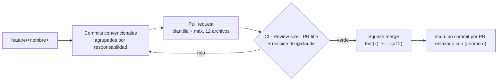

# Gobernanza del repositorio

Cómo se rastrea cada cambio, de la rama al commit en `main`. Las reglas para personas y agentes están en [AGENTS.md](../AGENTS.md).



## Qué hay en el repo

| Archivo | Para qué |
|---|---|
| `AGENTS.md` | Reglas de ramas, commits, pull requests y validación. Claude Code las lee vía `CLAUDE.md` |
| `.github/PULL_REQUEST_TEMPLATE.md` | Plantilla de descripción de cada pull request |
| `.github/workflows/ci.yml` | Valida JSON, la sintaxis del JavaScript en las páginas HTML y el Python |
| `.github/workflows/pr-size.yml` | Falla si el pull request cambia más de 12 archivos |
| `.github/workflows/pr-title.yml` | Falla si el título no es `tipo(alcance): gitmoji descripción` |
| `.github/workflows/claude.yml` | Responde cuando alguien menciona `@claude` en un issue o pull request |
| `.github/workflows/claude-code-review.yml` | Revisión automática de cada pull request |
| `.github/dependabot.yml` | Actualiza las acciones de GitHub cada lunes |

## Configuración que se hace una vez en GitHub

Estos ajustes no viven en archivos; se activan en la web del repositorio.

1. **Settings → General → Pull Requests**
   - Deja solo **Allow squash merging**; desmarca merge commits y rebase merging.
   - En *Default commit message* elige **Pull request title and commit details**. Equivale a `squash_merge_commit_title=PR_TITLE`, que garantiza el sufijo `(#número)`.
   - Marca **Automatically delete head branches**.
2. **Settings → Rules → Rulesets → New branch ruleset** sobre `main`:
   - Restrict deletions y Block force pushes.
   - Require a pull request before merging.
   - Require status checks to pass: `validate`, `review-size` y `conventional-title`.
3. **Revisión con Claude:** en Claude Code corre `/install-github-app` para instalar la app y crear el secreto `CLAUDE_CODE_OAUTH_TOKEN`. Sin ese secreto, los dos workflows de Claude fallan; el resto sigue funcionando.

Con GitHub CLI, el punto 1 es:

```bash
gh api -X PATCH repos/{owner}/{repo} \
  -F allow_merge_commit=false -F allow_rebase_merge=false -F allow_squash_merge=true \
  -f squash_merge_commit_title=PR_TITLE -f squash_merge_commit_message=COMMIT_MESSAGES \
  -F delete_branch_on_merge=true
```

## Cómo se ve el rastreo

```text
$ git log --oneline main
a1b2c3d feat(rutas): ✨ add finance learning path (#14)
d4e5f6a ci(governance): 👷 add PR size and title checks (#13)
```

Cada línea lleva al pull request, y el pull request conserva los commits originales, la revisión y los checks.

Basado en las prácticas de los repositorios de [Sergio A. Mora Pardo](https://github.com/sergiomorapardo).
