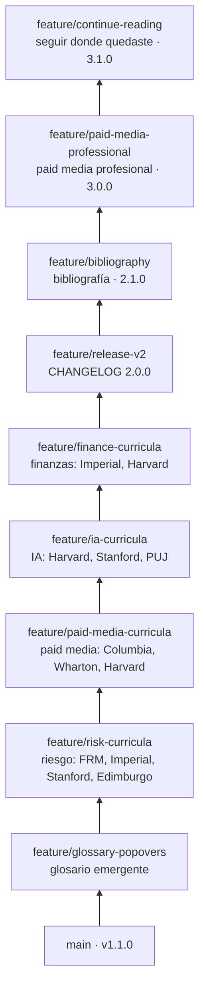

# Publicar las versiones 2.0.0 a 3.1.0 en GitHub

El repositorio se armó sin acceso para crear repos en GitHub, así que todo el historial está listo en local: commits convencionales, etiquetas `v1.0.0` y `v1.1.0` y nueve ramas apiladas, una por cambio. Estos pasos lo suben y dejan la trazabilidad completa de PR en GitHub.

## La pila de cambios



Cada capa es un pull request que apunta a la rama de abajo y cambia menos de 12 archivos.

## 1. Recuperar el repositorio en tu computador

Todo el historial viene en el archivo `learning.bundle` que quedó en el chat (un bundle de git: el repositorio completo en un solo archivo, con ramas y etiquetas). Descárgalo y, desde la carpeta donde lo guardaste:

```bash
git clone learning.bundle learning
cd learning
for b in glossary-popovers risk-curricula paid-media-curricula ia-curricula finance-curricula release-v2 bibliography paid-media-professional continue-reading topicos; do
  if [ "$b" = topicos ]; then git show-ref --quiet refs/heads/topicos || git branch --track topicos origin/topicos; continue; fi
  git show-ref --quiet "refs/heads/feature/$b" || git branch --track "feature/$b" "origin/feature/$b"
done
git branch --track main origin/main
git remote remove origin
git tag    # debe mostrar v1.0.0 y v1.1.0
```

## 2. Crear el repo y abrir los PR

```bash
gh auth login            # una sola vez
git checkout feature/continue-reading
bash scripts/publish_stack.sh
```

El script crea `neiderolaya26/learning` (privado), sube `main`, las etiquetas y la rama de datos `topicos`, configura squash merge con el título del PR, sube las nueve ramas, abre los nueve PR apilados con la plantilla completa y comenta `@claude` en cada uno.

Antes de que corran los workflows de Claude, instala la app con `/install-github-app` en Claude Code, para crear el secreto `CLAUDE_CODE_OAUTH_TOKEN`.

## 3. Revisar y fusionar de abajo hacia arriba

Para cada PR, empezando por `feature/glossary-popovers`:

1. Espera a que pasen `validate`, `review-size` y `conventional-title`, y a que Claude publique su revisión. Atiende los comentarios válidos.
2. Fusiona con squash sin cambiar el asunto: `gh pr merge <número> --squash`.
3. Actualiza la siguiente capa contra `main`, porque el squash cambia los commits:

   ```bash
   git fetch origin
   git rebase --onto origin/main <rama-recién-fusionada> <siguiente-rama>
   git push --force-with-lease origin <siguiente-rama>
   ```

   Si GitHub no cambió la base del PR siguiente a `main`, hazlo con `gh pr edit <número> --base main`.
4. Comprueba que el commit nuevo en `main` termine en `(#número)`: `git log --oneline -1 origin/main`.

## 4. Publicar la versión

Etiqueta cada versión cuando se fusione su PR: `v2.0.0` al fusionar `feature/release-v2` `v2.1.0` al fusionar `feature/bibliography` `v3.0.0` al fusionar `feature/paid-media-professional` y `v3.1.0` al fusionar `feature/continue-reading`. Por ejemplo, al final:

```bash
git checkout main && git pull --ff-only
git tag -a v2.0.0 <commit-del-PR-6> -m "v2.0.0: glosario emergente y rutas alineadas con programas de referencia"
git tag -a v2.1.0 <commit-del-PR-7> -m "v2.1.0: bibliografía y fuentes por módulo"
git tag -a v3.0.0 <commit-del-PR-8> -m "v3.0.0: ruta de Paid Media profesional"
git tag -a v3.1.0 -m "v3.1.0: seguir donde quedaste"
git push origin v2.0.0 v2.1.0 v3.0.0 v3.1.0
for v in 2.0.0 2.1.0 3.0.0 3.1.0; do
  gh release create "v$v" --title "v$v" --notes "$(awk -v v="$v" '$0 ~ "^## \\[" v "\\]" {f=1;next} /^## \[/{f=0} f' CHANGELOG.md)"
done
```

## 5. Reactivar los tópicos de investigación

Las cuatro tareas semanales de tópicos (Paid Media, Riesgo de Crédito, Finanzas y AI Engineering) quedaron en pausa y ya apuntan a la rama `topicos` de este repositorio. Cuando el repo exista en GitHub, reactívalos desde claude.ai, en la lista de tareas programadas, o pídeselo a Claude. Cada una sigue `topicos/RUTINA.md` (o `topicos/ai-engineering/RUTINA.md`) y publica su informe en esa rama.

## 6. Mostrarlo en tu perfil

- Settings → Pages → Deploy from a branch → `main` / raíz. Las rutas quedan en `https://neiderolaya26.github.io/learning/`.
- Haz público el repo cuando revises el contenido de Paid Media, que menciona empleadores y al líder.
- Fija el repo en tu perfil. La pestaña de releases y el historial de PR muestran cómo evolucionaron las rutas.
