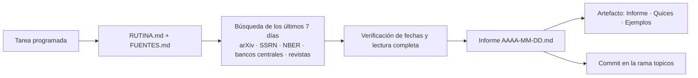

# Tópicos de investigación

Cuatro tareas programadas que cada semana buscan lo más reciente en investigación de cada ruta de aprendizaje, eligen de 3 a 5 piezas con evidencia sólida y publican un informe con quices y ejemplos interactivos.

| Tópico | Día (hora de Bogotá) | Carpeta | Ruta relacionada |
|---|---|---|---|
| Paid media y marketing | Lunes 16:43 | [`paid-media/`](paid-media/) | [Ruta Paid Media](https://claude.ai/artifact/7rj6FvQuqepDe81n9pgBCT) |
| Riesgo de crédito | Martes 16:36 | [`riesgo/`](riesgo/) | [Ruta Riesgo de Crédito](https://claude.ai/artifact/HPiqaab1BMyFVLDJ8UcKu2) |
| Finanzas | Miércoles 16:45 | [`finanzas/`](finanzas/) | [Ruta Finanzas](https://claude.ai/artifact/4djBhELtDbCmDn1He9ydZk) |
| AI Engineering | Viernes 16:47 | [`ai-engineering/`](ai-engineering/) | [Ruta IA y Data Science](https://claude.ai/artifact/H947fqUtcrKReVLwsKfKud) |

- Las instrucciones comunes están en [RUTINA.md](RUTINA.md); el tema, las fuentes y el lector de cada tópico, en su `FUENTES.md`.
- La URL del artefacto de cada tópico queda en su `ARTEFACTO.md` después de la primera edición.
- Esta es una rama de datos del repositorio `learning`: no se fusiona a `main`.
- El tópico de AI Engineering sigue su propia rutina en [ai-engineering/RUTINA.md](ai-engineering/RUTINA.md).
