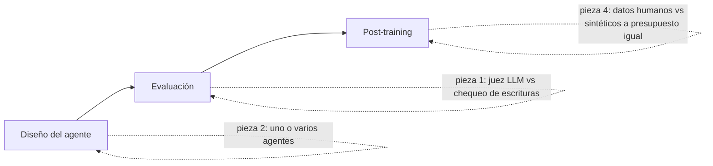

# Informe semanal de AI Engineering: 13 nov 2026

**Ventana:** 6–13 nov 2026 · **Para:** Sergio Mora · **Informes anteriores:** [27 oct](2026-10-27.md); las ediciones del 30 oct y del 6 nov se publicaron solo en el artefacto. Ninguna pieza de esas ediciones ni de su radar se repite aquí.

**Método:** revisé los listados de la última semana de arXiv (cs.CL, cs.AI, cs.LG, cs.SE y cs.MA; 2.965 entradas únicas) y los filtré por agentes, evaluación y post-training (~800 títulos). Leí 35 abstracts con la API de arXiv y el texto HTML completo de los 4 finalistas. Las cuatro piezas son v1 de esta semana, no versiones nuevas de trabajos anteriores. También busqué en los blogs de LangChain, Hugging Face, AI2, Qwen y NVIDIA, y no encontré publicaciones primarias de esta ventana con evidencia reproducible. Los enlaces se comprobaron el 13 nov; desde mi entorno, GitHub responde 403 a todo, así que de esos repos solo puedo decir que el paper los cita.

Etiquetas: **[medido]** es un resultado reportado por los autores; **[autores]** es una afirmación o interpretación de los autores; **[inferencia]** es una opinión mía.

La idea que une a las cuatro: **comparar a costo igual y con el instrumento correcto**. Las cuatro muestran conclusiones que se invierten cuando se iguala el presupuesto o cambia el evaluador.

---

## 1. When Evaluators of AI Agents Disagree: Native Scoring, LLM Judges, and Commit-Boundary Checks on tau2-bench
**Sungbin Im** (aSSIST, Seúl) · v1 10 nov 2026 · https://arxiv.org/abs/2611.14581

#### Contexto previo: cómo se evalúa un agente que escribe en sistemas
1. **Qué es:** evaluar un agente con herramientas (*tool-using agent*) es decidir si un episodio salió bien. Hay dos familias. El **oráculo de prueba** (*test oracle*) compara el estado final de la base de datos con una respuesta de referencia (*gold*). El **juez LLM** (*LLM-as-a-judge*) lee la transcripción y emite un veredicto.
2. **De qué se compone:** la tarea, la trayectoria (mensajes y llamadas a herramientas), el efecto en el mundo (escrituras ejecutadas), una referencia si existe y un criterio. Cada evaluador ve una parte distinta: el oráculo ve el estado, el juez ve el texto.
3. **Cómo se ha trabajado:** benchmarks como τ-bench y τ²-bench comparan estados finales. En producción no hay *gold*, así que se usa un juez LLM, popularizado con MT-Bench (Zheng et al., 2023). Para validarlo se suele medir su **consistencia** (si repite el veredicto) y su acuerdo con etiquetas humanas.
4. **Dónde está la dificultad:** consistencia no es validez. Un juez puede repetir siempre lo mismo y aun así medir otra cosa (*validez de constructo*). Además, el juez lee lo que el agente dice que hizo, no lo que el sistema registró. Un "listo, quedó cancelado" convence aunque la cancelación estuviera prohibida.
5. **Ejemplo intuitivo (números ilustrativos):** 100 episodios, 10 con una escritura prohibida. Si el juez aprueba 9 de esos 10 porque la conversación "suena bien", su exactitud global puede ser del 85 % y aun así deja pasar el 90 % de los errores que más cuestan.
6. **Conexión:** es el mismo problema que validar un scorecard con la métrica equivocada. El paper mide cuánto se equivocan los jueces justo en las escrituras.

**Qué cambia:** puntúa 2.160 episodios de τ²-bench (aerolínea y retail) de cuatro formas: el oráculo nativo, un juez LLM, el mismo juez con el documento de políticas y un **evaluador de frontera** (*boundary evaluator*). Este último es una regla sin modelo: cruza "la tarea esperaba una escritura" con "se ejecutó una escritura". Dos anotadores etiquetaron 120 episodios.
**Por qué importa:** fiabilidad. Las escrituras indebidas son el riesgo operativo de un agente, y el juez es lo que se usa en producción.
**Evidencia [medido]:** el juez repite su veredicto el 98,2 % de las veces, pero coincide con el oráculo solo en el 56,2 %. Hubo 11 escrituras prohibidas confirmadas por humanos: el juez aprobó 10 u 11 según la variante y el evaluador de frontera las detectó todas. Un juez de razonamiento más fuerte aún aprobó 6. Los *gates* de verificación no redujeron las escrituras prohibidas de forma significativa. **Limitaciones [autores]:** un solo benchmark, agentes de una familia (gpt-4.1), segundo anotador de la misma organización y acuerdo humano moderado en políticas (κ ≈ 0,3). La regla no revisa el contenido de la escritura. **[inferencia]** Todo descansa en 11 casos positivos.
**Experimento (laptop, sin GPU ni API):** sobre trazas ya guardadas de tu agente, compara el veredicto de tu juez LLM con la regla de frontera en unos 50 casos etiquetados a mano. Éxito: la regla detecta ≥ 90 % de las acciones indebidas con ≤ 10 % de falsas alarmas.
**Recursos:** [artefacto en Zenodo](https://doi.org/10.5281/zenodo.23683806) con trazas, código, prompts y etiquetas (CC BY 4.0, responde 200).

#### Cómo lo aplicas tú
1. **Lo que ya sabes que te sirve:** ya tienes evals con juez LLM, un auditor y firma humana en `credit-risk-agent-lab`. Desde riesgo de modelo sabes separar discriminación de calibración y desconfiar de una métrica global cuando el error caro es raro, como con el KS frente a la tasa de malos por encima del corte.
2. **Lo nuevo para ti:** la distinción entre consistencia y validez de constructo aplicada a jueces, y la idea de evaluar el **efecto** (la escritura registrada) en vez del texto. Es poco esfuerzo: un par de horas de lectura.
3. **Dónde lo aplicas:**
   - En tu trabajo: en cualquier agente que registre decisiones o cambie datos de clientes, como pre-aprobaciones o cambios de límite.
   - En tus repos: en las evals de `credit-risk-agent-lab`. La "escritura" equivale a la decisión que el agente emite o registra (aprobar, rechazar, escalar) **[inferencia]**. El caso crítico es aprobar cuando una regla dura obligaba a escalar.
4. **Veredicto: Adoptar ya.** Cuesta una función de pocas líneas y cubre justo el error que más te costaría. **[inferencia]**
5. **Primer paso (≤ 2 h):** marca en tus casos de eval cuáles deberían terminar en aprobación. Escribe la regla de cuatro etiquetas (acción correcta, acción omitida, acción prematura, rechazo correcto) y crúzala con el veredicto de tu juez en la última corrida.

#### Resumen ampliado en español
1. **Problema y motivación.** Los benchmarks puntúan agentes contra un estado de referencia, pero en producción se usa un juez LLM, y en la práctica se tratan como intercambiables. El paper mide si lo son, separando tres preguntas: ¿se resolvió la tarea?, ¿se respetó la política? y ¿la escritura era la debida? Trabajos previos como AgentRewardBench midieron el acuerdo de jueces con humanos, pero no separaron estos ejes ni diagnosticaron qué fallos se le escapan a cada evaluador.
2. **Conceptos clave.** *Commit*: el momento en que una escritura se ejecuta y la base cambia. *Compromiso prematuro* (*premature commitment*): una escritura ejecutada cuando la tarea no esperaba ninguna. *Evaluador de frontera* (*boundary evaluator*): una función determinista que cruza "se esperaba escritura" con "hubo escritura" y produce cuatro etiquetas; aprueba la acción correcta y el rechazo correcto. *Gates* C0–C3, acumulativos: sin gates; verificación que registra el fallo pero deja pasar; corrección con hasta 2 regeneraciones; y terminación segura que bloquea. *Juez-P*: el juez con el documento de políticas en el prompt.
3. **Datos.** τ²-bench sin modificar, en un commit fijo: 50 tareas de aerolínea y 40 de retail. El diseño es 90 tareas × 2 agentes (gpt-4.1 y gpt-4.1-mini) × 4 condiciones × 3 repeticiones = 2.160 episodios. El simulador de usuario es gpt-4.1-mini. El juez es gpt-4.1-mini a temperatura 0,4, con 2 llamadas y voto; los jueces extra (gpt-4.1 y un modelo de razonamiento) solo se corrieron sobre los 120 episodios etiquetados. Dos anotadores, a ciegas respecto a la condición, el modelo y los veredictos, etiquetaron 120 episodios estratificados. Todo es público en Zenodo.
4. **Método.** (a) Envuelve al agente con un `GatedAgent` y comprueba en C0 que no cambia su desempeño (recompensa media 0,36 en ambos). (b) Genera las trazas con un esquema de eventos por frontera. (c) Puntúa cada episodio de cuatro formas. (d) Mide el acuerdo con bootstrap por tarea (B = 10.000). (e) Compara contra las etiquetas humanas con bootstrap pareado. (f) Prueba C0 frente a C3 con permutaciones y corrección de Holm.
5. **Resultados [medido].**

| Comparación | Valor |
|---|---|
| Juez consigo mismo (2 llamadas) | 98,2 % |
| Oráculo frente a juez | 56,2 % |
| Oráculo frente a evaluador de frontera | 76,1 % |
| Episodios que el oráculo falla y el juez aprueba | 929 de 1.007 (92,3 %) |
| Acuerdo global con humanos: oráculo / juez / juez-P / frontera | 0,766 / 0,496 / 0,521 / 0,664 |
| Escrituras prohibidas aprobadas (de 11): juez / juez-P / frontera | 11 / 11 / 0 |

Frente a humanos, la tasa de aprobados falsos en la tarea es 0,399 para el juez y 0,216 para la frontera. Agregar la política al juez no mejora el eje de políticas (+0,001). Con un juez de razonamiento más fuerte sin política, el acuerdo en tarea sube a 0,737, pero aún aprueba 6 de las 11 escrituras prohibidas. Con la política, ese mismo juez las rechaza todas, a costa de rechazar 40 de 55 episodios correctos. Sin gates, el 11,1 % de los episodios tuvo escrituras prohibidas (19,3 % en aerolínea y 0,8 % en retail). C3 no las redujo de forma significativa tras Holm. La razón que encontró en las trazas: el resumen que recibía el verificador cortaba cada resultado de herramienta a 800 caracteres y se perdían datos como el estado del pedido. El costo total fue de unos USD 88.
6. **Robustez y limitaciones.** [autores] Un solo benchmark y dos dominios; agentes, simulador y verificador de la misma familia; segundo anotador de la misma empresa; acuerdo humano moderado en políticas (κ entre 0,31 y 0,32), por lo que no ordena evaluadores en ese eje. La regla de frontera depende de anotar qué tareas esperan escritura y no revisa el contenido. El resultado nulo de los gates mezcla su efecto con el defecto del resumen. [inferencia] Con 11 positivos, "detectó 11 de 11" dice poco sobre su sensibilidad real. La regla también falla en 29 de 53 errores de escritura, casi todos de contenido o momento equivocado. Conviene usarla como complemento del juez, no como reemplazo.
7. **Aporte frente a trabajos previos.** Frente a AgentRewardBench y a los estudios de fiabilidad test-retest, separa tres constructos y muestra qué fallos se le escapan a cada evaluador. Frente a guardas en tiempo de ejecución como AgentSpec o GuardAgent, muestra que una regla offline sin modelo detecta el fallo que los jueces no ven.
8. **Cómo aplicarlo.** Registra cada escritura con su id de llamada, anota qué tareas deberían escribir y reporta la regla de frontera junto al juez en cada eval.
9. **Glosario:** *oráculo de prueba* (comparación contra una referencia); *validez de constructo* (si el instrumento mide lo que dice medir); *compromiso prematuro* (escritura no debida); *gate* (control antes de escribir); *juez-P* (juez con la política).
**Para recordar:** un juez que siempre dice lo mismo puede estar siempre equivocado en lo que más cuesta; mide el efecto, no la narración.

---

## 2. Agent Architecture Cost-Success Trade-offs: A Controlled Evaluation across Enterprise-Style SOPs
**Nandi, Arora, Bai, Patel, Shah, Kwon, Zhang, Chen, Li, Sconfienza, Goyal, Lee, Xiong, Ramachandra** (Amazon y University of Washington) · v1 7 nov 2026 · https://arxiv.org/abs/2611.12953

#### Contexto previo: uno o varios agentes, y cuánto cuesta coordinar
1. **Qué es:** la arquitectura de un agente (*agent architecture*) es cómo se organiza el trabajo alrededor del modelo. Va desde un solo agente que llama funciones (*function calling*) hasta varios agentes con un orquestador (*orchestrator*) o un enjambre (*swarm*) que se pasa la tarea.
2. **De qué se compone:** el modelo, las herramientas, las instrucciones (el SOP, *standard operating procedure*), los *skills* (paquetes de instrucciones reutilizables) y la topología, es decir, quién ve qué y quién decide. El costo por tarea resuelta se puede escribir como costo por tarea ÷ tasa de éxito: tokens × precio, más latencia.
3. **Cómo se ha trabajado:** ReAct popularizó el agente único que razona y actúa. AutoGen, MetaGPT y Swarm de OpenAI popularizaron los diseños multiagente. Anthropic reportó que su sistema multiagente de investigación usa muchos más tokens que un chat. Los *Agent Skills* son la variante de un solo agente con instrucciones modulares.
4. **Dónde está la dificultad:** casi todas las comparaciones cambian varias cosas a la vez: modelo, prompts y herramientas. Así no se sabe si gana la arquitectura o la implementación. Además, se reporta éxito sin costo.
5. **Ejemplo intuitivo (números ilustrativos):** un agente único resuelve el 67 % con 25 mil tokens por tarea; un comité, el 70 % con 75 mil. El costo por tarea resuelta pasa de 37 mil a 107 mil tokens. El comité solo conviene si 3 puntos de éxito valen casi el triple.
6. **Conexión:** es tu decisión de aprobación por utilidad esperada, aplicada a elegir la arquitectura del agente.

**Qué cambia:** fija modelo, tareas y herramientas, y solo varía la arquitectura. Compara 8 brazos en 4 familias: agente único, agente con skills (de calidad alta o degradada), orquestación centralizada (v1 y un rediseño v2) y enjambre con tres niveles de guía compartida. Corre 2.124 tareas por brazo en 13 SOPs de SOP-Bench.
**Por qué importa:** costo y latencia. Muestra cuánto se paga por coordinar y cuándo no compensa.
**Evidencia [medido]:** ninguna arquitectura se separa del agente único en el agregado. Los brazos coordinados gastan entre 1,4 y 4,7× los tokens y entre 2,6 y 5,8× la latencia. Los skills de calidad alta llevan el éxito del 67,4 % al 73,1 %; los degradados lo bajan a 59,8 %. La orquestación v1 pierde (58,2 %). Su rediseño v2 es el único brazo significativamente mejor (75,6 %; OR 1,72; p = 0,007), pero cuesta 4,7× los tokens. **Limitaciones [autores]:** un modelo (Claude Opus 4.8), herramientas simuladas, una corrida por tarea, 13 SOPs y efectos de complejidad solo direccionales. **[inferencia]** v2 se diseñó mirando las trazas de v1 en los mismos SOPs, y la conclusión del paper cita cifras de un borrador anterior. No hay código publicado.
**Experimento (laptop):** en 30 casos de tu eval, compara tu grafo con comité frente a un agente único con las mismas herramientas. Mide éxito, tokens y latencia. El comité se justifica si gana ≥ 5 pp con ≤ 2× tokens; si no, el agente único queda como baseline.
**Recursos:** sin código ni datos propios; usa SOP-Bench (KDD '26). El DOI de ACM respondió 403 desde mi entorno.

#### Cómo lo aplicas tú
1. **Lo que ya sabes que te sirve:** tu agente en LangGraph tiene especialistas en paralelo, un comité y un auditor, así que es exactamente un brazo "coordinado". Ya registras el costo por solicitud, y en el lab decides por utilidad esperada, no por AUC: es la misma lógica de "la ganancia debe pagar el costo".
2. **Lo nuevo para ti:** el meta-análisis de efectos aleatorios por SOP (DerSimonian–Laird) te resultará familiar desde la econometría. Lo nuevo es la rúbrica de calidad de skills y la evidencia de que la implementación (qué ve cada trabajador y si puede pedir lo que le falta) pesa más que la topología.
3. **Dónde lo aplicas:**
   - En tu trabajo: al proponer un agente para un flujo de originación o cobranza, presenta el baseline de agente único con su costo antes de defender un multiagente.
   - En tus repos: en `credit-risk-agent-lab`, como ablación del comité. En `growth-marketing-agent`, cuyo agente aún no existe, como decisión de diseño desde el inicio.
4. **Veredicto: Probar en el lab.** Tu arquitectura actual nunca se comparó contra un agente único, y tienes todo para hacerlo. **[inferencia]**
5. **Primer paso (≤ 2 h):** crea un nodo único con todas las herramientas MCP del lab y el prompt del comité. Córrelo sobre tus casos de eval con el mismo modelo y compara éxito, tokens y latencia en una tabla.

#### Resumen ampliado en español
1. **Problema y motivación.** Las empresas usan agentes para ejecutar SOPs largos, con ramas y muchas herramientas, pero no hay evidencia controlada para elegir entre arquitecturas. Los trabajos previos estudian skills o coordinación por separado.
2. **Conceptos clave.** *Tasa de éxito* (*task success rate*, TSR): tareas correctas sobre el total. *Agente único con function calling* (FC): ve el SOP completo y todas las herramientas. *Ejecución restringida de skills* (CSE): un selector elige skills y un ejecutor los corre, viendo solo las herramientas de cada uno. *Orquestación*: un descomponedor reparte subtareas a trabajadores en serie y un sintetizador combina. *Enjambre guiado por triaje* (*swarm*): especialistas con herramientas exclusivas que se pasan el control con un pizarrón compartido; el *blueprint* puede no existir, ser descriptivo o ser completo. *Rúbrica de calidad de skills*: 50 puntos en identidad, instrucciones, contrato, desambiguación y gobierno.
3. **Datos.** 13 SOPs de SOP-Bench, un benchmark sintético de procedimientos industriales con herramientas simuladas deterministas y respuestas de referencia (del mismo grupo de autores). Son 2.124 tareas por brazo, con el modelo us.anthropic.claude-opus-4-8 a temperatura 1 y una corrida por tarea. Como chequeo, el baseline con tres versiones del modelo varía como mucho 2,3 puntos.
4. **Método.** Construye un corpus de skills de calidad alta y una versión degradada (99,8 % frente a 67,6 % en la rúbrica). Corre los 8 brazos y extrae la decisión final con un parser común. Mide tokens, latencia y llamadas. Usa el SOP como unidad de inferencia, con prueba de signos por SOP y meta-análisis de efectos aleatorios de los log-odds frente al baseline. Separa los SOPs en simples y complejos por la mediana de complejidad y calcula Spearman.
5. **Resultados [medido].**

| Brazo | TSR % | Tokens por tarea | Latencia |
|---|---|---|---|
| Agente único (FC) | 67,4 | 24,9 mil | 24,0 s |
| Orquestación v1 | 58,2 | 35,8 mil (1,4×) | 62,4 s |
| Enjambre descriptivo | 70,4 | 47,3 mil (1,9×) | 100,0 s |
| Skills degradados | 59,8 | 58,5 mil (2,4×) | 62,8 s |
| Enjambre completo | 70,5 | 67,2 mil (2,7×) | 138,6 s |
| Skills de calidad alta | 73,1 | 74,0 mil (3,0×) | 66,1 s |
| Orquestación v2 | 75,6 | 117,3 mil (4,7×) | 73,5 s |

El error estándar macro va de 6,3 a 7,8 puntos y los intervalos se solapan. Dentro de un SOP el éxito va de menos del 10 % a casi el 100 %. El agente único le gana a v1 en 9 de 13 SOPs. El rediseño v2 recupera los SOPs donde v1 colapsaba: patient_intake sube de 13,6 % a 98,5 % y KYB de 23,3 % a 60,0 %. Los skills de calidad alta superan a los degradados por 13,3 puntos, pero sin significancia (7 victorias, 4 derrotas y 2 empates). En un SOP, el skill degradado escribía la respuesta bajo una clave inventada y bajó al 2,5 %, aunque la decisión era correcta en 193 de 200 casos. El blueprint completo del enjambre no mejora al descriptivo y cuesta 42 % más tokens. Restringir las herramientas por skill ayuda con 8 herramientas y perjudica con 26 (ablación exploratoria en 2 SOPs).
6. **Robustez y limitaciones.** [autores] Un benchmark con herramientas simuladas y sin errores reales, un solo modelo, una implementación por arquitectura y una corrida por tarea sin varianza estocástica. Pocos SOPs para significancia, y los brazos se corrieron en distintas versiones del código. Las celdas multicampo de la orquestación son provisionales. [inferencia] v2 se rediseñó viendo trazas de los mismos SOPs, sin conjunto de reserva. La conclusión y las limitaciones citan cifras distintas (12 SOPs; 74,4 % frente a 65,6 %), lo que sugiere restos de un borrador. El costo está en tokens, no en dólares.
7. **Aporte frente a trabajos previos.** Frente a los reportes de sistemas multiagente (AutoGen, MetaGPT, el sistema de investigación de Anthropic) y a los benchmarks de skills, es la primera comparación que fija el modelo, las tareas y las herramientas y reporta éxito junto con costo.
8. **Cómo aplicarlo.** Empieza por el agente único como baseline, mide el costo por tarea resuelta y solo agrega coordinación donde gane con significancia. Si la agregas, dale a cada trabajador el contexto completo y una vía para pedir lo que le falta.
9. **Glosario:** *SOP* (procedimiento operativo estándar); *skill* (paquete de instrucciones y herramientas); *blueprint* (plan compartido del enjambre); *dominada en Pareto* (otra opción es igual o mejor en éxito y en costo); *efectos aleatorios* (meta-análisis que permite que el efecto varíe por SOP).
**Para recordar:** la arquitectura no gana por sí sola; gana la implementación que cuida qué ve cada parte, y el agente único es el baseline eficiente.

---

## 3. Are Dense Rewards Worth Their Tokens in GRPO?
**Singh, Chen, Ganguly y 16 coautores** (Case Western Reserve University) · v1 10 nov 2026 · https://arxiv.org/abs/2611.13560

#### Contexto previo: aprendizaje por refuerzo con recompensas verificables y el reparto del crédito
1. **Qué es:** el *aprendizaje por refuerzo con recompensas verificables* (*reinforcement learning with verifiable rewards*, RLVR) ajusta un modelo premiando las respuestas cuya respuesta final se puede comprobar, por ejemplo un problema de matemáticas. GRPO (*group relative policy optimization*) es el algoritmo más usado: no necesita un modelo de valor aparte.
2. **De qué se compone:** por cada pregunta se generan G respuestas (un grupo). Cada una recibe 1 si es correcta y 0 si no. Su **ventaja** es (recompensa − media del grupo) ÷ desviación del grupo, y esa ventaja se aplica por igual a todos los tokens de la respuesta.
3. **Cómo se ha trabajado:** GRPO viene de DeepSeekMath. Para dar crédito por paso se propusieron *recompensas de proceso* (*process rewards*): etiquetas humanas por paso (estilo PRM800K), estimaciones Monte Carlo (desde cada paso intermedio se generan continuaciones y se mide cuántas terminan bien) y variantes como VinePPO.
4. **Dónde está la dificultad:** el crédito por paso suena mejor, pero las continuaciones cuestan tokens y tiempo de GPU. Muchos trabajos comparan "por actualización" y no a presupuesto igual: es como comparar dos modelos de score cuando uno tuvo diez veces más datos.
5. **Ejemplo intuitivo (números ilustrativos):** un grupo de 4 respuestas con recompensas 1, 0, 0, 1. La media es 0,5 y la desviación 0,5, así que las ventajas son +1, −1, −1, +1. Una respuesta que iba bien hasta el último paso recibe −1 en todos sus tokens, incluidos los buenos. Una recompensa densa corregiría eso, pero si cada respuesta necesita 4 continuaciones por cada uno de 5 cortes, generas unas 20 veces más texto.
6. **Conexión:** el paper pregunta si ese crédito fino paga su costo cuando se iguala el presupuesto.

**Qué cambia:** introduce un protocolo de **cómputo igualado**: cada intervención recibe el mismo presupuesto, medido en tokens generados y en horas de GPU de entrenamiento, con estudios preregistrados y controles. Son 1.668 corridas en seis modelos de 0,6B a 4B (Qwen y Llama), entrenados sobre MATH.
**Por qué importa:** costo. Muestra que ganancias aparentes de post-training se invierten al igualar el cómputo.
**Evidencia [medido]:** en Qwen2.5-1.5B, las continuaciones Monte Carlo consumen el 91 % de los tokens. La recompensa densa gana por actualización, pero termina 14,3 pp por debajo a tokens iguales y 7,8 pp por debajo a tiempo igual. Ninguna de cuatro variantes densas supera a GRPO ni con el mismo tiempo de entrenamiento. Elegir las preguntas con éxito predicho cercano a 1/2 mejora 1,7 pp (Qwen3-0.6B) y 0,8 pp (Qwen2.5-1.5B), pero GRPO con el doble de tasa de aprendizaje queda a medio punto. **Limitaciones [autores]:** modelos ≤ 4B, solo MATH numérico, mayoría Qwen, una tasa de aprendizaje y variantes adaptadas, no reproducciones fieles. **[inferencia]** El −14,3 depende de K = 4 continuaciones; con K = 1 la brecha se achica.
**Experimento (laptop):** simula en numpy una política tabular con recompensa final frente a una recompensa por paso que cuesta 5× por muestra. Compara la exactitud a presupuesto igual de "tokens". Éxito: reproduces la inversión entre "por actualización" y "por presupuesto". **GPU local (~6–8 GB, orientativo):** GRPO con LoRA sobre Qwen3-0.6B en 500 problemas de GSM8K, comparando GRPO solo contra el filtro de éxito cercano a 1/2 a tokens iguales. Lee el modelo desde Hugging Face y los datos desde la laptop, envía métricas y logs a la laptop y al final borra checkpoints, la caché de modelos y los datasets intermedios. No conserves adaptadores.
**Recursos:** código citado en `github.com/vicky157/grpo-validation` (trainer, configs, preregistros y logs; no pude abrirlo: 403 desde mi entorno).

#### Cómo lo aplicas tú
1. **Lo que ya sabes que te sirve:** comparar modelos en condiciones iguales (validación out-of-time, mismo conjunto de prueba) y desconfiar de un baseline sin ajustar. Comparaste 6 modelos en el lab, y la lección de "GRPO con el doble de tasa de aprendizaje alcanza la mejora" es la misma que "un LightGBM bien ajustado iguala al modelo nuevo".
2. **Lo nuevo para ti:** RL y post-training están en lo que todavía no has trabajado. Tendrías que aprender la política, la ventaja, GRPO y el muestreo con vLLM. El esfuerzo es alto: varias semanas antes de correr algo propio.
3. **Dónde lo aplicas:**
   - En tu trabajo: hoy no hay un caso directo. Te sirve el principio de reportar cada mejora a presupuesto igual al evaluar propuestas de proveedores.
   - En tus repos: como criterio en la ruta de IA y Data Science y en las evals del lab, donde conviene reportar el costo junto a cada mejora. No hay un pendiente de `PERFIL.md` que lo requiera.
4. **Veredicto: Solo leer.** El método no se aplica a tu stack actual, pero el protocolo de cómputo igualado sí. **[inferencia]**
5. **Primer paso (≤ 2 h):** revisa la comparación de 6 modelos del lab y anota cuánta búsqueda de hiperparámetros recibió cada uno. Si fue desigual, repite la del campeón y la del segundo con el mismo número de pruebas de Optuna.

#### Resumen ampliado en español
1. **Problema y motivación.** GRPO da el mismo crédito a todos los tokens de una respuesta. Las recompensas densas intentan premiar pasos intermedios, y se validan comparando por actualización o con una prueba de gradiente en un solo lote. Ninguna de las dos cuenta su costo. El paper pregunta si siguen ayudando a cómputo igual y, si no, dónde conviene gastar esos tokens.
2. **Conceptos clave.** *Recompensa Monte Carlo por paso*: cada respuesta se corta en 5 puntos; desde cada prefijo se generan K continuaciones, y la fracción correcta estima el valor del prefijo. El crédito del segmento es el valor final menos el inicial. *Cómputo igualado* (*matched compute*): el mismo presupuesto B de tokens generados (incluidas continuaciones y grupos descartados) y horas de GPU registradas por etapa. *Prueba de gradiente por token*: mide si la actualización apunta en la dirección que mejora la exactitud, normalizada por los tokens que consume. *Preregistro*: hipótesis, contrastes, correcciones de Holm y semillas fijadas antes de correr. *Filtro por éxito predicho*: una regresión ridge sobre el estado oculto del modelo predice el éxito de cada pregunta, y se entrenan las más cercanas a 1/2.
3. **Datos.** Problemas de MATH con respuesta numérica (niveles 3–5 o 4–5 según el estudio), evaluados en problemas de prueba no vistos, con chequeos en GSM8K. Los modelos son Qwen2.5-1.5B-Instruct, Qwen3-0.6B, 1.7B y 4B, Llama-3.2-1B y 3B, con pilotos de un solo seed en otros. Cada corrida usó una GPU H200 o A100, con un trainer propio y vLLM para el muestreo. Son 1.668 corridas en total, con hasta 12–18 semillas en los estudios clave.
4. **Método.** (a) Estudio por actualización con pruebas de gradiente. (b) Reimplementación del trainer y presupuesto fijado por regla preregistrada. (c) Comparación de recompensas densas a tokens iguales (K = 4, 2 y 1; crítico aprendido; reutilización de continuaciones). (d) Reanálisis a tiempo igual y un estudio que deja entrenar a las variantes densas más que a GRPO. (e) Validación de la prueba de gradiente contra el entrenamiento real. (f) Selección de preguntas en 6 modelos con controles aleatorios, por historia, por nivel y con muestreo dinámico DAPO. (g) Controles de tasa de aprendizaje y de verificador.
5. **Resultados [medido].**

| Contraste | Resultado |
|---|---|
| Tokens que van a continuaciones (Monte Carlo, K = 4) | 91 % |
| Actualizaciones dentro del presupuesto: GRPO frente a Monte Carlo | 584 frente a 50 |
| Monte Carlo frente a GRPO a tokens iguales (Qwen2.5-1.5B) | −14,3 pp, en todas las semillas |
| Lo mismo a tiempo igual | −7,8 pp, 12 de 12 semillas |
| Crítico aprendido a tokens iguales | entre −0,4 y +0,7 pp |
| Sobreestimación de la prueba de gradiente | 1–2 pp en las 5 recompensas |
| Filtro de éxito cercano a 1/2 a tokens iguales | +1,7 (Qwen3-0.6B) y +0,8 (Qwen2.5-1.5B) |
| GRPO con el doble de tasa de aprendizaje frente al filtro | a ≤ 0,5 pp |

Con menos continuaciones la brecha baja (K = 1 es mejor que K = 2, y este mejor que K = 4), pero sigue por detrás de GRPO. El filtro ayuda solo en 2 de 6 modelos con el conjunto L3–5. Elegir al azar entre los mismos candidatos no reproduce la ganancia, y esta se transfiere a problemas no vistos y a GSM8K. La regla "los candidatos fallan más de lo que aciertan" predijo dónde aparece la ganancia en 5 de 6 pruebas preregistradas; falló en Llama-3.2-1B. El muestreo dinámico de DAPO pierde porque los grupos descartados cuentan en el presupuesto.
6. **Robustez y limitaciones.** [autores] Modelos ≤ 4B, presupuestos cortos, solo MATH, 4 de 6 modelos Qwen, una tasa de aprendizaje sin ajuste por modelo, Holm dentro de cada estudio y no entre estudios, y resultados a tiempo igual que dependen del hardware. Las variantes son adaptaciones de VinePPO, SPO-tree, TreeRL y PRIME, y los preregistros no están en un registro público. [inferencia] El resultado habla de los estimadores probados, no del crédito denso en principio. Las ganancias del filtro son pequeñas y el control de tasa de aprendizaje sugiere que muchos baselines de RLVR están subajustados.
7. **Aporte frente a trabajos previos.** Frente a VinePPO, PRIME y otros trabajos de recompensa de proceso, y a filtros de preguntas como GRESO o DAPO, aporta un protocolo de comparación justa con preregistro que invierte algunos rankings y confirma otros.
8. **Cómo aplicarlo.** Antes de adoptar una técnica de post-training, pide la comparación a tokens y tiempo iguales, y contra un baseline con la tasa de aprendizaje ajustada.
9. **Glosario:** *RLVR* (RL con recompensa comprobable); *ventaja* (qué tan mejor fue una respuesta que su grupo); *recompensa densa* (crédito por paso); *continuación* (texto generado desde un prefijo para estimar su valor); *preregistro* (plan fijado antes de ver datos).
**Para recordar:** una mejora por actualización puede ser una pérdida por dólar; compara siempre a presupuesto igual.

---

## 4. Human or Synthetic? What a Fixed Budget Buys for Post-Training
**Banerjee, Mendes, Raghavendra, Xu, Ritter** (Georgia Institute of Technology) · v1 12 nov 2026 · https://arxiv.org/abs/2611.16895

#### Contexto previo: datos de preferencia y su costo
1. **Qué es:** un *dato de preferencia* (*preference pair*) es una pregunta con dos respuestas, una elegida (*chosen*) y otra rechazada (*rejected*). Con ellos se alinea un modelo tras el ajuste supervisado (*supervised fine-tuning*, SFT), usando *Direct Preference Optimization* (DPO).
2. **De qué se compone:** el prompt, las dos respuestas, quién decide la preferencia (una persona o un modelo juez) y el costo por par. DPO sube la probabilidad relativa de la respuesta elegida frente a la rechazada, comparada con un modelo de referencia, sin entrenar un modelo de recompensa aparte.
3. **Cómo se ha trabajado:** RLHF con anotadores humanos (por ejemplo, el dataset HH de Anthropic). RLAIF, con preferencias de un modelo en vez de personas (Lee et al., 2023). Datasets sintéticos como UltraFeedback. Casi siempre se comparan con el mismo **número** de pares, no con el mismo **costo**.
4. **Dónde está la dificultad:** un par humano cuesta mucho más que uno sintético, así que comparar a igual número de pares favorece a los humanos. Además, la calidad humana varía: algunas fuentes infieren la preferencia de votos de un foro, no de anotadores instruidos.
5. **Ejemplo intuitivo (números ilustrativos):** con USD 500, a USD 1 por par humano compras 500 pares; a USD 0,01 por par sintético, 50.000. Si el modelo se satura con 20.000 pares, la pregunta ya no es cuál dato es mejor, sino cuál compra más aprendizaje por dólar.
6. **Conexión:** el paper hace esa comparación a dólares iguales con tres familias de modelos open-weight.

**Qué cambia:** compara datos de preferencia humanos y sintéticos **a presupuesto igual en dólares**, desde USD 100 hasta USD 13 mil. Entrena SFT y luego DPO con LoRA sobre Olmo-3-7B, Llama-3.1-8B y Qwen-2.5-7B, en ayuda (*helpfulness*) y resumen.
**Por qué importa:** costo. Es una decisión de presupuesto que cualquier equipo enfrenta al ajustar un modelo open-weight.
**Evidencia [medido]:** con un costo supuesto de USD 1,30 por par humano frente a ~USD 0,01 sintético, los datos sintéticos alcanzan casi su techo con USD 200–400. En ayuda, los humanos solo compiten hacia USD 13 mil; en resumen no alcanzan en ningún presupuesto probado. SHP queda por debajo del modelo sin entrenar en las tres familias. Las mezclas a USD 13 mil rinden peor que la mejor fuente pura. **Limitaciones [autores]:** generador de 8B, modelos de 7–8B, solo LoRA, solo modelos abiertos y precios de un proveedor. **[inferencia]** El juez (gpt-oss-20b) se validó con 50 ítems por tarea y κ entre 0,21 y 0,58; los datos sintéticos imitan el formato del conjunto de prueba, hay 2 semillas y no hay pruebas de significancia.
**Experimento (laptop):** etiqueta tú mismo 100 pares del dataset sintético publicado, midiendo el tiempo por par, y calcula el acuerdo con la etiqueta del juez. Éxito: acuerdo ≥ 75 % y un costo humano por par propio para contrastar con los USD 1,30 del paper. **GPU local (~8 GB, ajustado):** SFT+DPO con LoRA en 4 bits sobre Qwen2.5-0.5B-Instruct con 2 tramos del dataset (por ejemplo 2 mil y 20 mil pares). Lee el dataset desde la laptop, devuelve métricas y respuestas de prueba a la laptop y borra al final checkpoints, la caché de modelos y los datasets intermedios. El juicio de win rate va en la laptop o con un juez pequeño, porque gpt-oss-20b no cabe en 8 GB.
**Recursos:** [dataset sintético en HF](https://huggingface.co/datasets/liteshadow4/synthetic-pref-tulu3) (CC BY-NC-SA 4.0, 4 configuraciones y ~429 mil filas; responde 200). Código citado en `github.com/shourikb/human-or-synthetic` (403 desde mi entorno).

#### Cómo lo aplicas tú
1. **Lo que ya sabes que te sirve:** pensar en costo por unidad y en retorno marginal del presupuesto (FP&A). También sabes que una etiqueta proxy contamina el modelo, como una mala definición de default. SHP es justo eso: preferencias inferidas de votos de Reddit.
2. **Lo nuevo para ti:** SFT, DPO y LoRA están en lo que todavía no has trabajado. Necesitas entender el par elegido y rechazado, el modelo de referencia y el parámetro β de DPO. El esfuerzo es medio: unas semanas para correr un DPO pequeño.
3. **Dónde lo aplicas:**
   - En tu trabajo: al decidir si etiquetar a mano o con un LLM los casos de evaluación o de entrenamiento de un asistente interno.
   - En tus repos: en las evals con juez LLM de `credit-risk-agent-lab`. Antes de pagar etiquetas humanas, mide el acuerdo entre tu juez y tus propias etiquetas en una muestra.
4. **Veredicto: Solo leer.** El ajuste fino aún no está en tu práctica, pero la lógica de presupuesto igual sí aplica a tus datasets de evals. **[inferencia]**
5. **Primer paso (≤ 2 h):** carga 100 filas de `helpfulness-preference` con pandas o DuckDB, etiqueta 50 tú mismo con cronómetro y calcula el acuerdo con la etiqueta sintética y tu costo por par.

#### Resumen ampliado en español
1. **Problema y motivación.** El post-training combina SFT y DPO. Los datos humanos y sintéticos difieren mucho en costo por muestra, pero los trabajos previos los comparan con el mismo número de muestras. El paper pregunta qué conviene comprar con un presupuesto fijo, cómo cambia la respuesta al crecer el presupuesto y si depende de la tarea o del modelo.
2. **Conceptos clave.** *SFT*: entrenar con la respuesta elegida de cada par. *DPO*: partir del modelo con SFT, que queda como referencia congelada. *Presupuesto igualado en dólares*: cada fuente recibe los mismos dólares, así que el número de pares es presupuesto ÷ costo por par. *Win rate*: fracción de veces en que la respuesta del modelo entrenado gana a la respuesta de referencia del conjunto de prueba, según un juez (gpt-oss-20b) con el orden aleatorizado.
3. **Datos.** Fuentes humanas: Anthropic HH, SHP (Reddit), HelpSteer3 de NVIDIA (solo dominio general) y las preferencias de resumen de TL;DR. Los datos sintéticos los genera Llama-3.1-Tulu-3-8B-SFT con personas de Persona Hub, y Qwen-3-32B los etiqueta con 32 votos por par. Tras el filtrado quedan 105.005 pares de ayuda y 109.624 de resumen. El costo humano supuesto es USD 1,30 por par (a partir del costo reportado del dataset HH). El sintético es USD 0,0102 (ayuda) y USD 0,0194 (resumen), con precios de Groq; el 98 % de ese costo es el juicio. Se evalúa en 2.048 ejemplos de prueba, con 2 semillas por configuración, en GPUs A40 (~9.650 horas de GPU en total).
4. **Método.** (a) Generar y filtrar datos sintéticos: longitud, duplicados y etiquetas de rol. (b) Limpiar las fuentes humanas (subforos, razón de votos y un par por post). (c) Para cada tramo de presupuesto (USD 100, 200, 300, 400 y 1 mil; más USD 13 mil solo para humanos), muestrear los pares que alcanza a comprar. (d) SFT y luego DPO con LoRA (rango 16) vía Unsloth. (e) Medir el win rate. Además, mezclas humano/sintético a USD 13 mil y sensibilidad del costo humano entre USD 1,00 y 1,60.
5. **Resultados [medido].** En ayuda, los sintéticos capturan casi toda la ganancia con USD 200–400 y luego se estancan o caen: Olmo baja de 0,876 a 0,794 en USD 1 mil. Con USD 100–1 mil, los humanos compran entre 76 y 769 pares, y HelpSteer3 queda cerca del modelo sin entrenar. Solo a USD 13 mil los humanos compiten, y HelpSteer3 supera el pico sintético en Llama y Qwen, pero no en Olmo. En resumen, en Llama el techo sintético es 0,72 y el humano a USD 13 mil es 0,59.

| Pares TL;DR (Qwen) | Costo | Win rate |
|---|---|---|
| 0 (sin entrenar) | USD 0 | 0,41 |
| 307 | USD 400 | 0,21 |
| 769 | USD 1 mil | 0,28 |
| 6 mil | USD 7,8 mil | 0,42 |
| 12 mil | USD 15,6 mil | 0,53 |

Pocas muestras humanas empeoran a Qwen al principio y hacen falta unos 6 mil pares para recuperar el punto de partida. Las mezclas casi siempre rinden peor que la mejor fuente pura. La tasa de respuestas cortadas antes de terminar la frase sube cuando cae el win rate (Olmo: de 5,5 % a 17,5 %), así que sirve como alerta barata. SHP cae por debajo del modelo sin entrenar en las tres familias, y las limpiezas no cerraron la brecha. Las conclusiones se mantienen con costos humanos entre USD 1,00 y 1,60.
6. **Robustez y limitaciones.** [autores] Generador de solo 8B, modelos de 7–8B, solo LoRA, solo modelos abiertos y precios de un proveedor y momento. [inferencia] El juez se validó con 50 comparaciones por tarea, etiquetadas por los propios autores, con κ bajos. Las respuestas sintéticas son mucho más cortas (82 frente a 288 tokens de media en ayuda) y el juez de resumen premia la concisión. Los sintéticos imitan el formato de HH y TL;DR, que también son los conjuntos de prueba. Hay 2 semillas, sin pruebas de significancia, y un salto de USD 1 mil a 13 mil que deja mal ubicado el punto de cruce. El texto también se contradice sobre si HH se usó para entrenar o solo para evaluar.
7. **Aporte frente a trabajos previos.** Frente a RLAIF (Lee et al., 2023), "Distill or Annotate" (Kang et al., 2023) y CoAnnotating, cambia la unidad de comparación de muestras a dólares y lo prueba en tres familias abiertas y dos tareas.
8. **Cómo aplicarlo.** Con presupuestos bajos, empieza por datos sintéticos con un juez bien validado. Reserva lo humano para auditar al juez y para tareas donde el formato de prueba difiere.
9. **Glosario:** *par de preferencia* (dos respuestas y cuál es mejor); *DPO* (optimización directa de preferencias); *LoRA* (ajuste de pocas matrices de bajo rango); *win rate* (fracción de victorias frente a una referencia); *RLAIF* (preferencias dadas por un modelo).
**Para recordar:** a presupuesto fijo, mil pares sintéticos baratos suelen comprar más que cien humanos, pero solo si el juez que los etiqueta está validado.

---

**Radar (no las seleccioné; solo leí el abstract):** *Cleaning an Agent's History Hurts When the World Still Holds the Error* (2611.14654): limpiar el historial de un agente empeora la recuperación si el error sigue en el mundo. *Agent Benchmarks Stop Ranking Before They Run Out of Tasks* (2611.13541): propone crédito graduado en vez de pasa/falla. *ReTrace* (2611.14492): destila un agente con SOP en un workflow sin planificador, a 24 % menos costo. *Rethinking "RL Generalizes, SFT Memorizes"* (2611.14912, NeurIPS 2026): con datos de SFT bien mezclados y escalados, SFT generaliza como RL. *Termination Lag* (2611.14960): los agentes de código resuelven pronto pero paran tarde.

## Prioridades
- **Lectura: #2, arquitecturas de agentes a costo controlado.** Es la que más cambia una decisión que ya tomaste (el comité en paralelo de tu lab), con números de costo y éxito bajo un diseño controlado.
- **Experimentación: #1, evaluador de frontera frente a juez LLM.** Corre en la laptop sobre trazas que ya tienes, sin GPU ni llamadas pagadas, y mide el error que más te costaría en producción: una acción indebida que el juez aprueba.
