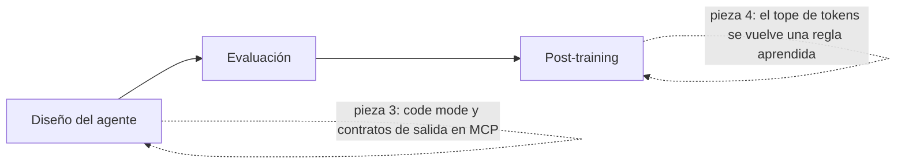

# Informe semanal de AI Engineering: 20 nov 2026

**Ventana:** 13–20 nov 2026 · **Para:** Sergio Mora · **Informes anteriores:** [13 nov](2026-11-13.md), [27 oct](2026-10-27.md); las ediciones del 30 oct y del 6 nov se publicaron solo en el artefacto. Ninguna pieza de esas ediciones ni de su radar se repite aquí.

**Método:** revisé los listados de la última semana de arXiv (cs.CL, cs.AI, cs.LG, cs.SE y cs.MA, anuncios del 16 al 20 nov; 2.663 entradas únicas) y los filtré por agentes, evaluación y post-training (~800 títulos). Leí 36 abstracts con la API de arXiv y el texto HTML o PDF completo de 5 finalistas. Las cuatro piezas elegidas son v1 nuevas, no versiones nuevas de trabajos anteriores. La pieza 1 tiene fecha v1 del 13 nov, pero se anunció el 16 nov y no entró en la edición anterior. También busqué en la web publicaciones de laboratorios (Anthropic, Hugging Face, AI2, LangChain, Qwen, NVIDIA) y no encontré nada primario de esta ventana con evidencia reproducible. Comprobé los enlaces el 20 nov. Desde mi entorno, GitHub responde 403 a todo, así que de esos repos solo puedo decir que el paper los cita.

Etiquetas: **[medido]** es un resultado reportado por los autores; **[autores]** es una afirmación o interpretación de los autores; **[inferencia]** es una opinión mía.

La idea que une a las cuatro: **la métrica agregada esconde la decisión**. Un promedio contra el baseline equivocado, una tasa de abstención que no cambia, un router que no suma y una exactitud medida en un solo presupuesto ocultan justo lo que importa.

---

## 1. More Agents, More Samples, or More Thinking? Untangling Coordination, Ensembling, and Test-Time Compute in Multi-Agent LLMs
**Seyed Mahmoud Sajjadi Mohammadabadi** (University of Nevada, Reno) · v1 13 nov 2026 (anunciado el 16 nov) · https://arxiv.org/abs/2611.17610

#### Contexto previo: qué compra realmente un sistema multiagente
1. **Qué es:** un sistema multiagente (*multi-agent system*, MAS) pone a varios modelos a conversar, debatir o repartirse subtareas antes de dar una respuesta. La pregunta de fondo es si la **coordinación** (*coordination*, que los agentes se lean entre sí) agrega algo, o si la ganancia viene solo de gastar más cómputo.
2. **De qué se compone:** N agentes que conversan T rondas usan aproximadamente N·T veces los tokens de una sola pasada. Ese gasto tiene varias dimensiones: número de muestras (*samples*), tokens de razonamiento, tokens totales con el historial repetido, costo, latencia y andamiaje (herramientas y prompts). Comparar bien exige fijar esas dimensiones o al menos reportarlas.
3. **Cómo se ha trabajado:** el debate multiagente (Du et al.), AutoGen y MetaGPT se suelen comparar contra una sola respuesta voraz (*greedy*, temperatura 0). En paralelo, la autoconsistencia (*self-consistency*, Wang et al., 2023) mostró que muestrear varias respuestas y votar por mayoría mejora la exactitud sin ninguna comunicación entre modelos.
4. **Dónde está la dificultad:** si el baseline es una sola pasada, la mejora del MAS mezcla dos efectos: el de coordinar y el de muestrear más. Para separarlos hace falta un baseline con el mismo número de muestras (votación de 5 respuestas frente a 5 agentes) o con el mismo presupuesto. Pocos estudios lo hacen, y los que lo hacen usan protocolos distintos.
5. **Ejemplo intuitivo (números ilustrativos):** una pasada acierta el 67 %. Cinco agentes que debaten aciertan el 71 %. Cinco muestras votadas sin conversar aciertan el 75 %. Contra la primera, el debate "gana 4 puntos"; contra la segunda, pierde 4. La comunicación costó tokens y restó.
6. **Conexión:** es la misma pregunta que tu comité en LangGraph, pero con un baseline más exigente que el de la semana pasada: no solo un agente único, sino un agente único que vota varias veces.

**Qué cambia:** es un meta-análisis de 9 estudios con 516 configuraciones multiagente, ordenadas por una "escalera de baselines": A, una pasada; B, igual número de muestras; C, igual presupuesto; y D, frontera de Pareto. Además, separa en una identidad contable el efecto de coordinar del efecto de escalar cómputo, y propone el protocolo PACE con una lista de chequeo para revisores.
**Por qué importa:** costo y calidad. Si coordinar no supera a votar, el comité paga tokens sin retorno.
**Evidencia [medido]:** contra baselines igualados en muestras o presupuesto (B/C, 474 contrastes en 8 estudios), el MAS promedia −0,042 de exactitud y queda igual o por debajo en el 74 % de los casos. En log-odds, el efecto es −0,195 (IC 95 % −0,320 a −0,070). Contra una sola pasada (A), la diferencia es casi nula. **Limitaciones [autores]:** solo 9 estudios, 5 elegidos sin protocolo, un estudio aporta 180 configuraciones, no está preregistrado y la heterogeneidad es alta (I² 93 %). **[inferencia]** Es un solo autor, la extracción es secundaria desde tablas y la mayoría de las fuentes son preprints.
**Experimento (laptop):** en 30 casos de tu eval, compara el comité con un agente único que responde 3 veces y vota (mismo modelo y herramientas). Éxito: el comité solo se justifica si supera al voto por ≥ 3 pp con tokens iguales o menores.
**Variante GPU local (VRAM orientativa ~5–6 GB, modelo de ~4B a 4 bits; no confirmada):** para no gastar API, sirve un modelo open-weight pequeño con Ollama o llama.cpp y corre los tres brazos con él. Los casos de eval se leen desde la laptop. Los resultados (JSON con éxito, tokens y latencia) vuelven a la laptop o al repo. Al final, borra la caché del modelo (`~/.ollama/models` o `~/.cache/huggingface`) y los logs crudos de esa máquina.
**Recursos:** el paper cita la herramienta `pace` en `github.com/mahmoudsajjadi/pace` (403 desde mi entorno; no verificado). El archivo en Zenodo se promete "al publicar".

#### Cómo lo aplicas tú
1. **Lo que ya sabes que te sirve:** el meta-análisis de efectos aleatorios con REML, los intervalos robustos por clúster y el "deja uno fuera" son econometría que ya manejas. La escalera de baselines es la misma disciplina que comparar tu LightGBM campeón contra una regresión logística bien ajustada y no contra un modelo trivial.
2. **Lo nuevo para ti:** la autoconsistencia como baseline de agentes y la idea de un vector de recursos (muestras, tokens, costo, latencia) que debe declararse en cada comparación. Es poco esfuerzo: una lectura de unas 2 horas, centrada en las secciones 3 y 4.
3. **Dónde lo aplicas:**
   - En tu trabajo: antes de proponer debate o comité para una decisión de crédito o de fraude, muestra el baseline de votación con el mismo presupuesto.
   - En tus repos: en `credit-risk-agent-lab`, como segundo baseline de la ablación del comité que quedó pendiente la semana pasada. En `growth-marketing-agent`, como regla de diseño antes de construir el agente.
4. **Veredicto: Probar en el lab.** Completa el experimento de la semana pasada con el baseline que este paper pide, y ya tienes los casos de eval y el registro de costos. **[inferencia]**
5. **Primer paso (≤ 2 h):** agrega al script de evals un modo "agente único × 3 con voto" y una tabla con éxito, tokens y latencia de los tres brazos (comité, agente único y agente único con voto).

#### Resumen ampliado en español
1. **Problema y motivación.** Las evaluaciones multiagente comparan casi siempre contra una pasada voraz, lo que mezcla la coordinación con la cantidad de muestras y el cómputo. El autor pregunta si la comunicación agrega algo una vez que se iguala el gasto.
2. **Conceptos clave.** *Vector de recursos* R con seis dimensiones: razonamiento, tokens totales, costo, latencia, muestras y sistema (herramientas y andamiaje). Cada dimensión se marca como controlada, aproximada, medida sin igualar u omitida. *Escalera de baselines*: A, una pasada voraz; B, igual número de muestras (como la autoconsistencia); C, igual presupuesto; D, barrido de Pareto. *Identidad contable*: la diferencia entre el MAS y una pasada es igual al efecto de coordinar más el efecto de escalar cómputo. El autor la presenta como identidad, no como identificación causal. *Brecha de muestreo* (*sampling gap*): la diferencia entre la pasada voraz y la muestreada, que no contiene información multiagente. Propone también tres rutas teóricas por las que coordinar sí podría rendir: evidencia repartida entre agentes, un verificador externo asimétrico y modelos distintos con errores poco correlacionados.
3. **Datos.** Nueve estudios de 2024 a 2026, entre ellos Tran & Kiela (presupuesto de razonamiento), Kim et al. (iteraciones), Jwalapuram et al. (costo auditado), Choi et al. (número de agentes), Wunderlich et al. (Pareto) y Zhang et al. (180 configuraciones). Son 516 configuraciones únicas que generan 358 contrastes de categoría A, 360 de B y 114 de C. Los benchmarks incluyen GSM8K, MMLU, MATH, AIME, GPQA, SWE-bench y Terminal-Bench. No hay una lista completa de modelos.
4. **Método.** Selección: 5 estudios iniciales sin protocolo más 4 de 7 candidatos que cumplieron cuatro criterios escritos (exactitud pareada, mismo split, baseline identificable y puntuación objetiva). Extracción de tablas con verificación (336/336 celdas en un estudio y una auditoría de 40 contrastes sin discrepancias). Métricas: diferencia de exactitud y log-odds con corrección de Haldane–Anscombe. Modelo REML de tres niveles (contrastes dentro de estudios) con intervalos CR2. Sensibilidad a la correlación entre ítems, deja-uno-fuera y covarianza por bloques.
5. **Resultados [medido].**

| Baseline | Contrastes | Diferencia media | MAS por delante |
|---|---|---|---|
| A (una pasada) | 358 | −0,032 | 37 % |
| B (mismas muestras) | 360 | −0,051 | 24 % |
| C (mismo presupuesto) | 114 | −0,012 | 32 % |
| B/C combinados | 474 | −0,042 | 26 % |

En el modelo REML B/C, β = −0,195 en log-odds (IC −0,320 a −0,070; p = 0,0076). Al dejar fuera cualquier estudio, el efecto va de −0,233 a −0,145 y siempre es negativo. Solo un supuesto de bloque adversarial por estudio entero hace cruzar el cero. Ocho de nueve estudios son no positivos; la excepción es Wunderlich (+0,020 frente a la autoconsistencia, en MMLU-Pro con Llama-3.1-70B). En Choi et al., la pasada voraz da 0,670, votar 5 muestras 0,747 y debatir con 5 agentes 0,715: el debate gana a la pasada, pero pierde contra el voto. Con presupuesto de razonamiento muy bajo (100 tokens) el MAS gana +0,077, y desde 1.000 tokens pierde entre 0,023 y 0,035. En un estudio, el MAS costó una mediana de 8,1 veces lo que una cadena de razonamiento simple. No encontró un umbral universal de "exactitud base" a partir del cual coordinar deje de servir.
6. **Robustez y limitaciones.** [autores] Pocos estudios, con categoría y estudio parcialmente confundidos; 5 elegidos sin protocolo ("permite sesgo de selección"); sin preregistro; brazos primarios elegidos antes de agrupar; muestras chicas en algunos casos (n = 20). Algunas filas del baseline son máximos entre variantes, lo que sesga en contra del MAS. [inferencia] Las categorías A y B comparten los mismos brazos multiagente, así que no son independientes. La conclusión sobre presupuesto igual (C) descansa en 2 estudios.
7. **Aporte frente a trabajos previos.** Frente a "More Agents Is All You Need" y a los estudios individuales de debate, une en un solo marco resultados con condiciones de igualación distintas y compara los mismos MAS contra baselines voraces y muestreados.
8. **Cómo aplicarlo.** Declara las seis dimensiones de recursos en cada comparación y usa la votación con igual número de muestras como baseline mínimo de cualquier diseño multiagente.
9. **Glosario:** *autoconsistencia* (votar entre varias muestras); *baseline igualado* (mismo gasto que el sistema evaluado); *brecha de muestreo* (ganancia de muestrear sin coordinar); *REML* (estimación de varianzas en modelos mixtos); *I²* (proporción de variación debida a heterogeneidad real).
**Para recordar:** antes de pagar por que los agentes conversen, comprueba que votar no te da lo mismo más barato.

---

## 2. Blind Spots Travel, Knowledge Stays Home: What RL Inherits from an LLM Judge
**Liang Yue, Eric A. Vance** (University of Colorado Boulder) · v1 18 nov 2026 · https://arxiv.org/abs/2611.25191

#### Contexto previo: un juez LLM como recompensa y el arte de abstenerse
1. **Qué es:** en el aprendizaje por refuerzo (*reinforcement learning*, RL) de modelos de lenguaje, la recompensa dice qué respuestas reforzar. Cuando no hay una clave de respuestas (*answer key*), se usa un **juez LLM como recompensa** (*LLM judge as reward*), con la esperanza de que su conocimiento pase al modelo entrenado.
2. **De qué se compone:** el estudiante (el modelo que se entrena), el juez, un umbral para aceptar una respuesta y una regla de pago. En este paper, acertar paga 1, fallar 0 y decir "no sé" 0,5. Con esa regla, a un modelo le conviene responder solo donde acierta más de la mitad de las veces: es una política de **abstención** (*abstention*).
3. **Cómo se ha trabajado:** el RL con recompensas verificables usa claves exactas; el RL con un modelo de recompensa o un juez cubre lo que no tiene clave. La literatura de *reward hacking* (Gao et al., 2023, entre otros) muestra que el modelo explota los errores de la recompensa. La autoconsistencia ofrece otra señal: si muchas muestras del modelo coinciden, la respuesta suele ser correcta.
4. **Dónde está la dificultad:** no se sabía qué parte de los errores del juez se generaliza a preguntas nuevas. ¿El modelo memoriza un pago equivocado puntual o aprende una regla más amplia? Las métricas agregadas (exactitud y tasa de abstención) pueden no mostrar la diferencia.
5. **Ejemplo intuitivo (números ilustrativos):** un juez rechaza casi todas las respuestas correctas sobre capitales de países que ya no existen, porque "duda" de ellas. El estudiante no aprende que esas capitales son falsas: aprende que **en esa clase de pregunta conviene decir "no sé"**. En el agregado, la abstención sube un par de puntos, pero toda una categoría desaparece.
6. **Conexión:** es tu problema de una variable objetivo contaminada, como una mala definición de default, aplicado a un juez que entrena en vez de evaluar.

**Qué cambia:** 814 corridas de RL (GRPO con LoRA) enseñan a Qwen2.5-7B-Instruct y Llama-3.1-8B-Instruct a responder o abstenerse en preguntas sin contexto (TriviaQA, PopQA y NQ-open). Los graders van desde la clave de respuestas hasta cinco jueces abiertos de 8–13B y Claude Sonnet. Separa lo que el juez sabe de respuestas sueltas de lo que cree sobre **clases** de preguntas.
**Por qué importa:** fiabilidad. Un juez con un punto ciego entrena un rechazo sistemático que la exactitud y la abstención agregadas no muestran.
**Evidencia [medido]:** el conocimiento del grader suma ~1 respuesta corregida por cada 100 preguntas frente a una regla que muestrea 32 respuestas y se abstiene donde no coinciden. Cuando el juez Qwen rechaza 11 de 12 capitales de estados desaparecidos, Llama rechaza el 98 % de esas capitales en preguntas nuevas. Las sabe: al bloquear el "no sé", recupera la correcta en ~95 %. Un jurado de 5 jueces no lo corrige. **Limitaciones [autores]:** solo preguntas cortas, estudiantes de 7–8B con LoRA, 2–6 corridas por celda y una sonda de capitales hecha a mano.
**Experimento (laptop):** con 200 casos de tu eval que sabes correctos, cuenta los rechazos de tu juez por categoría (subgrado, región, tipo de solicitud). Éxito: ninguna categoría con más del doble de la tasa media de rechazo.
**Recursos:** el paper cita código, respuestas, puntajes del juez y la sonda en `github.com/liyu2195/blind-spots-travel` (403 desde mi entorno; no verificado). No hay checkpoints.

#### Cómo lo aplicas tú
1. **Lo que ya sabes que te sirve:** sesgo de etiqueta y validación por segmento. Ya sabes que un KS global bueno puede esconder un subgrado mal calibrado, y que una política entrenada con etiquetas sesgadas reproduce el sesgo. La regla de pagar 0,5 por "no sé" es un corte por utilidad esperada, como tu aprobación en el lab.
2. **Lo nuevo para ti:** RL y post-training están en lo que todavía no has trabajado (GRPO, LoRA y KL), y entrenar algo así exige varias semanas. Pero la parte útil no requiere entrenar: auditar los rechazos del juez por categoría y usar el voto del propio modelo como señal de confianza.
3. **Dónde lo aplicas:**
   - En tu trabajo: si un juez LLM decide qué casos escalar o qué respuestas de un asistente se aceptan, revisa sus rechazos por segmento antes de confiar en el promedio.
   - En tus repos: en las evals con juez LLM de `credit-risk-agent-lab`, y en el pendiente de equidad por región o vivienda: un juez que rechaza más en una región es un punto ciego que viaja **[inferencia]**.
4. **Veredicto: Adoptar ya** la auditoría por categoría; **Solo leer** la parte de RL. La auditoría es barata y cubre un error que el promedio no muestra. **[inferencia]**
5. **Primer paso (≤ 2 h):** exporta los veredictos de la última corrida de tu juez, únelos con tus etiquetas y con una columna de segmento, y calcula en pandas la tasa de rechazo de casos correctos por segmento.

#### Resumen ampliado en español
1. **Problema y motivación.** Los jueces LLM reemplazan a la clave de respuestas cuando no existe, y se asume que su conocimiento pasa al modelo. El paper pregunta qué pasa realmente a preguntas que el modelo nunca vio.
2. **Conceptos clave.** *Juez como recompensa*: el juez da la probabilidad de "Sí, es correcta" y acepta la respuesta si supera un umbral. *Cortes*: el umbral por defecto (0,5), los cortes al 50 % y al 35 % (el umbral sube hasta que el juez acepta esa fracción de respuestas) y el corte igualado a la clave. *Regla del voto* (*vote rule*): el modelo sin entrenar muestrea 32 respuestas y se abstiene, en la misma proporción que el entrenado, donde menos coinciden. *"El conocimiento se queda en casa"*: los veredictos sobre respuestas sueltas no se transfieren. *"Los puntos ciegos viajan"*: los veredictos sobre una clase de pregunta se vuelven una regla de rechazo.
3. **Datos.** 1.500 preguntas de cada dataset (TriviaQA, PopQA, NQ-open): 750 para entrenar y ~750 para evaluar, más 2.569 preguntas nuevas de PopQA. Estudiantes: Qwen2.5-7B-Instruct y Llama-3.1-8B-Instruct. Jueces: Qwen3.5-9B, Mistral-Nemo-12B, Gemma-4-12B, OLMo-2-13B y Granite-3.3-8B; Claude Sonnet como juez fuerte y auditor; y un jurado de 5. La verdad viene de la clave o de la auditoría de Sonnet (93,1 % de acuerdo con anotadores humanos). Una GPU L4 por corrida, ~3 horas, unas 2.160 horas-GPU para las 814 corridas.
4. **Método.** GRPO con LoRA (rango 16), 120 pasos, 32 preguntas por paso, 8 muestras por pregunta, penalización KL de 0,2. (a) Mide cuánto paga un juez las respuestas erróneas de su estudiante en entrenamiento y en preguntas nuevas. (b) Compara cada grader contra la regla del voto, pregunta por pregunta. (c) Bloquea el "no sé" para ver qué sabe el modelo. (d) Prueba con una sonda de 270 capitales de estados desaparecidos y 65 actuales, ninguna en el entrenamiento. (e) Planta a mano el veredicto sobre 12 capitales de entrenamiento (0, 4, 8 o 12 rechazadas) sin cambiar nada más.
5. **Resultados [medido].** Un juez paga las respuestas erróneas de su propio estudiante 34 puntos más que otros jueces en entrenamiento, pero solo 3 puntos más en preguntas nuevas: transfiere ~9 %. Frente a la regla del voto, la clave queda −0,8, Sonnet +0,3 y el juez con referencia +1,0, con intervalos que incluyen el cero en los dos últimos. Descontando el voto propio, el conocimiento del grader suma 0,4–1,2 puntos.

| Recompensa real en preguntas nuevas (Llama: PopQA / TriviaQA / NQ) | Valor |
|---|---|
| Sin entrenar | 80,7 / 78,8 / 61,1 |
| Clave de respuestas | 83,7 / 81,0 / 59,8 |
| Sonnet | 84,2 / 80,5 / 65,2 |
| Voto propio | 82,9 / 80,5 / 60,9 |
| Juez Qwen, corte al 35 % | 69,0 / 70,1 / 63,8 |

Capitales: con el corte al 35 %, los estudiantes Llama de los cuatro jueces rechazan el 89–98 % de las capitales desaparecidas que conocen y solo el 1–6 % de las actuales. Al plantar 0, 4, 8 o 12 rechazos, Llama rechaza el 31, 85, 91 y 97 %; con el corte igualado a la clave, pasa del 5 % al 90 % con apenas 6–8 % de abstención total. Contra rechazos aleatorios con la misma abstención, el número de respuestas conocidas rechazadas es casi igual (25,5 frente a 26,6 por cada 100), así que las métricas usuales no lo muestran. En 43 de 44 pares de jueces, el estudiante rechaza más las respuestas correctas que solo su juez rechaza. La clave también tiene puntos ciegos: en NQ-open rechaza el 37–39 % de respuestas correctas, y 4 de 6 corridas de Qwen colapsan. El voto propio como grader queda a 0,2 puntos de la clave (IC −1,1 a +0,7) y no colapsa en 18 corridas. Un juez que paga respuestas largas las propaga en 8 de 8 corridas.
6. **Robustez y limitaciones.** [autores] Solo preguntas cerradas y cortas; estudiantes de 7–8B con LoRA; la penalización KL es necesaria (sin ella cambian 22–94 % de las respuestas); generación abierta sin probar; ambas categorías perdidas vienen de PopQA; sonda hecha a mano; Sonnet es auditor y grader a la vez. Su registro de afirmaciones marca 10 de 95 como fallidas. [inferencia] La sonda se diseñó después de ver el efecto. El efecto en el corte igualado varía mucho entre corridas (10–68 %). Los jueces abiertos son todos chicos, y hay una pequeña inconsistencia en el porcentaje de recuperación (94 % en el abstract y 95 % en el apéndice).
7. **Aporte frente a trabajos previos.** Frente a la literatura de *reward hacking* y de sesgos de jueces y jurados, separa los errores ligados a una respuesta (no viajan) de los ligados a una forma o clase (viajan), y nombra una fuente nueva de sobre-rechazo.
8. **Cómo aplicarlo.** Antes de entrenar, puntúa con el juez respuestas correctas conocidas y cuenta los rechazos por clase. Después, desagrega los rechazos por clase. Para enseñar abstención, considera el voto del propio modelo con un corte validado con ~100 etiquetas.
9. **Glosario:** *abstención* (responder "no sé"); *GRPO* (RL que compara respuestas dentro de un grupo); *LoRA* (ajuste con matrices de bajo rango); *punto ciego* (clase de casos que el juez rechaza sistemáticamente); *regla del voto* (abstenerse donde las muestras no coinciden).
**Para recordar:** el modelo no hereda lo que su juez sabe, sino lo que su juez duda; audítalo por categoría, no en promedio.

---

## 3. Beyond Plain MCP: Do Decision Models and Code Mode Make Tool Use Cheaper and Faster?
**Abhishek Rai** (investigador independiente) · v1 14 nov 2026 · https://arxiv.org/abs/2611.19123

#### Contexto previo: cuánto cuesta exponer herramientas por MCP
1. **Qué es:** el *Model Context Protocol* (MCP) estandariza cómo un agente descubre y llama herramientas. En el modo "plano" (*plain MCP*), el agente ve el esquema de todas las herramientas en cada turno y cada resultado vuelve completo al modelo.
2. **De qué se compone:** el catálogo de herramientas (esquemas de entrada y, opcionalmente, de salida), el formato de llamada (JSON o código), lo que regresa al contexto y, a veces, un **enrutador** (*router*) que preselecciona las herramientas relevantes. El costo por tarea es aproximadamente tokens de esquemas más tokens de resultados, multiplicados por el número de turnos.
3. **Cómo se ha trabajado:** hay dos arreglos populares. El **code mode**, descrito por Cloudflare y por Anthropic ("Code execution with MCP"), hace que el agente escriba un script contra *stubs* de las herramientas y solo devuelva el resultado final. La **recuperación de herramientas** (*tool retrieval*), como RAG-MCP, usa un enrutador para exponer solo un subconjunto.
4. **Dónde está la dificultad:** no se sabía si combinarlos suma, ni qué detalle produce el efecto: el stub, el enrutador o el plan de respaldo (*fallback*). Además, el modelo que escribe código necesita saber **qué devuelve** cada herramienta; sin esa información adivina claves y tipos.
5. **Ejemplo intuitivo (números ilustrativos):** 40 herramientas con 300 tokens de esquema cada una son 12 mil tokens por turno antes de empezar. Si el agente escribe un script que encadena tres llamadas y devuelve una línea, paga los stubs que buscó y una línea de resultado.
6. **Conexión:** tu servidor MCP del lab expone herramientas de scoring, LGD y pricing. El paper mide qué cambia al exponerlas como código y al declarar su forma de salida.

**Qué cambia:** un estudio preregistrado con un split de prueba sellado: 12 servidores simulados, 42 herramientas y hasta 1.958 herramientas distractoras. Usa tres agentes open-weight (Qwen3.8-27B, Gemma-4-26B-A4B y Nemotron-3-Nano-30B-A3B) y cinco brazos: MCP plano, enrutador + JSON, code mode, enrutador + code y un enrutador oráculo.
**Por qué importa:** costo y latencia: code mode recorta 70–90 % de los tokens. También fiabilidad: un detalle del stub decide el éxito.
**Evidencia [medido]:** code mode frente a MCP plano: +13,4 pp de éxito en Qwen y +19,3 pp en Nemotron. Declarar la forma de la salida en los stubs sube el éxito +22,7 pp en Gemma y +39,5 pp en Nemotron, un efecto mayor que agregar el enrutador. La hipótesis central (enrutador + code supera a code solo) no se confirma. **Limitaciones [autores]:** mundo sintético con herramientas instantáneas, 21 familias de tareas, poco poder estadístico (119–238 instancias frente a ~300 necesarias). **[inferencia]** Es un solo autor y evalúa su propio enrutador.
**Experimento (laptop):** declara un `outputSchema` (o un ejemplo de retorno) en cada herramienta de tu servidor MCP. Corre 30 casos de eval con y sin esa declaración. Éxito: ≥ 5 pp más de éxito o ≥ 20 % menos tokens.
**Variante GPU local (VRAM orientativa ~5–6 GB, modelo de ~4B a 4 bits; no confirmada):** el paper muestra que las pistas ayudan más a los agentes débiles, así que un modelo local pequeño es buen banco de prueba. Sirve el modelo con Ollama y apunta tu agente a ese endpoint. El servidor MCP y los casos se quedan en la laptop. Las métricas vuelven a la laptop o al repo. Al final, borra la caché del modelo y las trazas de esa máquina.
**Recursos:** el paper cita el repo `github.com/abhishek085/mcp-decision-layer` con el preregistro (403; no verificado). El enrutador está en [Hugging Face](https://huggingface.co/abhishek085/spark-s1-mcp-router-4b-r1) (Apache-2.0, respondió 200).

#### Cómo lo aplicas tú
1. **Lo que ya sabes que te sirve:** ya expones herramientas por un servidor MCP y registras el costo por solicitud, así que tienes el instrumento para medir tokens antes y después. Leer un diseño con preregistro, Holm y bootstrap pareado te resulta natural desde la validación de modelos.
2. **Lo nuevo para ti:** code mode (stubs en Python más un sandbox que ejecuta el script) y la idea de un contrato de salida por herramienta. Lo primero es un cambio de arquitectura de unos días; lo segundo es un cambio de una tarde.
3. **Dónde lo aplicas:**
   - En tu trabajo: en cualquier agente interno con muchas herramientas o consultas SQL, la forma de salida documentada ahorra reintentos.
   - En tus repos: en el servidor MCP de `credit-risk-agent-lab` (salidas de PD, LGD, monto óptimo y pricing). En `growth-marketing-agent`, cuando expongas las consultas de DuckDB como herramientas.
4. **Veredicto: Probar en el lab.** Declarar la forma de salida es barato y fue el efecto más grande del paper, aunque su evidencia viene de un mundo sintético. **[inferencia]**
5. **Primer paso (≤ 2 h):** lista las herramientas del servidor MCP, escribe para cada una las claves y tipos que devuelve y súmalos a la descripción o al `outputSchema`. Corre tu suite de evals y compara éxito y tokens con la corrida anterior.

#### Resumen ampliado en español
1. **Problema y motivación.** Un agente conectado a cientos de herramientas MCP "paga dos veces": por los esquemas en cada turno y por los resultados que vuelven al modelo. El autor preregistró la hipótesis de que un enrutador delante de code mode supera a cada uno por separado.
2. **Conceptos clave.** *MCP plano* (A): todos los esquemas y resultados, con llamadas JSON. *Code mode* (C): dos meta-herramientas, `search()`, que devuelve stubs en Python, y `execute()`, que corre un script en un sandbox con máximo 3 ejecuciones y devuelve solo la última línea. *Capa de decisión* o enrutador (B y D): un modelo barato elige un subconjunto de herramientas; aquí es un modelo de 4B del propio autor ajustado con LoRA. *Pistas de forma de retorno* (*return-shape hints*): claves y tipos de lo que devuelve cada herramienta, escritos a mano. *Fallback acotado*: si code falla, se reintenta con búsqueda completa y luego JSON, con un máximo de llamadas extra.
3. **Datos.** Mundo simulado de 12 servidores (tickets, chat, facturación, logs, CRM, etc.) y 42 herramientas con estado reiniciable. Tareas generadas por plantillas: 119 de desarrollo, 119 de prueba sellada y 119 de extensión, todas de 21 familias. Distractores de un catálogo público no nombrado. Agentes a temperatura 0, sin modo de razonamiento, en un equipo NVIDIA GB10 de 121 GB. Diseño confirmatorio: 3 agentes × 5 configuraciones × 119 = 1.785 corridas. Utilidad U = éxito − 0,01 × miles de tokens − 0,002 × segundos.
4. **Método.** Desarrollo exploratorio, congelamiento del protocolo con una etiqueta de git, corrida confirmatoria, bootstrap pareado (10.000) con Holm sobre 12 comparaciones y extensiones (ablación de pistas, réplica de H3 y bootstrap por familias).
5. **Resultados [medido].**

| Agente | Éxito: plano / code / enrutador + code | Tokens por tarea: plano / code |
|---|---|---|
| Qwen | 0,857 / 0,992 / 0,983 | 26.602 / 4.362 |
| Gemma | 0,866 / 0,891 / 0,933 | 16.779 / 5.112 |
| Nemotron | 0,361 / 0,555 / 0,672 | 74.608 / 7.553 |

Code mode recorta los tokens 84 %, 70 % y 90 %. Su mejora de utilidad es significativa en Qwen y Nemotron, no en Gemma. Enrutador + code frente a code: ΔU −0,025, +0,077 y +0,095, con Holm p = 0,43 en los tres: no confirmado. Sin pistas de forma, el éxito en code mode cae a 0,664 en Gemma y 0,160 en Nemotron (con pistas, 0,891 y 0,555). Las pistas también ahorran 1.600–6.100 tokens por tarea. El enrutador agrega ~1,5 s y solo compensa si cuesta menos de 0,4–0,7 s. Con 2.000 herramientas, el MCP plano falla por desborde de contexto y code mode se mantiene casi plano (de 4.112 a 11.942 tokens). Un fallback sin tope llegó a 370 mil tokens y 223 s, y acotarlo lo bajó a 34 mil tokens y 16 s. En un piloto de inyección de prompts, la tasa de éxito del ataque fue 0,148 (plano), 0,093 (code) y 0,000 (enrutador + code).
6. **Robustez y limitaciones.** [autores] Herramientas simuladas e instantáneas; el split de prueba reusa las 21 familias de desarrollo; poco poder; una corrida por celda; el análisis por familias se agregó después y elimina 2 de 6 resultados significativos; pistas escritas a mano y ajustadas en desarrollo; los agentes difieren en arquitectura, cuantización y servidor; el sandbox no es un contenedor. [inferencia] Un solo autor que evalúa su propio enrutador y su modelo base; la escala con 2.000 herramientas es descriptiva (10 tareas, solo Qwen). Los modelos de 26–30B no caben en una GPU de 8 GB.
7. **Aporte frente a trabajos previos.** Frente a los posts de Cloudflare y Anthropic sobre code mode y a los estudios de código frente a JSON, aísla por primera vez la variable de forma de retorno, combina enrutador y code mode, y mide latencia y fallback de punta a punta.
8. **Cómo aplicarlo.** Publica un contrato de salida por herramienta, usa code mode con fallback acotado por defecto y mide la latencia completa, no solo el *recall* del enrutador.
9. **Glosario:** *stub* (firma de función sin implementación); *code mode* (el agente escribe un script que llama herramientas); *enrutador* (preselector de herramientas); *outputSchema* (esquema de lo que devuelve una herramienta en MCP); *fallback acotado* (respaldo con tope de intentos).
**Para recordar:** antes de agregar un enrutador, dile al modelo qué devuelve cada herramienta.

---

## 4. Budget Internalization: Fixed-Budget RLVR Trades Test-Time Scaling for In-Budget Accuracy
**Zavidnyi, Kovrigin, Puchkova, Gelvan, Titov** (JetBrains Research; Zavidnyi también Czech Technical University) · v1 19 nov 2026 · https://arxiv.org/abs/2611.26172

#### Contexto previo: el tope de tokens en el entrenamiento por refuerzo
Para RL con recompensas verificables (RLVR) y GRPO, ver el contexto de la pieza 3 de la edición del [13 nov](2026-11-13.md). Aquí agrego lo que falta.
1. **Qué es:** el **escalado en tiempo de prueba** (*test-time scaling*) es que un modelo de razonamiento acierte más cuando se le deja generar más tokens. El **tope de rollout** (*rollout cap*) es el máximo de tokens por respuesta durante el entrenamiento con RL; una respuesta que lo alcanza sin terminar recibe recompensa 0.
2. **De qué se compone:** el presupuesto de entrenamiento B, el presupuesto de evaluación (que puede ser mayor), la tasa de truncamiento (respuestas cortadas) y la curva de exactitud contra presupuesto.
3. **Cómo se ha trabajado:** se entrena con topes fijos para ahorrar cómputo, porque el costo crece rápido con la longitud. El *budget forcing* (s1, Muennighoff et al., 2025) corta o alarga el razonamiento a la fuerza en la inferencia. Métodos como L1 enseñan a controlar la longitud de forma explícita.
4. **Dónde está la dificultad:** si un modelo se evalúa solo cerca del tope de entrenamiento, no se ve qué pasa con más presupuesto. Un modelo puede ganar en un punto de la curva y perder en otro.
5. **Ejemplo intuitivo (números ilustrativos):** el modelo base acierta 40 % con 4 mil tokens y 78 % con 64 mil. Tras entrenar con tope de 4 mil, acierta 75 % con 4 mil, pero sigue en 50 % con 64 mil porque ya no usa los tokens extra. Según dónde mires, "mejoró" o "empeoró".
6. **Conexión:** es tu validación por tramo, aplicada a la longitud: un modelo puede ganar en un rango y perder en otro.

**Qué cambia:** muestra que el tope fijo de RLVR se vuelve una **regla aprendida** (*budget internalization*). Tras entrenar, el modelo casi no usa tokens más allá del tope. Gana cerca del tope y queda por debajo del modelo base con presupuestos grandes. Usa Qwen3.5-4B, Gemma4-E2B y Nemotron-3-Nano-4B, con GRPO en DeepScaleR y Reasoning Gym, y evalúa en AIME, GPQA-Diamond y LiveCodeBench.
**Por qué importa:** calidad y costo. Un checkpoint que "mejora" en el benchmark del tope puede ser peor si en producción le das más tokens.
**Evidencia [medido]:** Qwen entrenado con 8 mil tokens gana +42,4 pp en AIME con 8 mil y pierde −24,6 pp con 64 mil. Las 18 corridas de 3 semillas reproducen el cruce. A 64 mil tokens, el modelo base usa en promedio 27 mil y el entrenado 6 mil. Ninguna intervención probada (datos, KL, máscara de truncados, Dr.GRPO, RFT) conserva ambas cosas. **Limitaciones [autores]:** modelos de 4–5B activos, sobre todo matemáticas, una sola semilla fuera del experimento principal y solo GRPO. **[inferencia]** Solo 60 problemas de AIME, y no se reporta el cómputo.
**Experimento (laptop):** en los logs de tu agente, compara los tokens de salida de cada nodo con su `max_tokens`. Éxito: ningún nodo con más del 5 % de respuestas truncadas.
**Recursos:** [checkpoints, incluidas las ablaciones, en Hugging Face](https://huggingface.co/collections/JetBrains-Research/budget-internalization) (respondió 200) y el dataset [Nemotron-RL-ReasoningGym-v1](https://huggingface.co/datasets/nvidia/Nemotron-RL-ReasoningGym-v1) (200). No se cita un repo de código propio.

**Variante GPU local (VRAM orientativa ~6–8 GB con cuantización a 4 bits; no confirmada):** compara Gemma4-E2B base con un checkpoint entrenado con tope de 1 mil tokens de la colección, en 20 problemas de AIME con presupuestos de 1, 4 y 16 mil tokens. Usa llama.cpp o vLLM. Lee los problemas desde la laptop y descarga los modelos a una caché temporal. Envía a la laptop o al repo solo un CSV con exactitud, longitud y truncamiento por presupuesto. Éxito: reproduces el cruce (el entrenado gana a 1 mil y pierde a 16 mil). Limpieza final: borra la caché de modelos (`~/.cache/huggingface` o la carpeta temporal), las salidas crudas y cualquier archivo convertido (GGUF). No hace falta conservar checkpoints.

#### Cómo lo aplicas tú
1. **Lo que ya sabes que te sirve:** validación por tramos y reversión de rankings. Ya viste un modelo que gana en AUC global y pierde en el tramo de aprobación, o que gana in-time y pierde out-of-time. Aquí la dimensión es el presupuesto de tokens.
2. **Lo nuevo para ti:** RLVR, GRPO y el budget forcing están en lo que todavía no has trabajado; entrenar exige semanas. Leer las curvas de exactitud contra presupuesto y medir truncamiento es inmediato.
3. **Dónde lo aplicas:**
   - En tu trabajo: al elegir un modelo de razonamiento open-weight para un asistente, evalúalo con el presupuesto que usarás en producción, no solo con el del benchmark.
   - En tus repos: en `credit-risk-agent-lab`, revisa los `max_tokens` de los especialistas y del comité. En tu ruta de IA y Data Science, como ejemplo de evaluación por presupuesto.
4. **Veredicto: Solo leer** el método; **Adoptar ya** el hábito de reportar exactitud y longitud a varios presupuestos. Ningún pendiente de tu perfil requiere post-training. **[inferencia]**
5. **Primer paso (≤ 2 h):** saca de tus logs de costo la distribución de tokens de salida por nodo, marca las respuestas que llegaron al tope y repite 10 casos truncados con el doble de `max_tokens` para ver si cambia la decisión.

#### Resumen ampliado en español
1. **Problema y motivación.** RLVR suele entrenar con un tope fijo de tokens por respuesta para ahorrar cómputo, y luego se evalúa cerca de ese tope. Los autores muestran que el tope cambia el comportamiento del modelo, no solo el costo.
2. **Conceptos clave.** *Internalización del presupuesto*: por encima del tope de entrenamiento, el modelo base sigue usando más tokens y mejorando, mientras el entrenado se satura en longitud y exactitud. *Exactitud dentro del presupuesto*: la exactitud cerca del tope. *avg@k*: exactitud promediada en k muestras por problema. *Tasa de truncamiento*: fracción de respuestas que llegan al tope sin terminar. *Budget forcing*: cerrar una respuesta truncada con el delimitador de fin de razonamiento y una breve ventana de respuesta.
3. **Datos.** Entrenamiento con DeepScaleR (matemáticas) y Nemotron-RL-ReasoningGym-v1 (15 mil problemas de 104 entornos procedurales); ablaciones con GSM8K y Nemotron-RL-Math-v2. Evaluación en AIME 2024 y 2025 (60 problemas), GPQA-Diamond y LiveCodeBench v6, con presupuestos de 512 a 64 mil tokens. Tres semillas en el experimento principal (18 corridas) y una en el resto. No reporta hardware ni horas de GPU.
4. **Método.** GRPO en NeMo RL con grupos de 8, 32 prompts por paso, hasta 300 pasos y sin KL (β = 0). Topes de 4 y 8 mil tokens para Qwen, y de 1 y 2 mil para Gemma y Nemotron, elegidos por debajo de lo que los modelos base usan para terminar AIME. Evalúa exactitud, longitud y truncamiento a muchos presupuestos frente al modelo base. Prueba la transferencia, el budget forcing sobre el base, forzar al entrenado a seguir pensando ("Wait") y presupuestos anunciados en el prompt. Termina con ablaciones de un factor.
5. **Resultados [medido].**

| Checkpoint | Cambio frente al base en el tope | Cambio en el presupuesto mayor |
|---|---|---|
| Qwen, tope 4 mil | +34,8 pp (4 mil) | −30,2 pp (64 mil) |
| Qwen, tope 8 mil | +42,4 pp (8 mil) | −24,6 pp (64 mil) |
| Gemma, tope 1 mil | +10,9 pp (1 mil) | −24,8 pp (16 mil) |
| Gemma, tope 2 mil | +14,8 pp (2 mil) | −20,6 pp (16 mil) |
| Nemotron, tope 1 mil | +23,3 pp (1 mil) | −25,4 pp (16 mil) |
| Nemotron, tope 2 mil | +12,6 pp (2 mil) | −13,1 pp (16 mil) |

En AIME con 64 mil tokens, Qwen base acierta 78,3 %, el entrenado con 4 mil 48,2 % y el de 8 mil 53,7 %. Su longitud media es de 27,3 mil, 5,0 mil y 6,2 mil tokens. Con Reasoning Gym el patrón se repite (Qwen +31,1 pp a 4 mil y −25,0 pp a 64 mil). En GPQA y LiveCodeBench el daño es menor y a veces nulo (Qwen de 8 mil: −2,2 y −1,0 pp a 64 mil), con salidas mucho más cortas (LiveCodeBench pasa de 38,3 mil a 8,3 mil tokens). El budget forcing sobre Qwen base a 4 mil sube GPQA en 56,2 pp. Forzar al entrenado a seguir pensando no recupera nada en AIME a 64 mil. En las ablaciones (Qwen con tope de 8 mil), una KL de 0,01 reduce la pérdida a −8,6 pp, pero la ganancia baja a +23,2. Forzar respuesta en el entrenamiento elimina tanto el efecto como la ganancia. RFT con trazas naturalmente cortas da +4,3 pp a 64 mil, pero −1,4 a 8 mil. Un presupuesto anunciado en el prompt no controla bien la longitud.
6. **Robustez y limitaciones.** [autores] Modelos de 4–5B activos, sobre todo matemáticas, una semilla fuera del experimento principal, solo GRPO y variantes. Las mediciones son de comportamiento y no dicen si el modelo representa el tope. [inferencia] Muestras chicas (60 problemas, intervalos de ±10 pp en las ablaciones), ablaciones solo en Qwen, curvas de Gemma y Nemotron hasta 16 mil, y "base" significa los modelos publicados que ya pasaron por RL. El resumen del paper da rangos (+11,7 a +46,7 pp) que no coinciden del todo con las medias por semilla.
7. **Aporte frente a trabajos previos.** Frente a los métodos que acortan el razonamiento a propósito (L1 y otros), muestra que el RLVR estándar lo hace como efecto secundario, que eso se transfiere fuera del dominio y qué partes de la señal de entrenamiento lo causan.
8. **Cómo aplicarlo.** Reporta exactitud y longitud a varios presupuestos, vigila el truncamiento durante el entrenamiento y aprovecha el efecto donde el modelo base piensa de más.
9. **Glosario:** *rollout* (respuesta generada durante el entrenamiento); *tope de rollout* (máximo de tokens por respuesta); *test-time scaling* (mejorar con más tokens en la inferencia); *truncamiento* (respuesta cortada por el tope); *RFT* (ajuste fino con muestras rechazadas filtradas).
**Para recordar:** el tope con que entrenas se vuelve el techo con que razona; evalúa en el presupuesto en que lo vas a usar.

---

**Radar (no las seleccioné):** *On Evaluating User Simulators for Interactive Agents* (2611.24892, UCLA y Arena; leí el texto completo). Las suites previas detectan solo 5–6 de 10 fallos plantados en simuladores de usuario, y sus puntajes premian al simulador que aprueba trabajo roto. Quedó fuera porque no publica código ni datos y sus autores diseñaron tanto las perturbaciones como la suite que las detecta todas. De las siguientes solo leí el abstract: *Beyond Leaderboard Ranks* (2611.21515), donde 27 de 35 pasos de la frontera precio-exactitud de agentes de código no son estadísticamente distinguibles; *Idempotency Is Not Recovery* (2611.23353), donde un registro de acciones evita efectos duplicados al reintentar herramientas; *Can You Undo It? Reversibility Classes* (2611.22075), con cinco niveles de reversibilidad para 536 herramientas MCP; y *Harness Leverage Across Model Size* (2611.21407), con cinco harnesses locales y modelos de 0,75B a 4,7B.

## Prioridades
- **Lectura: #2, lo que el modelo hereda de su juez.** Tiene la evidencia más sólida de la semana (814 corridas con controles plantados a mano) y cambia cómo usas tu juez LLM incluso sin entrenar: el promedio no muestra una categoría perdida, y eso conecta con tu pendiente de equidad por región.
- **Experimentación: #3, contrato de salida en tu servidor MCP.** Corre en la laptop sobre el servidor y las evals que ya tienes, cuesta una tarde, y fue el efecto más grande del paper (hasta +39,5 pp de éxito en un agente). Si no quieres gastar API, usa un modelo local pequeño en la GPU para ambos brazos.
