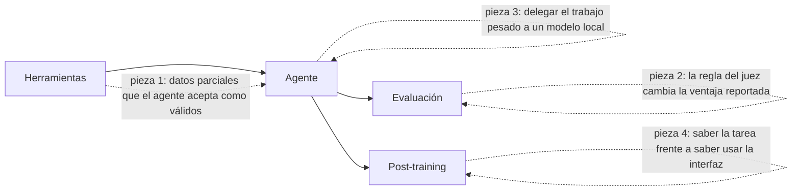

# Informe semanal de AI Engineering: 27 nov 2026

**Ventana:** 20–27 nov 2026 · **Para:** Sergio Mora · **Informes anteriores:** [20 nov](2026-11-20.md), [13 nov](2026-11-13.md), [27 oct](2026-10-27.md); las ediciones del 30 oct y del 6 nov se publicaron solo en el artefacto. Ninguna pieza de esas ediciones ni de su radar se repite aquí.

**Método:** revisé los listados de la última semana de arXiv (cs.CL, cs.AI, cs.LG, cs.SE y cs.MA; 2.824 entradas únicas). Descarté los anuncios del 20 nov, que ya cubrió la edición anterior, y filtré los del 23 al 26 nov por agentes, evaluación y post-training (~415 títulos). Leí 32 abstracts con la API de arXiv y el texto HTML completo de 5 finalistas. Las cuatro piezas elegidas son v1 nuevas, no versiones nuevas de trabajos anteriores. La pieza 1 tiene fecha v1 del 20 nov, pero se anunció el 24 nov y no entró en la edición anterior. También busqué en la web publicaciones de laboratorios (Anthropic, OpenAI, Hugging Face, AI2, Qwen, LangChain, NVIDIA) y no encontré nada primario de esta ventana con evidencia reproducible. Comprobé los enlaces el 27 nov: arXiv y Hugging Face responden 200, y GitHub responde 403 a todo desde mi entorno, así que de esos repos solo puedo decir que el paper los cita.

Etiquetas: **[medido]** es un resultado reportado por los autores; **[autores]** es una afirmación o interpretación de los autores; **[inferencia]** es una opinión mía.

La idea que une a las cuatro: **lo que parece un éxito puede no estar respaldado por la evidencia**. Una respuesta segura construida sobre datos truncados, una ventaja que desaparece al pedir evidencia, un costo que baja sin perder tareas y un modelo que "sabe" la tarea pero no logra expresarla en otra interfaz obligan a medir algo distinto del puntaje agregado.

---

## 1. When Tools Fail, Agents Fabricate: Silent Failure and Verification-First Oversight in Tool-Using LLM Agents
**Gün Kaynar, Boshen Yan, Carl Kingsford** (Carnegie Mellon University) · v1 20 nov 2026 (anunciado el 24 nov) · https://arxiv.org/abs/2611.28341

#### Contexto previo: qué pasa cuando una herramienta falla a mitad de la tarea
1. **Qué es:** un agente con herramientas (*tool-using agent*) alterna pensamiento, llamada y observación en un ciclo (el patrón ReAct). La **recuperación ante fallos** (*error recovery*) es lo que hace cuando una llamada falla: reintentar, cambiar de herramienta, replantear el plan o admitir que no puede responder.
2. **De qué se compone:** el tipo de fallo (tiempo agotado, permiso denegado, recurso inexistente, salida mal formada o resultado parcial), su **persistencia** (transitorio, que se arregla al reintentar, o persistente, que no) y el desenlace. Hay tres desenlaces: respuesta correcta, **fallo honesto** (*honest failure*: "el dato no está disponible") y **fabricación** (*fabrication*: una respuesta segura pero falsa).
3. **Cómo se ha trabajado:** los benchmarks de agentes (WebArena, AppWorld, tau-bench, SWE-bench) miden si la tarea se completa, pero no controlan qué fallo ocurre ni cuándo. Las técnicas de auto-reflexión, como Reflexion y Self-Refine, suponen que el modelo mejora releyendo su propio trabajo. Huang et al. (2024) mostraron que, sin una señal externa, la auto-corrección a menudo empeora el resultado. En software clásico, la ingeniería del caos inyecta fallos a propósito para ver cómo responde el sistema.
4. **Dónde está la dificultad:** un error visible (un 401 o un permiso denegado) queda escrito en el contexto, pero un **resultado parcial** (la mitad de las filas de una consulta) parece un éxito. No había un banco de pruebas con fallos reales y una verdad conocida que permitiera separar la fabricación del fallo honesto.
5. **Ejemplo intuitivo (números ilustrativos):** una consulta SQL debía devolver 100 cuotas en mora y devuelve 50 sin avisar. El agente suma esas 50 y reporta "saldo en mora: 32 millones" cuando el real es 65. No hubo ningún error en pantalla y el número se ve verosímil.
6. **Conexión:** tu servidor MCP devuelve PD, LGD y pricing a un comité que decide. Si una herramienta devuelve algo incompleto, ¿el comité lo nota o firma igual?

**Qué cambia:** construye RetryRealistic, un banco de pruebas con sistema de archivos real (con permisos `chmod`), SQLite, un servidor HTTP local determinista y una shell restringida. Tiene 8 herramientas, 9 tipos de fallo con persistencia controlada y 30 tareas con verdad conocida. Además, propone un Monitor que verifica con código, antes que con un LLM, si los números de la respuesta aparecen en las salidas de las herramientas.
**Por qué importa:** fiabilidad. Una fabricación segura es peor que un fallo honesto, porque nadie la detecta aguas abajo.
**Evidencia [medido]:** en 2.100 corridas con fallos, la recuperación correcta va del 19 % al 68 % según el modelo, y entre el 6 % y el 26 % terminan en fabricación. Los resultados parciales son los que más fabricación producen (38,3 %). El Monitor sube la recuperación correcta del 45,6 % al 56,3 % y baja la fabricación del 17,3 % al 10,8 %. **Limitaciones [autores]:** shell restringida, HTTP simulado y Monitor y juez propietarios. **[inferencia]** Son 30 tareas hechas por los autores, y el Monitor casi no ayuda con los datos truncados.
**Experimento (laptop):** en 20 casos de tu eval, haz que una herramienta MCP devuelva solo la mitad de las filas o campos. Mide la fabricación con y sin una verificación en código de que cada cifra de la respuesta aparezca en las salidas de las herramientas. Éxito: la verificación baja la fabricación al menos a la mitad sin rechazar más del 5 % de las respuestas correctas.
**Variante GPU local (VRAM orientativa ~5–6 GB, modelo de ~4B a 4 bits; no confirmada):** usa como agente un modelo open-weight pequeño en Ollama o llama.cpp, para no gastar API. Los casos y el servidor MCP corren en la laptop, y los resultados (CSV con desenlace por caso y tipo de fallo) vuelven a la laptop o al repo. Al final, borra la caché del modelo y las trazas crudas de esa máquina.
**Recursos:** el paper cita el banco de pruebas, el inyector de fallos y todas las trazas anotadas en `github.com/Kingsford-Group/RetryRealistic` (403 desde mi entorno; no verificado).

#### Cómo lo aplicas tú
1. **Lo que ya sabes que te sirve:** las reglas duras y el auditor de `credit-risk-agent-lab` ya son una capa de verificación, y el registro de costos por solicitud te da trazas para revisar. La idea de que un dato incompleto pasa el filtro de plausibilidad la conoces de los controles de calidad de datos en originación, donde un campo vacío que se imputa en silencio cambia el score.
2. **Lo nuevo para ti:** la inyección controlada de fallos por tipo y persistencia, y separar en la evaluación "fallo honesto" de "fabricación". Es poco esfuerzo: un envoltorio sobre tus herramientas MCP que trunque o deniegue según una semilla, más una etiqueta nueva en tu eval. Calcula de uno a dos días.
3. **Dónde lo aplicas:**
   - En tu trabajo: en cualquier asistente que resuma cartera, cosechas o alertas de fraude a partir de consultas SQL, donde un resultado truncado produce un número verosímil.
   - En tus repos: en el servidor MCP y el auditor de `credit-risk-agent-lab`; el chequeo S1 del paper (cada cifra debe aparecer en alguna salida de herramienta) cabe como regla dura antes de la firma humana. En `growth-marketing-agent`, sobre las consultas de DuckDB cuando construyas el agente.
4. **Veredicto: Adoptar ya** la verificación en código y la etiqueta de fabricación. Es barata, corre sin API y cubre un error que tu tasa de éxito no muestra. **[inferencia]**
5. **Primer paso (≤ 2 h):** escribe un decorador que, con probabilidad 0,5, devuelva la mitad de las filas de una herramienta de tu servidor MCP. Corre 20 casos y cuenta cuántas respuestas citan un número que no aparece completo en las salidas.

#### Resumen ampliado en español
1. **Problema y motivación.** Los agentes con herramientas fallan en producción por permisos, bloqueos de base de datos o respuestas truncadas. Importa tanto *cómo* fallan como *si* fallan: un fallo ruidoso se puede corregir aguas abajo y una fabricación silenciosa no. Faltaba un banco de pruebas realista con verdad conocida para medirlo.
2. **Conceptos clave.** *Persistencia del fallo*: los transitorios (tiempo agotado, error de red y base bloqueada) se arreglan al reintentar con un 50 % de probabilidad; los persistentes (permiso denegado, autenticación, no encontrado, salida mal formada, éxito parcial y código de salida distinto de cero) no. *Ingesta silenciosa* (*silent ingestion*): el agente acepta como válido un dato defectuoso en el primer contacto, sin reintentar ni marcarlo, y construye la respuesta encima. *Monitor de verificación primero* (*verification-first Monitor*): una cascada de chequeos S1 (cada cifra de la respuesta aparece en alguna salida), S2 (pedir que reformule si no da cifras), S3 (recalcular sumas, promedios y conteos desde las filas recuperadas) y S4 (un LLM revisa solo si la respuesta se desvió de la pregunta). Cada veto es una instrucción correctiva, no un bloqueo: el agente puede corregir una vez.
3. **Datos.** 30 tareas de varios pasos (10 fáciles, 12 medias y 8 difíciles; de 2 a 7 llamadas mínimas) con ruta alternativa de recuperación y verdad verificable por máquina. Cuatro agentes ReAct: Llama-3.1-8B, Llama-3.1-70B, DeepSeek-V4 y Claude Haiku 4.5, con temperatura 0,2 y un tope de 20 pasos. Tres semillas por condición: 615 corridas por modelo y brazo, 2.100 de ellas con fallo. Monitor: Claude Sonnet 4.6. Juez de evaluación: Claude Opus 5.5, distinto de agentes y Monitor.
4. **Método paso a paso.** Cada tarea define un `fault_target` (herramienta y argumento) y el fallo se dispara en la primera llamada que coincide. Luego se compara la línea base con el Monitor completo, el Monitor solo de código, un brazo sin cadena de razonamiento y uno con una instrucción de honestidad, más dos brazos dirigidos. La evaluación clasifica la respuesta final contra la verdad en tres desenlaces, en vez de una taxonomía de comportamiento hecha por un LLM: dos jueces coincidían solo en el 67 % de las categorías de comportamiento, pero en el 94 % con los tres desenlaces.
5. **Resultados [medido].**

| Modelo (línea base, % de corridas con fallo) | Correcto | Fabricado | Fallo honesto |
|---|---|---|---|
| Llama-3.1-8B | 18,9 | 25,9 | 55,2 |
| Llama-3.1-70B | 33,0 | 18,7 | 48,4 |
| DeepSeek-V4 | 67,6 | 5,5 | 26,9 |
| Claude Haiku 4.5 | 62,9 | 19,0 | 18,1 |
| Total | 45,6 | 17,3 | 37,1 |

Por tipo de fallo, el éxito parcial produce un 38,3 % de fabricación y el permiso denegado, un 78,1 % de fallo honesto. El tipo de fallo explica 1,6 veces más varianza de la fabricación que el modelo. Los agentes que reintentan tres o más veces fabrican solo el 7,0 %, frente al 20,7 % con 0–1 reintentos. Con datos parciales, en el 91 % de las corridas el agente repitió la llamada como mucho una vez. Al fijar el punto de inyección y variar solo el contenido, un resultado parcial produce un 35,2 % de fabricación y una negación explícita, un 16,0 %. Monitor completo: 56,3 % correcto y 10,8 % fabricado; solo código: 54,7 % y 13,4 %. Con éxito parcial, el Monitor solo baja la fabricación del 38,3 % al 32,1 %. Quitar el razonamiento sube la fabricación 8,3 pp. Una instrucción de honestidad la baja del 17,3 % al 13,7 %, pero no ayuda con datos parciales. Si se permite que el agente repare el permiso, DeepSeek pasa del 9,7 % al 81,9 % de recuperación correcta.
6. **Robustez y limitaciones.** [autores] Shell restringida y HTTP simulado; el recálculo solo cubre agregados escalares y vetó algunas respuestas correctas con valores derivados; Monitor y juez son modelos propietarios fuertes; hay pocas corridas que repitan la llamada con datos parciales (55 de 609). [inferencia] Son 30 tareas diseñadas por los propios autores, no hay intervalos de confianza en las tablas principales y la mejora del Monitor es menor justo donde el problema es mayor.
7. **Aporte frente a trabajos previos.** Frente a MAS-FIRE y ReliabilityBench, que inyectan fallos sin verdad conocida o sin separar la fabricación, aquí se califica contra la verdad, se aísla el contenido del fallo como causa y se propone una corrección verificable en código en lugar de la auto-reflexión.
8. **Cómo aplicarlo.** Mide la fabricación como desenlace propio, prueba resultados parciales además de errores explícitos y verifica con código que las cifras de la respuesta estén en las salidas de las herramientas.
9. **Glosario:** *ingesta silenciosa* (aceptar un dato defectuoso sin marcarlo); *fallo honesto* (admitir que falta el dato); *persistencia* (si el fallo sobrevive al reintento); *grounding* (anclar la respuesta en salidas verificables); *veto correctivo* (rechazo con derecho a corregir).
**Para recordar:** el fallo peligroso no es el que grita, sino el que devuelve la mitad de las filas sin avisar.

---

## 2. Same Executions, Different Gaps: Judgment Rules in Web-Agent Evaluation
**Zelong Wang, Weiyue Li, Fei Xue, Junru Zhu** (UC San Diego, Harvard e investigadores independientes) · v1 23 nov 2026 (anunciado el 24 nov) · https://arxiv.org/abs/2611.30190

#### Contexto previo: estimar una diferencia entre agentes con un juez imperfecto
1. **Qué es:** para decir que el agente B es mejor que el A, se estima la **diferencia de tasas de éxito** (*success-rate gap*) entre ambos. Cuando no hay verificador automático, un **juez LLM** (*LLM-as-judge*) etiqueta cada ejecución guardada como éxito o fracaso.
2. **De qué se compone:** la regla de decisión del juez (qué pregunta responde), la evidencia que recibe (traza, capturas, URLs), la referencia contra la que se compara (etiquetas humanas o recompensa del benchmark) y el estimador de la diferencia. En fórmula: diferencia = tasa(B) − tasa(A). Su error es el error de B menos el error de A.
3. **Cómo se ha trabajado:** se reportan los puntajes de cada agente según el juez y, a veces, se corrige cada puntaje por la sensibilidad y especificidad del juez. La **inferencia potenciada por predicciones** (*prediction-powered inference*, PPI; Angelopoulos et al., 2023) combina muchas predicciones baratas con pocas etiquetas reales para estimar un parámetro con menos varianza, sin sesgo. Es la misma lógica de una variable de control o de un estimador de regresión en muestreo.
4. **Dónde está la dificultad:** si el juez subestima ambos agentes por igual, los errores se cancelan en la diferencia. Mejorar cada puntaje por separado puede romper esa cancelación y empeorar la diferencia. Además, el mismo juez puede responder "¿probablemente lo logró?" o "¿la evidencia guardada demuestra que lo logró?", y no está claro qué pregunta mide una mejora.
5. **Ejemplo intuitivo (números ilustrativos):** con la regla "probablemente", A tiene 20 % y B 28 %: B gana por 8 puntos. Con la regla "demostrado", A baja a 15 % y B a 16 %: B sigue primero, pero gana por 1 punto. El ranking es el mismo y la decisión de inversión es otra.
6. **Conexión:** tus evals con juez LLM comparan versiones del comité. Este paper pide declarar qué significa "éxito" y estimar la diferencia directamente con pocas etiquetas pareadas.

**Qué cambia:** sobre 300 ejecuciones fijas de AgentRewardBench (Qwen2.5-VL-72B frente a Claude 3.7 Sonnet, con tareas de AssistantBench, WebArena, VisualWebArena y WorkArena), cambia solo la pregunta del juez: *predicción* (¿lo logró probablemente?) frente a *certificación* (¿lo respalda el registro?). Luego agrega evidencia controlada y propone estimar la diferencia con 50 pares etiquetados y una regresión al estilo PPI.
**Por qué importa:** fiabilidad de las decisiones. La magnitud de una mejora guía en qué se invierte, y aquí cambia sin que cambie el ranking.
**Evidencia [medido]:** con el juez Astra y la vista final, la ventaja de Claude baja de 8,33 a 1,33 pp (reducción de 7,00; IC 95 % de 3,67 a 10,50). Las cinco combinaciones de juez y vista reducen la ventaja. Con los mismos 50 pares etiquetados, la regresión reduce el error cuadrático medio entre un 16,9 % y un 36,9 % frente al muestreo pareado directo en diez escenarios. **Limitaciones [autores]:** ejecuciones fijas publicadas; las intervenciones de evidencia son efectos locales. **[inferencia]** Hay un solo par principal de agentes y no encontré código enlazado.
**Experimento (laptop):** toma las salidas de tu juez para dos versiones del agente sobre todos tus casos, etiqueta a mano 50 casos en ambas versiones y compara tres estimadores de la diferencia: el bruto del juez, el pareado directo con las 50 etiquetas y la regresión. Éxito: el intervalo bootstrap de la regresión es al menos un 15 % más estrecho que el directo. No necesita GPU ni API.
**Recursos:** el paper describe un suplemento con prompts, matrices de comparación y un estimador ejecutable (Suplemento S.6), pero no cita un repositorio. Los datos de base son públicos (AgentRewardBench).

#### Cómo lo aplicas tú
1. **Lo que ya sabes que te sirve:** muestreo, variables de control, bootstrap pareado y la diferencia entre la exactitud de cada estimación y la de una diferencia. Es lo mismo que cuando comparas el Gini de dos scorecards sobre la misma muestra out-of-time y usas la correlación entre ambos para estrechar el intervalo. Tu economía te da el resto del paper sin esfuerzo.
2. **Lo nuevo para ti:** PPI aplicada a evaluar agentes, y la distinción entre "predecir el desenlace" y "certificar con evidencia" como dos objetivos de medición distintos. Calcula unas 2 horas de lectura (secciones 4 y 6).
3. **Dónde lo aplicas:**
   - En tu trabajo: cuando reportes que una versión de un asistente o de un flujo de revisión "mejora X puntos", reporta las dos tasas, la regla del juez y un intervalo para la diferencia.
   - En tus repos: en las evals con juez LLM de `credit-risk-agent-lab`, para la comparación entre el comité y el agente único que quedó pendiente en las ediciones anteriores; y en `growth-marketing-agent`, donde la incrementalidad usa la misma lógica de estimar una diferencia.
4. **Veredicto: Adoptar ya.** Es estadística que dominas, cuesta 50 pares de etiquetas y cambia cómo comunicas cualquier mejora de tu agente. **[inferencia]**
5. **Primer paso (≤ 2 h):** escribe en pandas la función `gap_ppi(y_labeled, j_labeled, j_full)` que ajuste el peso λ con una regresión de las diferencias etiquetadas sobre las diferencias del juez, y pruébala con bootstrap sobre tus evals actuales.

#### Resumen ampliado en español
1. **Problema y motivación.** Las mejoras de agentes web se reportan como diferencias de tasa de éxito calificadas por jueces LLM. Saber quién gana no dice cuánta confianza merece la ventaja. El paper estudia la comparación misma: cómo se define el éxito, qué evidencia lo respalda y cómo se estima la diferencia.
2. **Conceptos clave.** *Predicción* (*prediction*): el juez elige el desenlace más probable cuando el registro no lo decide. *Certificación* (*certification*): el juez solo aprueba si el registro respalda la finalización; un cero significa "no respaldado" y mezcla fracaso observado con falta de confirmación. *Juicio de tres estados*: éxito respaldado, fracaso respaldado y no resuelto. *Referencia humana* (las evaluaciones expertas de AgentRewardBench) frente a *referencia funcional* (las recompensas guardadas del benchmark). *Efecto de la regla*: la ventaja con predicción menos la ventaja con certificación.
3. **Datos.** Las 300 tareas compartidas entre Qwen2.5-VL-72B y Claude 3.7 Sonnet en una versión fija de AgentRewardBench, más GPT-4o (300 tareas en común) y Llama 3.3-70B (206 en común, porque no tiene ejecuciones de VisualWebArena). Jueces: Astra, Sonnet 4.5 y Kimi K2.5, distintos de los agentes evaluados. Vista final (última captura) y vista ampliada (hasta dos capturas previas). Dos llamadas por ejecución, regla y vista. Los datos de base son públicos.
4. **Método paso a paso.** (a) Fijar las ejecuciones y variar la regla del juez; intervalos bootstrap por pares de tareas dentro de cada benchmark. (b) Agregar evidencia archivada (relación posición–producto–destino, identidad del producto) y controles de re-presentación. (c) Estimar la diferencia con muestras de n = 50 pares etiquetados: Δ̂ = Ȳₙ + λ·(J̄_N − J̄ₙ), donde Ȳₙ es la diferencia de referencia en la muestra etiquetada, J̄ₙ la diferencia del juez en esa muestra y J̄_N la del juez en toda la cohorte. Con λ = 0 es el muestreo pareado directo; con λ = 1, la corrección de peso igual; la propuesta ajusta λ con una regresión sobre los mismos 50 pares. Un sesgo sistemático del juez se cancela, y lo que aporta es la correlación entre tareas.
5. **Resultados [medido].**

| Juez y vista | Ventaja con predicción (pp) | Ventaja con certificación (pp) | Reducción (IC 95 %) |
|---|---|---|---|
| Astra, final | 8,33 | 1,33 | 7,00 (3,67 a 10,50) |
| Astra, ampliada | 7,00 | 3,33 | 3,67 (0,50 a 7,00) |
| Sonnet 4.5, final | 6,00 | 4,83 | 1,17 (−2,33 a 4,83) |
| Sonnet 4.5, ampliada | 7,17 | 3,83 | 3,33 (0,17 a 6,67) |
| Kimi K2.5, final | 9,50 | 7,50 | 2,00 (−1,17 a 5,33) |

Con tres estados, la ventaja pasa de 8,17 a 1,33 pp (reducción de 6,83; IC de 3,33 a 10,50). Claude tiene menos fracasos respaldados (62,5 % frente a 74,3 %) pero más casos no resueltos (23,2 % frente a 12,7 %). Las relaciones necesarias se pudieron ubicar en 52 de las 59 ejecuciones que explican el cambio. En una tarea de posición en cuadrícula, ambas reglas daban una diferencia de cero a pesar de acciones distintas, y la evidencia agregada la reveló; en una compra de laptop, la evidencia eliminó una ventaja aparente. Las dos referencias implican ventajas muy distintas: 10,67 pp (humana) y 0,67 pp (funcional). Calibrar cada puntaje por separado acercó ambos puntajes pero empeoró la diferencia. La regresión identifica al líder humano en el 48–62 % de las muestras, frente al 41 % del muestreo directo, con una cobertura de 94,2–94,7 %.
6. **Robustez y limitaciones.** [autores] Ejecuciones fijas; las intervenciones de evidencia son locales; nuevos jueces, tareas o interfaces pueden cambiar los resultados; el peso igual gana a la regresión en dos escenarios; la cobertura queda un poco por debajo del nominal. [inferencia] El par principal es uno solo; dos de cinco reducciones tienen intervalos que incluyen el cero; y en el HTML no encontré repositorio, solo la mención del suplemento.
7. **Aporte frente a trabajos previos.** Frente a AgentRewardBench, WebJudge y "Gaming the Judge", fija todo el registro y varía solo la regla de decisión, y mide su efecto sobre la diferencia, no sobre cada puntaje. Frente a la corrección binaria por sensibilidad y especificidad, muestra que corregir cada puntaje no basta y aplica PPI++ a la diferencia pareada.
8. **Cómo aplicarlo.** Declara la regla de éxito, guarda la evidencia que permite revisarla, reporta las dos tasas y la diferencia, y estima la diferencia con etiquetas pareadas más las predicciones del juez.
9. **Glosario:** *certificación* (aprobar solo con evidencia); *predicción* (aprobar lo más probable); *muestreo pareado* (etiquetar ambos agentes en la misma tarea); *PPI* (estimador que combina predicciones y pocas etiquetas); *cancelación de errores* (errores iguales que se anulan en la diferencia).
**Para recordar:** que el ganador no cambie no significa que la ventaja sea la misma; estima la diferencia, no los dos puntajes.

---

## 3. Delegent: A Multi-Agent Harness That Reduces Cost without Sacrificing Performance
**Lingwei Gu, Jimmy Lin** (University of Waterloo) · v1 24 nov 2026 (anunciado el 25 nov) · https://arxiv.org/abs/2611.33098

#### Contexto previo: por qué un agente cuesta tanto y cómo se combinan modelos caros y baratos
1. **Qué es:** un *harness* es el programa que llama al modelo, ejecuta sus herramientas y le devuelve los resultados en un ciclo. En cada paso el modelo **relee todo el contexto**, que crece con cada llamada. Un modelo de lenguaje pequeño (*small language model*, SLM) cuesta mucho menos, y nada extra si corre en una GPU propia.
2. **De qué se compone:** el costo por tarea es aproximadamente la suma, sobre los pasos, de los tokens de contexto por el precio de entrada más los tokens generados por el de salida. La caché de prompts (*prompt caching*) abarata la parte repetida, pero no la elimina. A eso se suman la latencia y la calidad final.
3. **Cómo se ha trabajado:** las **cascadas** (FrugalGPT) dejan responder primero al modelo barato y escalan si dudan; los **routers** (RouteLLM) eligen un solo modelo por consulta. En ambos, un modelo resuelve toda la tarea. El patrón orquestador–trabajador (*orchestrator–worker*) reparte subtareas, pero normalmente con el mismo modelo caro en todos los roles.
4. **Dónde está la dificultad:** un modelo de 2B no resuelve solo una tarea larga de código, así que un router lo usa poco. Pero buena parte del trabajo del modelo caro es "trabajo pesado" (*legwork*): buscar código, leer archivos y correr pruebas. No estaba medido cuánto de eso se puede delegar sin perder tareas.
5. **Ejemplo intuitivo (números ilustrativos):** un agente da 100 pasos y en cada uno relee en promedio 50 mil tokens: 5 millones de tokens de entrada. Si 60 de esos pasos (leer y buscar) los hace un modelo local que solo devuelve un informe de 500 tokens, el modelo caro da 40 pasos con un contexto más corto.
6. **Conexión:** tu agente tiene especialistas en paralelo que leen datos y un comité que decide; los especialistas son candidatos naturales para un modelo local en tu GPU de 8 GB.

**Qué cambia:** el modelo de frontera dirige siempre y escribe la respuesta final; un SLM local hace las subtareas fáciles en subagentes con contexto propio, y al modelo caro solo vuelve el informe. Está construido sobre Claude Code sin modificarlo: un relé enruta cada llamada según su rol. No entrena ningún modelo, y una instrucción corta le explica al modelo caro qué delegar.
**Por qué importa:** costo, con una advertencia de latencia.
**Evidencia [medido]:** con GPT-6.1-Sol y Qwen3.8-27B-FP8, el costo de frontera en DeepSWE baja de 2,11 a 0,70 USD por tarea con las mismas 29 tareas resueltas de 50. En 694 preguntas de búsqueda, el costo queda en el 41 % con las mismas 663 respuestas correctas. Un SLM de 2B (MiniCPM5-2B) deja el costo de DeepSWE en el 34 %. La instrucción explica unas tres quintas partes del ahorro. **Limitaciones [autores]:** solo código y búsqueda, latencia mediana de 38 frente a 25 minutos en DeepSWE, y Claude Code podría favorecer a Claude. **[inferencia]** Son muestras de 50 a 204 tareas, una corrida por celda y sin intervalos.
**Experimento (laptop):** en tu agente de LangGraph, envía los nodos de especialistas que solo leen y resumen datos a un modelo local y deja el comité en el modelo actual. Corre 30 casos de eval en ambos brazos. Éxito: el mismo número de decisiones correctas (±1 caso) con al menos un 30 % menos de tokens del modelo principal en tu registro de costos.
**Variante GPU local (VRAM orientativa ~3–6 GB: un modelo de 2–4B a 4 bits; no confirmada):** sirve el SLM con Ollama, llama.cpp o vLLM en la GPU y expón un endpoint a la laptop. Los casos se leen desde la laptop y solo vuelven los informes y un CSV con tokens, latencia y decisión. Al final, borra la caché del modelo (`~/.ollama/models` o `~/.cache/huggingface`) y los logs crudos de esa máquina.
**Recursos:** el paper cita el código en `github.com/castorini/delegent` (403 desde mi entorno; no verificado).

#### Cómo lo aplicas tú
1. **Lo que ya sabes que te sirve:** tu agente ya tiene especialistas en paralelo y un comité, y registras el costo por solicitud, así que tienes el baseline y la métrica. La lógica de que "el ahorro crece con el trabajo pesado" es la de asignar costos por actividad, que manejas desde FP&A.
2. **Lo nuevo para ti:** servir un modelo local con un endpoint compatible con la API y enrutar por rol, más la caché de prompts como parte del costo. Es un cambio de uno o dos días en LangGraph: cada nodo puede tener su propio cliente de modelo.
3. **Dónde lo aplicas:**
   - En tu trabajo: en asistentes internos que leen muchas tablas o documentos antes de decidir, donde la lectura se puede hacer con un modelo local y la decisión queda en el modelo caro o en una persona.
   - En tus repos: en `credit-risk-agent-lab`, mover especialistas a un SLM local y comparar el costo en tu registro; también sirve para tu presupuesto de API pequeño. En `growth-marketing-agent`, para las consultas exploratorias sobre DuckDB.
4. **Veredicto: Probar en el lab.** El ahorro es grande y no requiere entrenar, pero la evidencia es de código y búsqueda, no de decisiones de crédito, y la latencia sube. **[inferencia]**
5. **Primer paso (≤ 2 h):** saca de tu registro de costos qué fracción de tokens consume cada nodo; si los especialistas pesan más de la mitad, cambia el cliente de uno de ellos a un modelo local y repite 10 casos.

#### Resumen ampliado en español
1. **Problema y motivación.** Los agentes de frontera son caros porque releen todo el contexto en cada paso y hacen cada subtarea con el mismo modelo, sin importar su dificultad. La tesis es que un SLM en hardware propio puede hacer las subtareas fáciles, bajando mucho el costo sin perder tareas y sin entrenar.
2. **Conceptos clave.** *Costo de frontera*: lo que se le cobra al modelo grande, con la caché de prompts incluida. *Enrutamiento por rol*: las llamadas del ciclo principal van al modelo de frontera, y las de los subagentes y del modelo auxiliar, al SLM. *Informe* (*report*): lo único que vuelve al ciclo principal; en búsqueda trae respuesta, evidencia citada y confianza, y el harness verifica que cada cita aparezca literal en el documento. *Instrucción de economía*: explica que el plan más barato es el de menos pasos propios.
3. **Datos.** Código: muestras aleatorias de SWE-bench Verified (50), SWE-bench Pro (75) y DeepSWE v1.1 (50). Búsqueda: 200 preguntas de BrowseComp-Plus sobre su propio corpus, y cuatro conjuntos de CMASS sobre ClimbMix (un corpus web de 400 mil millones de tokens, accesible solo con BM25): BrowseComp-Plus (80), TRQA (68), HotpotQA (204) y DSQA (71, en los modos "encontrar una" y "encontrar todas"). Modelos: GPT-6.1-Sol con esfuerzo de razonamiento alto, Claude Opus 5.5 en las ablaciones, y Qwen3.8-27B-FP8 y MiniCPM5-2B como SLM, servidos con vLLM.
4. **Método paso a paso.** Se compara el mismo harness con y sin la herramienta de delegación y la instrucción. Una tarea de código se resuelve si el parche pasa las pruebas ocultas; una de búsqueda se califica contra la respuesta de referencia con un juez. Para Qwen se agrega además su precio de API (0,039 USD por millón de tokens de entrada y 1,25 USD por millón de salida).
5. **Resultados [medido].**

| Conjunto | Resueltas solo frontera | Resueltas con Qwen 27B | Costo relativo con Qwen | Costo relativo con 2B |
|---|---|---|---|---|
| SWE-bench Verified (50) | 46 | 46 | 44 % | 53 % (47 resueltas) |
| SWE-bench Pro (75) | 63 | 63 | 37 % | 44 % (62 resueltas) |
| DeepSWE (50) | 29 | 29 | 33 % | 34 % (30 resueltas) |
| Búsqueda, total (694) | 663 | 663 | 41 % | no probado |

Pagando el SLM a precio de API, el costo total de DeepSWE queda en el 38 % y el de Verified en el 57 %. En ClimbMix el costo baja a entre un cuarto y un tercio, y en BrowseComp-Plus sobre su propio corpus, solo al 63 %. En tareas de menos de 25 llamadas, el costo baja a ~60 % y en el 11 % sube; por encima de 200 llamadas baja a ~25 % y nunca sube. El 80 % del ahorro viene de mover a los subagentes, que en Claude Code ya consumían el 53 % del costo pero usaban el modelo caro. Sin la instrucción, el SLM de 2B resuelve 22 tareas en vez de 29; con ella, 30. Con Opus 5.5, el costo baja solo al 69 % porque planifica antes de actuar (18 turnos frente a 84 de Sol), y resuelve 38 de 50 frente a 34 solo.
6. **Robustez y limitaciones.** [autores] Depende de Claude Code; el SLM no es gratis; solo código y búsqueda; Opus solo en DeepSWE y el 2B solo en código; latencia aproximadamente doble en tareas cortas; no afirman mejoras de desempeño, solo que no se pierde. [inferencia] Una corrida por celda y sin intervalos de confianza; el juez de búsqueda es el mismo modelo de frontera; el 27B FP8 necesita una GPU de estación de trabajo, mucho más que tus 8 GB.
7. **Aporte frente a trabajos previos.** Frente a FrugalGPT, RouteLLM y Minions, el modelo caro nunca suelta la tarea ni la respuesta final; se mide en tareas largas y se descompone de dónde sale el ahorro.
8. **Cómo aplicarlo.** Mide qué fracción del costo se va en trabajo pesado, delega eso a un modelo barato con informes verificables y explícale al modelo principal la economía del plan.
9. **Glosario:** *harness* (programa que orquesta modelo y herramientas); *SLM* (modelo pequeño); *subagente* (ciclo propio con contexto limpio); *caché de prompts* (descuento por contexto repetido); *trabajo pesado* (buscar, leer y probar).
**Para recordar:** no cambies de modelo para toda la tarea; deja que el modelo caro dirija y que el barato haga el trabajo pesado.

---

## 4. Learning What vs. Learning How: Decomposing Task and Interface Competence in Agentic Training
**Chaeeun Lee, Hossein A. Rahmani, Aryo Pradipta Gema, Kexin Xu, Emine Yilmaz, Pasquale Minervini, T. Ian Simpson, Chen Jin, Amrutha Saseendran** (University of Edinburgh, UCL, University of Oxford, AstraZeneca y Miniml.AI) · v1 23 nov 2026 (anunciado el 25 nov) · https://arxiv.org/abs/2611.31427

#### Contexto previo: destilación, harness y qué aprende un modelo cuando lo afinas para ser agente
1. **Qué es:** la **destilación** (*distillation*) entrena un modelo pequeño (estudiante) con trayectorias exitosas de uno grande (maestro), mediante ajuste fino supervisado (*supervised fine-tuning*, SFT). En agentes, cada trayectoria se genera dentro de un **harness** concreto: un prompt de sistema, un formato de acción (llamada nativa a herramientas, JSON, XML o código Python), un ciclo de retroalimentación y unos límites.
2. **De qué se compone:** la **competencia de tarea** (*task competence*: saber qué hacer) y la **competencia de interfaz** (*interface competence*: saber expresarlo en ese formato). La pérdida del SFT cubre toda la trayectoria, así que enseña ambas a la vez.
3. **Cómo se ha trabajado:** se recolectan trazas con un harness y se afina con ellas; luego, a veces, se aplica aprendizaje por refuerzo (RL) con GRPO (ver el contexto de la pieza 3 de la edición del 13 nov). Se suele evaluar en el mismo harness de entrenamiento.
4. **Dónde está la dificultad:** si el modelo falla en otro harness, no se sabe si le falta conocimiento o si no sabe usar la interfaz. Afinar con un solo formato puede "romper" los demás, igual que un modelo sobreajustado a un canal de originación falla en otro.
5. **Ejemplo intuitivo (números ilustrativos):** un modelo afinado con llamadas JSON acierta el 55 % en JSON y el 0 % en XML. No olvidó la tarea: escribe JSON donde se esperaba XML. Diez ejemplos que solo practiquen el formato XML recuperan casi todo.
6. **Conexión:** si algún día afinas un modelo open-weight pequeño para tus herramientas MCP, este paper dice qué datos necesitas y por qué un buen resultado en tu harness puede no viajar a otro.

**Qué cambia:** separa experimentalmente las dos competencias. Destila de Qwen3-32B a Qwen3-4B (y a Gemma-3-4B-it) en MedAgentBench, Reasoning Gym, AppWorld y BFCL V3, con tres harnesses de entrenamiento y uno reservado. Introduce el **ensayo de harness** (*harness rehearsal*): trazas en las que la instrucción ya trae la solución y el modelo solo practica la interfaz.
**Por qué importa:** calidad y costo del post-training. Aprender la interfaz es mucho más barato que volver a entrenar toda la tarea.
**Evidencia [medido]:** en BFCL multi-turno con Qwen3-4B (harness objetivo de llamadas nativas; base 44,6 %), la supervisión desde otros harnesses sola da 8,5 % y el ensayo solo 32,5 %, pero juntos llegan a 58,8 %. Afinar solo en llamadas nativas lleva JSON de 33,5 % a 0,1 %. GRPO en un solo harness no produce esa interferencia. **Limitaciones [autores]:** un harness reservado por benchmark y sobre todo Qwen3-4B. **[inferencia]** La mayoría de las condiciones son una sola corrida de entrenamiento, y requiere GPUs que no tienes.
**Experimento (laptop):** sin entrenar, evalúa un modelo pequeño open-weight en 30 casos de tus herramientas con dos formatos de acción (llamada nativa y JSON en texto) y anota qué casos resuelve cada uno. Éxito: el informe identifica si los fallos son de formato (llamada mal formada) o de tarea (herramienta o argumento equivocados).
**Variante GPU local (VRAM orientativa ~6–8 GB para QLoRA de un modelo de 1,5–4B; no confirmada):** solo si el diagnóstico muestra fallos de formato, prepara 50–100 trazas de ensayo (instrucción con la solución escrita) y propón un QLoRA corto. Los datos se leen desde la laptop, y solo vuelven el adaptador LoRA (decenas de MB) y las métricas. Al final, borra checkpoints intermedios, la caché del modelo base y los datasets tokenizados. No hace falta conservar el modelo completo. No lo ejecuto: queda como propuesta.
**Recursos:** [dataset en Hugging Face](https://huggingface.co/datasets/chaeeunlee/harness-competence) (respondió 200). Código citado en `github.com/chaeeunlee-io/harness-competence` (403 desde mi entorno; no verificado). Usa Harbor y SkyRL para ejecutar los entornos.

#### Cómo lo aplicas tú
1. **Lo que ya sabes que te sirve:** la interferencia entre harnesses es un problema de validación fuera de dominio: un modelo que gana en su muestra de desarrollo y cae en otra población. El diseño 2×2 (tarea × interfaz) es un experimento factorial con interacción, que lees como econometrista.
2. **Lo nuevo para ti:** el fine-tuning y el post-training están en lo que todavía no has trabajado: destilación por SFT, LoRA y GRPO. Entender el paper toma una tarde; ejecutar una versión mínima con QLoRA en tu GPU, varias semanas de aprendizaje.
3. **Dónde lo aplicas:**
   - En tu trabajo: al elegir un modelo open-weight para un flujo con herramientas, evalúalo en el formato de acción de producción, no en el del benchmark.
   - En tus repos: en el servidor MCP de `credit-risk-agent-lab`, como diagnóstico de si un modelo local falla por formato o por tarea; y en tu ruta de IA y Data Science, como primer ejemplo de post-training.
4. **Veredicto: Solo leer.** El método requiere GPUs y experiencia que todavía no tienes; el diagnóstico de formato frente a tarea sí lo puedes hacer ya. **[inferencia]**
5. **Primer paso (≤ 2 h):** revisa en tus trazas los fallos de herramientas y clasifícalos en "llamada mal formada" y "herramienta o argumento incorrecto"; si dominan los primeros, el problema es de interfaz.

#### Resumen ampliado en español
1. **Problema y motivación.** Los agentes operan a través de harnesses, y un modelo puede saber resolver una tarea sin saber expresarla en un harness dado. La pregunta es si un fallo se debe a falta de conocimiento o de manejo de la interfaz, y cómo interactúan ambos al entrenar.
2. **Conceptos clave.** *Competencia de tarea* y *competencia de interfaz*. *Especialista*: un modelo destilado con un solo harness. *3H*: destilado con los tres harnesses de entrenamiento. *Transferencia* (mejora frente al base) e *interferencia* (caída frente al base). *Ensayo de harness*: instrucciones generadas por programa que dicen qué operaciones hacer y qué valor entregar, de modo que la traza enseña la interfaz con casi ningún conocimiento de la tarea. *Supervisión cruzada*: demostraciones de la tarea generadas en otros harnesses.
3. **Datos.** MedAgentBench (80/20 estratificado), Reasoning Gym (96 generadores; entrenamiento con semillas 0–1 y evaluación con la 2), AppWorld (splits oficiales) y BFCL V3 de uno y varios turnos. Harnesses: Terminus-2, mini-swe-agent, Goose y Aider (de uso general) y formatos fc, json, xml, pycall, code y parity. Maestro Qwen3-32B y estudiante Qwen3-4B, con réplicas en Gemma-3-4B-it. Tareas de entrenamiento y prueba disjuntas. Dataset publicado en Hugging Face.
4. **Método paso a paso.** (Q1) Evaluar el modelo base en todos los harnesses. (Q2) Destilar especialistas y 3H con SFT sobre toda la trayectoria. (Q3) Diseño 2×2: supervisión cruzada sí o no × ensayo en el harness objetivo sí o no. (Q4) GRPO sin normalizar por desviación estándar ni penalización KL, en una banda de tareas que el modelo a veces resuelve, desde el base o desde 3H. Métrica: éxito promedio en 4 intentos con intervalos bootstrap por tarea al 95 %.
5. **Resultados [medido].** El harness cambia qué tareas se resuelven: los harnesses más débiles resuelven tareas que el mejor no resuelve (17 % de las resueltas en MedAgentBench, 11 % en BFCL multi-turno y 5 % en Reasoning Gym).

| BFCL multi-turno, Qwen3-4B (éxito %) | fc (objetivo) | json | pycall |
|---|---|---|---|
| Base | 44,6 | 33,5 | 28,2 |
| Solo supervisión cruzada | 8,5 | 47,4 | 52,5 |
| Solo ensayo en fc | 32,5 | 0,0 | 0,1 |
| Cruzada + ensayo | 58,8 | 50,8 | 50,9 |
| Especialista fc | 55,2 | 0,4 | 19,5 |
| 3H | 59,0 | 49,5 | 49,1 |

En MedAgentBench con Terminus-2 como objetivo, el base da 3,7 %, el ensayo solo 9,5 %, la supervisión cruzada sola 2,0 % y juntos 34,4 %; en Reasoning Gym, 20,0 %, 19,8 % y 37,0 % juntos. 3H supera al peor especialista en el harness reservado en todos los escenarios, pero solo supera al base en MedAgentBench y AppWorld. En cuatro de seis escenarios el peor especialista cae a menos de la mitad del base en el harness reservado. GRPO desde 3H en un solo harness no degrada los demás; en MedAgentBench, 3H más GRPO multi-harness llega a 85,7 % en fc y 78,0 % en el reservado xml.
6. **Robustez y limitaciones.** [autores] Un harness reservado por benchmark; foco en Qwen3-4B con réplica parcial en Gemma; tareas que no dependen de herramientas, memoria o habilidades propias de cada harness. [inferencia] La mayoría de las condiciones son una sola corrida (las comparaciones principales se repiten en 4); el ensayo necesita la solución correcta para escribir la instrucción; y no reporta el cómputo total.
7. **Aporte frente a trabajos previos.** Frente a la destilación de agentes en un solo harness y al trabajo que optimiza el harness, separa con un diseño factorial lo que el modelo sabe de lo que sabe expresar, y muestra que la interfaz se aprende barato y por separado.
8. **Cómo aplicarlo.** Evalúa en el harness de producción, mezcla harnesses al destilar y, si falla la interfaz, agrega ensayos baratos en lugar de más datos de la tarea.
9. **Glosario:** *destilación* (entrenar con trazas de un maestro); *harness* (formato y ciclo de interacción); *ensayo de harness* (practicar la interfaz con la solución dada); *interferencia* (caída en otros formatos); *GRPO* (RL que compara respuestas dentro de un grupo).
**Para recordar:** un modelo puede saber la tarea y no saber decirla en tu formato; enséñale el formato aparte.

---

**Radar (no las seleccioné):** *Which Loopholes Get Found? Predicting Reward Hacking of LLM Judges Before RL Training* (2611.29651; leí el abstract y revisé el HTML). En 36 corridas de GRPO con siete jueces, la "exposición" (propensión del modelo × tasa de falsos positivos del juez) predijo el primer atajo explotado en las 12 corridas con explotación. Quedó fuera porque continúa el tema del juez como recompensa de la edición del 20 nov; queda en seguimiento. Solo abstracts: *Recursive Collective Intelligence* (2611.32606), una escalera de presupuesto igual para grupos de agentes que continúa el meta-análisis multiagente del 20 nov; *SecondChance* (2611.31586), donde el mejor modelo completa solo el 16 % de las recuperaciones sin ayuda; *What Makes Good Data for Training Coding Agents?* (2611.30207), donde el 74 % de las tareas de SWE-Gym que un modelo de 9B nunca resuelve tienen una prueba que rechaza arreglos correctos; y *Separating Automation Gains from Agent Contributions in AI-Assisted Model Validation* (2611.27094), un protocolo para validar modelos de crédito con agentes que todavía no evalúa ningún LLM.

## Prioridades
- **Lectura: #2, la regla del juez cambia la ventaja.** Es la pieza más cercana a tu formación (muestreo pareado, variables de control, PPI) y cambia cómo reportas cualquier mejora de tu agente: dos tasas, una regla declarada y un intervalo para la diferencia, con solo 50 pares etiquetados.
- **Experimentación: #1, fallos parciales en tu servidor MCP.** Corre en la laptop sobre lo que ya tienes, sin API si usas un modelo local, y mide un riesgo concreto para un agente que decide crédito: una cifra verosímil construida sobre datos truncados. La verificación en código (cada cifra debe aparecer en alguna salida de herramienta) cabe como regla dura antes de la firma humana.
