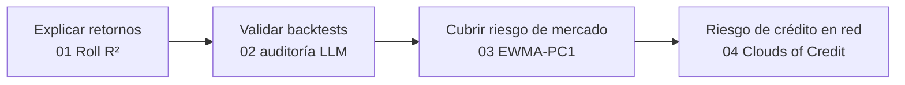

# Tópicos de finanzas — 18 de noviembre de 2026

- **Ventana de búsqueda:** 11 al 18 de noviembre de 2026.
- **Lector:** data scientist con base en riesgo de crédito que construye un perfil de finanzas de nivel máster y reproduce en Python con datos públicos.
- **Informe anterior:** [2026-11-11](https://github.com/neiderolaya26/learning/blob/topicos/topicos/finanzas/2026-11-11.md).
- **Artefacto:** https://claude.ai/artifact/BEhS4jnBe9sYYoRdueyUcP

**Método.** Revisé la lista semanal de arXiv q-fin (98 envíos, con listados cruzados) y econ.EM (45), la lista de NBER marcada como nueva esta semana (31 working papers) y los feeds de working papers del BIS, la Fed (FEDS), el BCE y el Banco de la República. Esta vez no revisé SSRN ni las revistas (JF, JFE, RFS, JFQA). Confirmé con la API de arXiv que las tres piezas de arXiv son v1 dentro de la ventana, y en la página de NBER, que la fecha de publicación de w36032 es el 16 nov 2026. Quedaron 10 finalistas. Leí el texto completo de las 4 piezas elegidas: los PDF de arXiv y el de NBER respondieron bien. Los repositorios de GitHub que citan los papers devolvieron 403 desde mi entorno, así que no los verifiqué. Ninguna pieza repite las de la edición anterior. NoLBERT-Calls continúa el tema de la pieza 04 de la semana pasada y queda en seguimiento.

Etiquetas: **[medido]** resultado reportado por los autores; **[autores]** afirmación o interpretación de los autores; **[inferencia]** opinión del informe.

## Diagrama

## 01. Explaining Realized Returns: Roll's R² 40 Years Later

Bryan Kelly (Yale, AQR, NBER), Yinan Su (Johns Hopkins) y Chao Zhang (HKUST Guangzhou). arXiv v1, 17 nov 2026. https://arxiv.org/abs/2611.22277

#### Contexto previo: cuánto de los retornos se puede explicar

**Qué es:** explicar un retorno (*explaining realized returns*) no es pronosticarlo. Pronosticar es usar información de t−1 para adivinar el retorno de t. Explicar es mirar hacia atrás y preguntar qué parte de la variación observada se puede atribuir a hechos del mundo. La medida usual es el coeficiente de determinación (*R²*): la fracción de la varianza del retorno que reproduce un modelo.

**De qué se compone:** (1) el retorno a explicar, por ejemplo el del S&P 500 en un día o un mes; (2) los candidatos a explicación, como datos macro, dividendos, expectativas de analistas, flujos de inversionistas o noticias; (3) un mapeo estable del candidato al retorno, por ejemplo una regresión; (4) una evaluación honesta. En fórmula, R² = 1 − Σ(r − r̂)² / Σ(r − r̄)². Si se calcula fuera de muestra (*out-of-sample*, OOS), puede ser negativo: el modelo explica peor que la media.

**Cómo se ha trabajado:** Richard Roll, en su discurso presidencial de la American Finance Association de 1988 ("R²"), mostró que la información pública conocida explicaba poca variación de los retornos de acciones individuales. Cutler, Poterba y Summers (1989), en "What Moves Stock Prices?", llegaron a una conclusión parecida para el mercado agregado con variables macro y noticias clasificadas a mano. Otra rama descompone el retorno en noticias de flujo de caja y de tasa de descuento (Campbell y Shiller), pero esas descomposiciones usan los propios precios y dan R² de casi 100 % por construcción. La literatura de análisis de texto (Tetlock, 2007; Loughran y McDonald, 2011) mide el tono de las noticias, más para pronosticar que para explicar.

**Dónde está la dificultad:** los datos macro llegan mensuales o trimestrales, revisados y con rezago, mientras el mercado reacciona el mismo día a la noticia. Las noticias, en cambio, son texto no estructurado y suelen describir el propio movimiento de precios ("las acciones cayeron"), lo que infla el R² sin explicar nada. Y queda la duda de si el periodista elige, después de ver el precio, la razón que encaja.

**Ejemplo intuitivo (números ilustrativos):** si el mercado varía con una desviación de 1 % diaria y un modelo deja errores con desviación de 0,84 %, el R² es 1 − 0,84² ≈ 0,29. Si el modelo usa una frase que dice "el S&P subió 1 %", el R² sería casi 1, pero sería trampa.

**Cómo se conecta:** el paper usa LLMs para leer solo las razones de una nota diaria y medir cuánto explican. Para el lector es la diferencia entre un modelo que predice el default y uno que explica después por qué subió la mora de una cosecha.

- **Qué cambia:** mide fuera de muestra cuánto explican del mercado las razones que da el Wall Street Journal. Un LLM extrae solo las razones, sin lenguaje de precios, y se convierten en embeddings.
- **Por qué importa:** da una vara de cuánto del mercado entendemos y una plantilla para usar texto sin fuga del objetivo.
- **Evidencia y limitaciones:** [medido] En 2002–2024, las variables macro y de flujo de caja dan R² mensual negativo o casi nulo; los flujos, cerca de 10 %. Las razones explican 29,8 % diario y 40,3 % mensual. [autores] Las razones anticipadas contradicen una atribución puramente ex post. [inferencia] El WSJ es licenciado y el LLM pudo conocer las reacciones de 2002–2023.
- **Experimento sugerido:** baseline: ridge sobre FRED-MD sin series financieras para el retorno mensual del mercado de French, con validación cruzada de 5 bloques. Luego, embeddings locales de los comunicados del FOMC para el retorno de esos días. Métrica: R² OOS; éxito si el texto supera 0.
- **Código y datos:** sin código. WSJ licenciado; FRED-MD y Shiller públicos.

#### Cómo lo aplicas tú

**Veredicto: Probar en el lab.** El método se reproduce a escala pequeña con texto público y embeddings locales, y deja una disciplina útil contra la fuga de información.

- **Lo que ya sabes que te sirve:** el R² fuera de muestra, la validación cruzada, ridge y lasso, y sobre todo el reflejo de buscar fuga de la variable objetivo, como cuando una variable de cobranza se cuela en un scorecard de originación. Como economista, ya conoces FRED y el problema de rezagos y revisiones de los datos macro.
- **Lo nuevo para ti:** los embeddings de texto como regresores, la extracción con LLM y su filtro de fuga, y el filtro HAR, que quita persistencia de una serie. El asset pricing del mercado agregado está en tu ruta de Finanzas. El esfuerzo es moderado, porque no hay que entrenar redes, solo usar embeddings ya hechos.
- **Dónde lo aplicas:**
  - En tu trabajo: [inferencia] en el P&L de cartera o en los comités de riesgo, la misma idea sirve para medir cuánto de los movimientos mensuales de mora explican las razones que se escriben en los informes, con una regla: el texto no puede mencionar la propia mora.
  - En tus repos: en `credit-risk-agent-lab`, el agente redacta justificaciones; puedes medir si sus razones, convertidas en embeddings, explican la decisión fuera de muestra o si solo la repiten.
- **Primer paso (≤ 2 h):** baja FRED-MD, quita las series financieras y corre ridge con validación cruzada de 5 bloques contra el retorno mensual del mercado de Kenneth French. Así reproduces el baseline negativo del paper con tus herramientas.

#### Resumen ampliado en español

**Problema y motivación:** Roll (1988) preguntó si, en retrospectiva y con información pública, se podían explicar los precios, y encontró que no. Los autores retoman la pregunta para el mercado agregado de EE. UU.: no pronostican ni identifican causas, miden cuánta variación explican las razones que da la prensa.

**Conceptos clave:**

- Criterio 1, sin fuga de precios (*neither about nor derived from asset prices*): la explicación no contiene el retorno ni transformaciones de él.
- Criterio 2, mapeo estable (*consistently mapped*): razones parecidas, reacciones parecidas; se mide con R² fuera de muestra.
- Fragmento de razón (*reason snippet*): cita textual de la nota que el artículo presenta como causa del movimiento.
- Regresión sobre embeddings (*embedding regression*): regresión regularizada del retorno sobre el vector numérico del texto.
- Inferencia sin ejemplos (*zero-shot*): pedirle a un LLM el retorno implícito sin entrenarlo con la muestra.
- Filtro HAR (*heterogeneous autoregressive filter*): quita a la serie de retornos implícitos su media y su persistencia predecible, sin usar retornos realizados.

**Datos:** una nota diaria de la columna "Today's Markets" del Wall Street Journal (licenciada), 2002–2024. Baselines: 99 series de FRED-MD sin índices financieros, dividendos y utilidades de Shiller, expectativas de analistas y flujos de 12 sectores inversionistas (Gabaix y Koijen, 2021).

**Método paso a paso:**

1. Un LLM extrae citas textuales en pares: razón y movimiento de precio.
2. Un segundo pase elimina fragmentos con lenguaje de precios, incluso sutil ("rebotó").
3. Los fragmentos del día se convierten en embeddings de 3.072 dimensiones (text-embedding-3-large) o de 768 (BERT).
4. Se estima r_t = f(x_t) + error con ridge o lasso y validación cruzada de 5 bloques; los días sin razones reciben retorno implícito cero.
5. Sin ejemplos: gpt-4o-mini (corte de octubre de 2023) lee las razones y da un retorno implícito.
6. Una taxonomía de 12 metaclústeres permite descomponer el R² por tipo de razón.

**Resultados:**

| Especificación | R² diario (%) | R² mensual (%) |
|---|---|---|
| Embeddings grandes + ridge | 29,82 | 40,30 |
| Embeddings grandes + lasso | 28,99 | 32,54 |
| BERT + ridge | 12,60 | 24,35 |
| Sin ejemplos, crudo | 25,58 | −115,03 |
| Sin ejemplos, filtro HAR | 31,88 | 49,84 |
| Ridge diario sumado, filtro HAR | 33,88 | 44,42 |

Todas las cifras son [medido] y fuera de muestra.

- [medido] Los baselines sin noticias tienen R² mensual mayormente negativo; los flujos, cerca de 10 %. No hay baseline diario.
- [medido] Noticias corporativas (22 % de los fragmentos), macro (19 %) y sentimiento (14 %) explican cada una entre 6 % y 9 % del retorno diario; la política monetaria (16 %), cerca de 4 %.
- [medido] Las razones anticipadas en notas previas son el 4,1 % de los fragmentos y tienen un R² activo de 11,47 %, frente a 12,09 % del clúster monetario (bootstrap, p = 1,2 %).
- [medido] En los días de FOMC, el retorno implícito del clúster monetario tiene una pendiente de 0,94 (t = 4,24, N = 193) sobre la respuesta intradía del S&P 500.

**Robustez y limitaciones:**

- [autores] Una sola nota diaria es una cota conservadora; las razones declaradas no son causas identificadas.
- [autores] Los flujos podrían responder al precio (causalidad inversa), lo que afectaría su R².
- [inferencia] El embedding y gpt-4o-mini se entrenaron con texto que pudo describir las reacciones de 2002–2023; parte del R² sin ejemplos podría ser memoria, y no hay prueba posterior al corte del modelo.
- [inferencia] Sin el WSJ no hay réplica exacta con datos públicos.

**Aporte frente a trabajos previos:** pasa de contar o clasificar noticias (Cutler, Poterba y Summers; Baker et al. sobre saltos del mercado) a medir cuánto explica su contenido, con criterios que excluyen las descomposiciones basadas en precios.

**Cómo aplicarlo:** reproduce el baseline con FRED-MD y luego explica días de evento con texto público.

**Glosario breve:** R² fuera de muestra; fuga de precios; embedding; zero-shot; filtro HAR; R² activo.

**Frase para recordar:** con buenos datos de texto y sin dejar que el precio se cuele, ya se explica cerca de un tercio del mercado diario; con datos macro, casi nada.

## 02. Short Windows, Unmodelled Costs, Unknown Cutoffs: A Pre-Registered Evidence Audit of 91 LLM Trading Papers

Henry Zhang (investigador independiente). arXiv v1, 13 nov 2026. https://arxiv.org/abs/2611.18934

#### Contexto previo: sobreajuste de backtests y pruebas múltiples

**Qué es:** un backtest simula cómo habría rendido una estrategia en el pasado. El sobreajuste de backtests (*backtest overfitting*) aparece cuando se prueban muchas variantes y se reporta la mejor: su desempeño refleja suerte y no habilidad. El sesgo de anticipación (*look-ahead bias*) ya se explicó en la pieza 04 de la edición del 11 de noviembre; aquí se suma el problema de la búsqueda.

**De qué se compone:** (1) una ventana de prueba fechada y un universo de activos; (2) costos de transacción (spread, impacto, préstamo de acciones); (3) el número de estrategias probadas (*trials*); (4) un estadístico que corrija por ese número; (5) un benchmark, como comprar y mantener (*buy-and-hold*). Con N estrategias de Sharpe real cero, el máximo Sharpe estimado crece aproximadamente con √(2·ln N) veces su error estándar.

**Cómo se ha trabajado:** Lo y MacKinlay (1990) y White (2000, *reality check*) formalizaron el fisgoneo de datos (*data snooping*). Hansen (2005) propuso el test de habilidad predictiva superior. Harvey, Liu y Zhu (2016) pidieron subir el umbral t a cerca de 3 en asset pricing, y Hou, Xue y Zhang (2020) encontraron que muchas anomalías no se replican. Bailey y López de Prado (2014) propusieron el Sharpe deflactado (*deflated Sharpe ratio*), que descuenta el número de pruebas y la no normalidad. McLean y Pontiff (2016) mostraron que la predictibilidad cae después de publicarse.

**Dónde está la dificultad:** el número de pruebas casi nunca se reporta. Los LLM agravan el problema de dos formas: un agente genera cientos de estrategias en minutos, y el modelo pudo leer en su preentrenamiento lo que pasó en la ventana de prueba. Además, las ventanas cortas y sin costos inflan el Sharpe.

**Ejemplo intuitivo (números ilustrativos):** prueba 100 estrategias aleatorias durante 12 meses. Con Sharpe real cero, el error estándar del Sharpe anual estimado es cerca de 1. El máximo de 100 suele quedar alrededor de 2,5. Reportar solo ese "2,5" parece un hallazgo, pero es ruido.

**Cómo se conecta:** el paper cuenta cuántos papers de trading con LLM controlan estos problemas. Para el lector es el equivalente de reportar en un modelo de crédito cuántas variables y especificaciones se probaron antes de elegir el campeón.

- **Qué cambia:** audita 91 papers con un diseño pre-registrado: población, rúbrica de diez campos, cinco hipótesis y script fijados antes de codificar, con citas textuales verificadas.
- **Por qué importa:** convierte la sospecha sobre los Sharpe con LLM en conteos y propone seis líneas mínimas de reporte.
- **Evidencia y limitaciones:** [medido] De 75 papers con prueba de trading, el 51 % no descuenta costos y el 9 % los modela con datos; la ventana mediana es de 12 meses. De 51 cuyo test podría solaparse con el entrenamiento del modelo, el 98 % no lo controla. [autores] Es un corpus curado, codificado por LLMs, y el autor vende herramientas del área.
- **Experimento sugerido:** simula 200 estrategias de ruido por 12 meses y elige la mejor. Baseline: p-valor crudo de su Sharpe. Métrica: tasa de falsos descubrimientos frente al Sharpe deflactado; éxito si baja cerca de 5 %.
- **Código y datos:** cita https://github.com/henryzhangpku/llm-trading-evidence-audit; respondió 403 desde mi entorno y no lo verifiqué.

#### Cómo lo aplicas tú

**Veredicto: Adoptar ya.** Las seis líneas de reporte cuestan una tarde y protegen tus backtests y tus evals con LLM.

- **Lo que ya sabes que te sirve:** la validación fuera de tiempo, la selección de un campeón entre 6 modelos y el backtest de tu política de aprobación. Ya sabes que el AUC en desarrollo no es el de producción. El paper aplica esa misma disciplina a la literatura.
- **Lo nuevo para ti:** el Sharpe deflactado, el *reality check* de White y la idea de que el número de configuraciones probadas es parte del resultado. También la pre-registración como herramienta de un estudio. El esfuerzo es bajo: son fórmulas cortas en numpy.
- **Dónde lo aplicas:**
  - En tu trabajo: [inferencia] al presentar un nuevo modelo o una política, reporta cuántas especificaciones probaste, la ventana fechada y el corte de entrenamiento de cualquier LLM que intervenga.
  - En tus repos: `credit-risk-agent-lab` tiene backtest y evals con un juez LLM sobre préstamos de Lending Club de años en que el LLM ya estaba entrenado. Las líneas 2 y 4 del mínimo (corte del modelo y número de configuraciones) aplican directo a sus evals.
- **Primer paso (≤ 2 h):** agrega al README del lab una tabla con las seis líneas del paper llenas para tu backtest de política, incluido el costo de equilibrio: la pérdida esperada a la que la política deja de ganarle al corte por subgrado.

#### Resumen ampliado en español

**Problema y motivación:** los papers de trading con LLM reportan Sharpe notables. El autor pregunta si descuentan costos, si controlan que el modelo no haya leído el periodo de prueba y si reportan cuántas estrategias probaron.

**Conceptos clave:**

- Pre-registro (*pre-registration*): fijar población, rúbrica, hipótesis y script antes de mirar los datos, y guardarlos en control de versiones.
- Rúbrica de codificación (*coding rubric*): diez campos por paper (ventana, activos, costos, fuga, pruebas, baseline, Sharpe titular, código).
- Fuga por entrenamiento (*training leakage*): que la ventana de prueba caiga antes del corte de conocimiento del modelo.
- Modelo cronológicamente consistente (*chronologically consistent model*): modelo entrenado solo con texto anterior a cada fecha.
- Resultado ajustado por multiplicidad (*multiplicity-adjusted result*): Sharpe deflactado, *reality check* o control de falsos descubrimientos.
- Costo de equilibrio (*breakeven cost*): el costo al que el resultado desaparece.

**Datos:** de un corpus curado de 233 papers, la población son 91 papers de agentes o minería de alfas, o que reportan Sharpe o retorno anual: 50 de agentes, 13 benchmarks, 11 de minería de alfas y 17 de otros tipos. La mayoría son preprints de 2024–2026.

**Método paso a paso:**

1. Congelar papers, rúbrica, cinco hipótesis (H1 a H5) y script.
2. Codificar con LLMs; cada código exige una cita textual que un script verifica. Ninguna falló.
3. Recodificar a ciegas 18 papers: acuerdo del 100 % en costos y del 89 % al 94 % en el resto.
4. Registrar los tres cambios posteriores y probar H3 y H5 con permutaciones.

**Resultados:**

| Campo (75 papers con prueba de trading) | Papers | Porcentaje |
|---|---|---|
| Sin costos descontados | 38 | 51 % |
| Tasa fija declarada | 30 | 40 % |
| Costos modelados con datos | 7 | 9 % |
| Fuga no discutida | 30 | 40 % |
| Prueba después del corte del modelo | 14 | 19 % |
| Evaluación en vivo | 6 | 8 % |
| Reporta número de pruebas | 23 | 31 % |
| Resultado ajustado por multiplicidad | 7 | 9 % |
| Baseline de comprar y mantener | 47 | 63 % |
| Código público | 22 | 29 % |
| Costos, control de fuga y número de pruebas a la vez | 5 | 7 % |

Todas las cifras son [medido].

- [medido] H2 se cumple: la ventana mediana es de 12 meses (cuartiles de 6 y 36) y 18 papers prueban en seis meses o menos. 20 de 54 papers prueban con diez activos o menos.
- [medido] H4 se cumple: de 51 papers cuyo corte no consta como anterior a la prueba, 50 (98 %) no la prueban después del corte, ni en vivo, ni con un modelo cronológico.
- [medido] H1 falla: el 40 % reporta pruebas o ajuste, pero 13 de los 23 conteos son semillas aleatorias repetidas, no estrategias buscadas. Con la lectura estrecha, el 23 % revela su búsqueda.
- [medido] H3 y H5 fallan por falta de muestra: solo 13 papers dan un Sharpe titular (mediana 2,0). La correlación con la longitud de la ventana es −0,10 (p = 0,36). Las medianas con y sin costos son 1,62 y 3,46 (p = 0,10).

**Robustez y limitaciones:**

- [autores] Es un corpus curado, no una búsqueda sistemática; 29 papers quedan con corte indeterminado.
- [autores] Codificaron LLMs: la verificación de citas garantiza que el texto exista, no que el juicio sea correcto.
- [autores] El autor vende herramientas del área; por eso publica códigos y script.
- [inferencia] Son seis páginas: una nota corta, no una revisión sistemática.

**Aporte frente a trabajos previos:** una revisión de alcance previa sobre realismo de ejecución en sistemas de trading con LLM se guardaba sus conteos por campo; este paper los publica para una población definida y con un diseño difícil de manipular.

**Cómo aplicarlo:** usa el mínimo de seis líneas: (1) ventana fechada y número de activos; (2) modelo y su corte de entrenamiento; (3) modelo de costos y costo de equilibrio; (4) número de estrategias, prompts o configuraciones probadas; (5) un estadístico ajustado por ese número; (6) un benchmark o nulo comparable.

**Glosario breve:** pre-registro; Sharpe deflactado; *reality check*; fuga por entrenamiento; costo de equilibrio.

**Frase para recordar:** la mitad de los backtests con LLM no paga costos y casi ninguno sabe si su modelo ya había leído el examen.

## 03. EWMA Principal Eigenportfolios of Equity Returns: Market Representation and Beta-Hedging Performance

Andrew Kangmin Kim (Universidad de Oxford) y Aurora Neyan Zhou (Universidad de Warwick). arXiv v1, 16 nov 2026. https://arxiv.org/abs/2611.20363

#### Contexto previo: componentes principales y cobertura de beta

**Qué es:** cubrir la beta (*beta hedging*) es vender la cantidad justa de un instrumento de mercado para quitarle a un portafolio su exposición a los movimientos generales. Un eigenportafolio (*eigenportfolio*) es un portafolio cuyos pesos salen de un vector propio de la matriz de covarianzas o correlaciones de los retornos. El primero, PC1, suele parecerse al mercado.

**De qué se compone:** (1) los retornos de las acciones; (2) una matriz de segundos momentos, a menudo de retornos estandarizados por su volatilidad; (3) su descomposición en vectores y valores propios (análisis de componentes principales, *principal component analysis*, PCA); (4) una normalización que convierte el vector propio en pesos que suman 1; (5) un coeficiente de cobertura b = Cov(r_P, r_H)/Var(r_H). La efectividad se mide como reducción de varianza: 1 − Var(residuo)/Var(portafolio).

**Cómo se ha trabajado:** Sharpe (1964) puso el riesgo de mercado en el centro del CAPM, y Roll (1977) advirtió que cualquier índice es solo un proxy del portafolio de mercado. Ederington (1979) evaluó coberturas por reducción de varianza. Con matrices de correlación, Laloux et al. (1999) y Plerou et al. (2002) mostraron que el valor propio mayor corresponde a un modo de mercado y que buena parte del resto parece ruido. Avellaneda y Lee (2010) usaron factores de PCA para arbitraje estadístico. RiskMetrics (1996) popularizó el promedio móvil exponencial (*exponentially weighted moving average*, EWMA) para volatilidades y covarianzas.

**Dónde está la dificultad:** el SPY pondera por capitalización y queda dominado por pocas empresas grandes, que quizá no representan la exposición de un portafolio concreto. Un PC1 estimado de los datos podría cubrir mejor, pero si se compara solo contra el SPY no se sabe si la ganancia viene del método o de ponderar distinto. El índice equiponderado (RSP) es la prueba exigente, al estilo del 1/N de DeMiguel et al. (2009).

**Ejemplo intuitivo (números ilustrativos):** un portafolio de 50 acciones medianas tiene volatilidad diaria de 1,2 %. Cubierto con el SPY, queda en 0,55 %: reducción de varianza de 1 − (0,55/1,2)² ≈ 79 %. Si con un índice equiponderado queda en 0,34 %, la reducción es de 92 %, porque el portafolio se parece más al promedio que a los gigantes.

**Cómo se conecta:** el paper construye un PC1 adaptativo y lo compara con ambos índices. Para el lector, el PC1 es como el factor común que mueve todas las cosechas de una cartera.

- **Qué cambia:** construye un PC1 diario desde una matriz EWMA de retornos estandarizados del S&P 500 histórico y lo compara con SPY y RSP como cobertura de 1.000 portafolios aleatorios por tamaño.
- **Por qué importa:** separa dos logros que suelen confundirse: parecerse al mercado y cubrir mejor.
- **Evidencia y limitaciones:** [medido] En 2018–2026, el PC1 correlaciona 0,925 con SPY y 0,993 con RSP. En portafolios de 50 acciones (Dirichlet) reduce la varianza 92,17 %, frente a 79,03 % del SPY y 91,93 % del RSP; con pesos inclinados a liquidez gana el RSP. [autores] Es efectividad bruta, sin costos.
- **Experimento sugerido:** con los 49 portafolios de industrias diarios de Kenneth French, construye el PC1 EWMA y cubre 1.000 combinaciones aleatorias de 10 industrias. Baselines: el mercado de French y el promedio equiponderado. Métrica: reducción de varianza media; éxito si el PC1 supera al mercado.
- **Código y datos:** no enlaza código. Precios de Yahoo Finance y miembros históricos reconstruidos desde Wikipedia.

#### Cómo lo aplicas tú

**Veredicto: Probar en el lab.** Se reproduce entero con datos públicos y pandas, y te da PCA y EWMA aplicados a riesgo de mercado.

- **Lo que ya sabes que te sirve:** la regresión (el coeficiente de cobertura es una beta de MCO), la validación con ventanas móviles, el bootstrap y la idea de comparar contra un baseline simple antes de declarar ganador, como cuando un LightGBM debe superar a una logística. Como economista conoces el CAPM.
- **Lo nuevo para ti:** PCA sobre matrices de covarianza, EWMA, eigenportafolios y la cobertura de beta con ETFs. Los derivados y la microestructura no aparecen, así que el esfuerzo es bajo a moderado.
- **Dónde lo aplicas:**
  - En tu trabajo: [inferencia] el PC1 de las curvas de mora por cosecha o por segmento es un "factor común" de la cartera. Separarlo del componente propio de cada segmento ayuda a explicar si un deterioro es sistémico o local.
  - En tus repos o rutas: es un ejercicio natural del módulo de portafolios y riesgo de mercado de tu ruta de Finanzas.
- **Primer paso (≤ 2 h):** baja los 49 portafolios de industrias diarios de Kenneth French. Calcula la matriz EWMA de retornos estandarizados con vida media de 252 días y compara el PC1 con el retorno del mercado de French (correlación y pesos positivos).

#### Resumen ampliado en español

**Problema y motivación:** para conservar acciones sin exposición al mercado hace falta un instrumento que capture el movimiento común. SPY y RSP no eligen pesos según la dependencia observada. ¿Cubre mejor un PC1 adaptativo, y depende del portafolio cubierto?

**Conceptos clave:**

- Componente principal (*principal component*): dirección de máxima varianza de una matriz; el primero, PC1, suele ser el modo de mercado.
- EWMA (*exponentially weighted moving average*): promedio que da más peso a lo reciente; la vida media es el número de días en que una observación pierde la mitad de su peso.
- Retorno estandarizado (*volatility-standardised return*): retorno dividido por la volatilidad estimada el día anterior.
- Inversión neta unitaria (*unit net investment*): normalizar los pesos para que sumen 1.
- Reducción de varianza (*variance reduction*): 1 − Var(residuo cubierto)/Var(portafolio).
- Correlación residual media (*average pairwise residual correlation*): cuánto se mueven juntos los portafolios ya cubiertos.
- Bootstrap estacionario por bloques (*stationary block bootstrap*): remuestreo de fechas por bloques que conserva la dependencia temporal.

**Datos:** precios diarios de Yahoo Finance de los miembros históricos del S&P 500, SPY y RSP, de enero de 2015 a agosto de 2026; tras 756 días de calentamiento, el análisis cubre 2.170 días desde enero de 2018. De 744 tickers, 134 no tenían precios.

**Método paso a paso:**

1. Volatilidad EWMA de cada acción con vida media de 60 actualizaciones; retorno estandarizado, recortado a ±10.
2. Matriz EWMA de segundos momentos sin centrar, con vida media de 252 días; reinicio de fila y columna cuando una acción entra al índice.
3. Cada día, vector propio principal sobre los miembros activos (al menos 30); pesos = v_i/σ_i normalizados para sumar 1.
4. 1.000 portafolios por tamaño (1, 10, 20 y 50 acciones) formados el 3 de enero de 2018, con pesos Dirichlet o inclinados a liquidez.
5. Coeficiente de cobertura con ventanas móviles de 126 días, actualizado cada 21 días con datos hasta el día anterior.
6. Comparación de reducción de varianza y de correlación residual, con bootstrap de 500 réplicas y bloques de media 21 días.

**Resultados:**

- [medido] El PC1 tiene una mediana de 472 nombres activos y 100 % de pesos positivos (mínimo 98,80 %). Los diez mayores pesos suman 4,06 % y el PC1 explica una mediana de 29,30 % del segundo momento estandarizado.

| Reducción de varianza media (%) | SPY | RSP | PC1 |
|---|---|---|---|
| 1 acción | 30,80 | 35,45 | 35,72 |
| 10, Dirichlet | 63,52 | 73,69 | 74,03 |
| 50, Dirichlet | 79,03 | 91,93 | 92,17 |
| 10, liquidez | 61,17 | 66,45 | 66,31 |
| 50, liquidez | 80,93 | 83,65 | 82,99 |

Todas las cifras son [medido].

- [medido] Frente al SPY, el PC1 da residuos al cuadrado significativamente menores en todos los tamaños Dirichlet y en 1, 10 y 20 con liquidez. Frente al RSP, ninguna diferencia Dirichlet es significativa, y el RSP gana con significancia en los portafolios de varias acciones inclinados a liquidez.
- [medido] En 50 acciones Dirichlet, la correlación media pasa de 0,9335 sin cubrir a 0,6840 con SPY, 0,1593 con RSP y 0,1244 con PC1.

**Robustez y limitaciones:**

- [autores] No incluye costos de transacción, financiamiento ni préstamo de acciones; mide efectividad estadística bruta.
- [autores] Las vidas medias son fijas, no óptimas. La reconstrucción histórica no elimina el sesgo por las historias de precios que faltan.
- [autores] El experimento no aísla si la ventaja viene de la ponderación o de la concentración.
- [inferencia] El PC1 se rebalancea a diario sobre unos 470 nombres; replicarlo en la práctica costaría más que mantener el RSP.

**Aporte frente a trabajos previos:** Avellaneda et al. ya construyeron eigenportafolios y los compararon con el mercado ponderado por capitalización. Este paper agrega el benchmark equiponderado y muestra que buena parte de la ventaja del PCA sobre el SPY ya la da un ETF equiponderado.

**Cómo aplicarlo:** reproduce el ejercicio con industrias de Kenneth French y valida siempre contra el benchmark simple equiponderado antes de atribuir valor al método.

**Glosario breve:** PC1; EWMA; vida media; reducción de varianza; correlación residual; bootstrap por bloques.

**Frase para recordar:** que un componente se parezca al mercado no lo hace mejor cobertura; compáralo con el índice equiponderado antes de celebrar.

## 04. Clouds of Credit: Mapping the Financial Web Behind AI Compute

Stijn Van Nieuwerburgh y Zijin Su (Columbia Business School). NBER WP 36032, publicado el 16 nov 2026 (primer borrador del 1 nov). https://www.nber.org/papers/w36032

#### Contexto previo: contagio en redes financieras y pérdida dado incumplimiento

**Qué es:** el contagio en redes (*network contagion*) ocurre cuando el impago de una empresa reduce lo que reciben sus acreedores, que a su vez dejan de pagar a los suyos. La pérdida dado incumplimiento (*loss given default*, LGD) es la fracción de la deuda que el acreedor no recupera cuando el deudor incumple.

**De qué se compone:** (1) un libro de obligaciones entre empresas (quién debe a quién y con qué prioridad); (2) los activos externos de cada empresa; (3) las participaciones de capital cruzadas; (4) una regla de compensación (*clearing*): cada empresa paga lo que debe o, si no le alcanza, reparte lo que tiene en proporción. Con deuda garantizada sin recurso (*non-recourse*), el prestamista solo cobra de los flujos del proyecto pignorado, no del resto de la empresa.

**Cómo se ha trabajado:** Eisenberg y Noe (2001) definieron el vector de pagos de equilibrio en una red de obligaciones. Elliott, Golub y Jackson (2014) estudiaron cascadas con participaciones cruzadas, y Acemoglu, Ozdaglar y Tahbaz-Salehi (2015) mostraron que la misma red puede amortiguar choques pequeños y amplificar choques grandes. En crédito minorista y Basilea, la LGD se modela por tipo de garantía y prioridad. Stulz y Johnson (1985) mostraron que garantizar deuda nueva con la inversión nueva puede aliviar el sobreendeudamiento (*debt overhang*).

**Dónde está la dificultad:** las exposiciones están dispersas en reportes, contratos y notas de prensa, y los contratos de servicio o arriendo no siempre aparecen como deuda. Sin un libro consolidado, no se sabe si el capital de una empresa sana protege a los acreedores de otra.

**Ejemplo intuitivo (números ilustrativos):** A debe 100 a B y B debe 80 a un banco. Si A solo puede pagar 40, B recibe 40 y, si no tiene otros activos, paga 40 al banco: LGD del banco de 50 %, aunque el banco nunca le prestó a A. Si B tuviera 60 de otros negocios, pagaría completo.

**Cómo se conecta:** el paper construye ese libro para las empresas del auge de la IA. Para el lector, es LGD y prioridad de pago, conceptos que ya maneja, en una red de empresas en lugar de una cartera de consumo.

- **Qué cambia:** arma un libro de deudas, arriendos, compromisos y participaciones entre 11 empresas del auge de la IA y los arrendadores de centros de datos, y lo calibra en un modelo con inversión y financiamiento endógenos.
- **Por qué importa:** muestra cómo los contratos de servicio y la deuda sin recurso llevan el riesgo de la IA a acreedores que no prestaron a los laboratorios.
- **Evidencia y limitaciones:** [medido] El equilibrio invierte 55 % más que el óptimo social y la deuda financia el 59 %. En el estado malo se pierden 16,87 billones de dólares y los prestamistas externos pierden 42,3 %; sin contagio de pagos, 11,81 billones. [inferencia] El escenario malo es calibrado, no estimado.
- **Experimento sugerido:** Eisenberg-Noe en numpy con 6 empresas sintéticas. Baseline: pérdidas sin contagio. Métrica: fracción de pérdidas debida a la propagación.
- **Código y datos:** sin código. SEC (pública); CRSP, Compustat y Pitchbook (licenciados).

#### Cómo lo aplicas tú

**Veredicto: Solo leer.** Usa conceptos que ya dominas (LGD, prioridad, garantías) en un contexto de finanzas corporativas, pero el modelo no es reproducible con tus datos.

- **Lo que ya sabes que te sirve:** LGD, deuda garantizada frente a obligaciones ordinarias, pérdida esperada y estrés por escenarios. El análisis de "qué pasa si cae la productividad" es la lógica de un estrés de cartera con escenarios macro.
- **Lo nuevo para ti:** los modelos de compensación en redes (Eisenberg-Noe), la valoración con probabilidades neutrales al riesgo, la deuda de proyecto sin recurso y el equilibrio de Nash en inversión. Es finanzas corporativas avanzada, con un esfuerzo moderado a alto.
- **Dónde lo aplicas:**
  - En tu trabajo: [inferencia] la lección "la solvencia de la empresa no garantiza el pago de la deuda de proyecto" se traslada a créditos con garantía específica y a la concentración en aliados comerciales de una fintech.
  - En tus repos: el módulo de LGD de `credit-risk-agent-lab` estima LGD por préstamo. Este paper agrega una idea que el lab no tiene: la LGD depende de lo que paguen los deudores de tu deudor.
- **Primer paso (≤ 2 h):** escribe en numpy el vector de pagos de Eisenberg-Noe para una red de 4 nodos con números inventados y mide cuánto cambia la LGD de un banco externo al quitar los pagos entre nodos.

#### Resumen ampliado en español

**Problema y motivación:** la expansión de cómputo para la IA supera lo que las grandes tecnológicas financian con caja y crea una red de contratos, arriendos, préstamos y participaciones. ¿Cuánto puede financiar la red, invierte de más y quién pierde si la IA decepciona?

**Conceptos clave:**

- Hyperscaler: proveedor de nube a gran escala (Microsoft, Amazon, Alphabet, Meta, Oracle y el grupo SpaceX/xAI/X).
- Neocloud: proveedor especializado en cómputo de IA (CoreWeave, Nebius).
- Deuda sin recurso (*non-recourse debt*): préstamo que solo se cobra con los flujos del proyecto pignorado.
- Obligaciones heredadas (*legacy obligations*): deudas y compromisos firmados antes de la nueva inversión.
- Probabilidades neutrales al riesgo (*risk-neutral probabilities*): probabilidades ajustadas que valoran los activos descontando a la tasa libre de riesgo.
- Externalidad de robo de negocio (*business-stealing externality*): cada empresa no internaliza que su expansión reduce los ingresos de las demás.

**Datos:** libro al 30 de junio de 2026 con reportes de la SEC, anuncios y prensa; CRSP y Compustat; Pitchbook para valoraciones privadas; Cleanview para capacidad y Epoch AI para chips. Los compromisos se descuentan al 5 % anual.

**Método paso a paso:**

1. Registrar cada reclamo bilateral y asignar el resto de las obligaciones a acreedores externos.
2. Calibrar ingresos heredados para reproducir el patrimonio de referencia de cada empresa.
3. Resolver un equilibrio de Nash: cada usuario de cómputo elige su expansión para maximizar el valor de sus accionistas actuales.
4. Valorar contratos y deuda nueva con un mismo sistema de precios: productividad de la IA de (1,95; 1; 0,05) con probabilidades físicas (25 %, 50 %, 25 %) y neutrales al riesgo (15 %, 50 %, 35 %); tasa bruta de 1,05.
5. Compensar pagos en el estado malo según prioridades contractuales y consolidar las tenencias internas.

**Resultados:**

- [medido] Antes de la expansión hay 1,21 billones de dólares de deuda con prestamistas frente a 20,55 billones de patrimonio. Las obligaciones heredadas suman 5,22 billones.
- [medido] El equilibrio descentralizado instala 277,5 GW con 6,30 billones de capex, frente a 178,9 GW del óptimo social (55 % más). Se financia con 3,73 billones de préstamos, 2,26 billones de acciones nuevas y 0,31 billones de caja.
- [medido] La deuda con prestamistas sobre patrimonio pasa de 5,9 % a 26,3 %; las obligaciones brutas, de 25,4 % a 71,2 % del patrimonio.

| Estado de baja productividad (billones de USD) | Sin expansión | Con expansión |
|---|---|---|
| Pérdida de accionistas externos | 8,61 | 14,64 |
| Pérdida de prestamistas externos | 0,05 | 2,07 |
| Pérdida de otros acreedores externos | 0,12 | 0,16 |
| Pérdida consolidada | 8,78 | 16,87 |

Todas las cifras son [medido] dentro del modelo calibrado.

- [medido] Con la expansión, OpenAI, Anthropic y Oracle pagan 9,24 %, 12,88 % y 3,11 % de sus obligaciones ordinarias. CoreWeave paga 42,99 %, pero cubre completos sus préstamos garantizados nuevos.
- [medido] Los prestamistas externos pierden 42,3 % de su inversión inicial (el resumen lo redondea como LGD de 40 %).
- [medido] Si el gobierno cubre los pagos faltantes entre las empresas clave (5,06 billones en transferencias), las pérdidas privadas bajan de 16,87 a 11,81 billones, cerca de 30 % menos.

**Robustez y limitaciones:**

- [autores] Donde faltan datos, el libro usa supuestos explícitos, por ejemplo para el sector arrendador; el sistema de precios se toma como dado.
- [inferencia] Un estado con productividad de 0,05 y probabilidad de 25 % es un escenario severo; las pérdidas son condicionales a él, no un pronóstico.
- [inferencia] Solo cubre once empresas nombradas y un sector agregado, y una parte de los datos es licenciada.

**Aporte frente a trabajos previos:** lleva la teoría de redes de pagos (Eisenberg y Noe; Elliott, Golub y Jackson; Acemoglu et al.) a un caso donde las mismas empresas son a la vez clientes, proveedores, deudoras e inversionistas, y la combina con inversión endógena y contratos con precio.

**Cómo aplicarlo:** usa el ejemplo de compensación de pagos para entender por qué la LGD de un acreedor depende de la red de su deudor.

**Glosario breve:** deuda sin recurso; compensación de Eisenberg-Noe; obligaciones heredadas; probabilidades neutrales al riesgo; externalidad de robo de negocio.

**Frase para recordar:** el patrimonio de la red es grande, pero no está donde están las deudas: las pérdidas viajan por los contratos.

## Prioridades

- **Lectura: 01, Roll's R² 40 Years Later.** Es una pregunta fundacional de asset pricing respondida con herramientas que el lector está aprendiendo (embeddings, LLM, validación fuera de muestra). Además enseña a construir variables de texto sin dejar que se cuele el objetivo. Las secciones 2 y 5 se leen sin datos propietarios.
- **Experimentación: 03, EWMA-PC1.** Se reproduce entero en una laptop con datos públicos (industrias diarias de Kenneth French o Yahoo Finance) y un centenar de líneas de pandas. Además deja una lección general: compara siempre contra el baseline simple equiponderado antes de atribuirle valor al método.

## En seguimiento

- **Global Seasonality Factor Investing** (arXiv 2611.15657, v1 11 nov). Cinco anomalías estacionales en futuros. Las rápidas (día de la semana y del mes) mueren netas de costos; las lentas, salvo el día del trimestre, sobreviven, y carry, momentum y asimetría no las explican. Requiere datos de futuros.
- **NoLBERT-Calls** (arXiv 2611.19849, v1 15 nov). Continúa la pieza 04 de la semana pasada: un codificador pre-entrenado con texto de 1976–1995 y adaptado a llamadas hasta 2023 elige la respuesta correcta en el 78,0 % de las preguntas y no muestra prima de anticipación año a año. Solo leí el resumen.
- **Tabular Foundation Models in Financial Predictions** (arXiv 2611.13550, v1 10 nov, justo antes de la ventana). TabFM supera a un LLM ajustado y a árboles al predecir cambios de utilidades, en una sola tarea de prueba. Toca directo los modelos tabulares del lector.
- **Ready-to-run global liquidity stress tests for banks and banking systems** (BIS WP 1394, 11 nov). Pruebas de estrés de liquidez listas para usar. No leí el texto.
