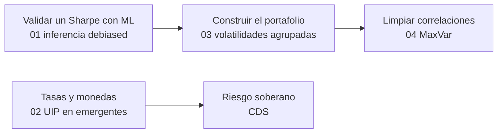

# Tópicos de finanzas — 25 de noviembre de 2026

- **Ventana de búsqueda:** 18 al 25 de noviembre de 2026.
- **Lector:** data scientist con base en riesgo de crédito que construye un perfil de finanzas de nivel máster y reproduce en Python con datos públicos.
- **Informe anterior:** [2026-11-18](https://github.com/neiderolaya26/learning/blob/topicos/topicos/finanzas/2026-11-18.md).
- **Artefacto:** https://claude.ai/artifact/BEhS4jnBe9sYYoRdueyUcP

**Método.** Revisé la lista semanal de arXiv q-fin (89 envíos, con listados cruzados) y econ.EM (28), y la lista de working papers de NBER ordenada por fecha de publicación (w36037 a w36060 son nuevos de noviembre; w36052 y w36057 tienen fecha de emisión del 19 nov 2026). Esta vez no revisé SSRN, las revistas (JF, JFE, RFS, JFQA) ni los feeds de bancos centrales. Confirmé con la API de arXiv que las tres piezas de arXiv son v1 dentro de la ventana (2611.30843 tiene además una v2 del 24 nov). Quedaron 11 finalistas. Leí el texto completo de las 4 piezas elegidas: los tres PDF de arXiv y el PDF de NBER w36052 (146 páginas con apéndice). Ningún paper publica código. Descarté *Which Loans, Not How Many* (arXiv 2611.28342) porque ya lo cubrió el tópico de riesgo del 24 nov. Ninguna pieza repite las ediciones anteriores; la 01 continúa el tema de la auditoría de backtests con LLM de la semana pasada y la 03 y la 04 continúan el de covarianzas y PCA.

Etiquetas: **[medido]** resultado reportado por los autores; **[autores]** afirmación o interpretación de los autores; **[inferencia]** opinión del informe.

## Diagrama

## 01. Sharpe Ratio Inference after Machine Learning

Sander Barendse y Ming Cheng (Universidad de Ámsterdam y Tinbergen Institute). arXiv v1, 22 nov 2026 (versión del texto del 20 nov). https://arxiv.org/abs/2611.29747

#### Contexto previo: el Sharpe ratio y su error de estimación

**Qué es:** el ratio de Sharpe (*Sharpe ratio*, SR) mide cuánto retorno en exceso da una estrategia por unidad de volatilidad: SR = E[r] / desv(r). Es la vara con la que la literatura de asset pricing con ML decide si una señal "vale" económicamente.

**De qué se compone:** (1) una señal o pronóstico del retorno de cada activo; (2) una regla de portafolio que convierte señales en pesos, por ejemplo comprar el decil más alto y vender el más bajo (*long-short*) o subir la exposición al índice cuando el pronóstico es alto (*market timing*); (3) los retornos realizados de ese portafolio; (4) la media y la varianza de esos retornos; (5) un error estándar para construir un intervalo de confianza o comparar contra un benchmark.

**Cómo se ha trabajado:** Jobson y Korkie (1981), Memmel (2003), Lo (2002) y Ledoit y Wolf (2008) dieron errores estándar para el Sharpe y para la diferencia de dos Sharpe, tomando los retornos del portafolio como datos observados. Kan y Zhou (2007) estudiaron cómo el error al estimar medias y covarianzas degrada la cartera óptima. Gu, Kelly y Xiu (2020) popularizaron predecir retornos con 94 características de empresas y redes neuronales, y evaluar las señales con el Sharpe de portafolios long-short. En econometría, el aprendizaje automático doble o *debiased* (*double/debiased machine learning*, DML) de Chernozhukov et al. (2018) corrige el sesgo que deja un modelo flexible al estimar un parámetro de interés.

**Dónde está la dificultad:** los métodos clásicos tratan los pesos del portafolio como dados, pero en la práctica salen de un modelo estimado. Si el error de la señal es grande, el intervalo de confianza del Sharpe queda mal centrado o demasiado estrecho. Además, se suele creer que con miles de acciones ese error se promedia y desaparece, lo cual no es obvio cuando las variables tienen componentes comunes.

**Ejemplo intuitivo (números ilustrativos):** una estrategia muestra un Sharpe anual de 0,50 con error estándar de 0,20: t = 2,5 y "significativo". Si el error de estimar la señal agrega incertidumbre y el error estándar real es 0,28, t = 1,8 y ya no pasa el umbral de 5 %. El Sharpe puntual casi no cambia; cambia la confianza.

**Cómo se conecta:** el paper construye un estimador del Sharpe que descuenta el error de la señal. Para el lector es lo mismo que reportar un intervalo del AUC que reconozca que el modelo fue entrenado con datos limitados, no solo el ruido de la muestra de prueba.

- **Qué cambia:** un estimador del Sharpe con momentos ortogonales de Neyman y validación cruzada cronológica (*cross-fitting*) que corrige el error de estimar la señal con ML y da intervalos válidos para el Sharpe y su diferencia con un benchmark.
- **Por qué importa:** separa "el modelo predice algo" de "tenemos evidencia estadística de que la estrategia supera al índice".
- **Evidencia y limitaciones:** [medido] En simulación con N = 500 activos, el test convencional rechaza un nulo verdadero hasta 54,4 % de las veces (nominal 5 %); el corregido, 4,5–7,4 %. Con los datos de Gu et al. (1987–2021), el long-short de NN1 conserva t = 10,95; NN2, NN4 y NN5 pierden significancia en *market timing*. [autores] Requiere que el error del ML caiga a una tasa mínima. [inferencia] Usa CRSP, que es licenciado.
- **Experimento sugerido:** simula 300 activos con una señal común no lineal, entrena un LightGBM en 360 meses y evalúa en 360. Baseline: t-stat convencional del long-short. Métrica: cobertura del intervalo de 95 % en 200 réplicas; éxito si la versión con *cross-fitting* queda más cerca de 95 %.
- **Código y datos:** sin código. Características y predictores en las páginas de Dacheng Xiu y Amit Goyal según los autores (no verificadas); CRSP licenciado.

#### Cómo lo aplicas tú

**Veredicto: Probar en el lab.** Conecta directo con tu validación de modelos y con la auditoría de backtests de la semana pasada, y se prueba con datos simulados.

- **Lo que ya sabes que te sirve:** la validación fuera de tiempo, XGBoost y LightGBM, la calibración y la diferencia entre métricas en desarrollo y en producción. Ya sabes que un modelo elegido entre varios rinde peor fuera de muestra que en desarrollo; el paper lleva esa intuición a un intervalo de confianza.
- **Lo nuevo para ti:** el Sharpe como métrica de una señal, la regla *long-short* suavizada con una logística, el jacobiano de los pesos respecto a la señal, los errores estándar de Newey-West y el DML con momentos ortogonales. [inferencia] El DML no está en tu perfil, pero pertenece a la inferencia causal aplicada que estás aprendiendo y lo volverás a ver en efectos de tratamiento. El esfuerzo es moderado: hay álgebra de momentos, pero no redes grandes.
- **Dónde lo aplicas:**
  - En tu trabajo: [inferencia] cuando comparas la utilidad esperada de una política nueva contra el corte actual, la diferencia viene de un modelo estimado; vale reportar un intervalo que incluya esa incertidumbre, por ejemplo reentrenando por bloques de tiempo.
  - En tus repos: el pendiente de `credit-risk-agent-lab` es una política que no supera al corte por subgrado. Antes de declarar perdedor o ganador, mide la diferencia de utilidad con intervalos por *cross-fitting* temporal.
- **Primer paso (≤ 2 h):** simula en numpy 200 réplicas de una estrategia con señal estimada por regresión lineal sobre 20 variables, y mide cuántas veces el intervalo convencional del Sharpe contiene el Sharpe verdadero.

#### Resumen ampliado en español

**Problema y motivación:** la literatura evalúa señales de ML con el Sharpe de portafolios armados con ellas, pero calcula su intervalo de confianza como si la señal fuera conocida. Los autores preguntan cuánta confianza merece ese Sharpe cuando la señal es estimada, y si un panel grande de acciones resuelve el problema.

**Conceptos clave:**

- Señal verdadera (*true return signal*): el retorno esperado condicional a las variables; el objetivo es el Sharpe poblacional de la regla evaluada en esa señal.
- Momento ortogonal de Neyman (*Neyman-orthogonal moment*): condición de estimación que no se mueve, en primer orden, ante errores pequeños en la señal o la covarianza.
- Validación cruzada cronológica (*time-series cross-fitting*): estimar la señal y la covarianza solo con datos anteriores al bloque de evaluación.
- Jacobiano de pesos (*portfolio-weight Jacobian*): cuánto cambia cada peso cuando cambia la señal de cada activo; entra en la corrección.
- Long-short suavizado (*smoothed long-short*): versión del portafolio de deciles que usa una función logística con ancho τ para que los pesos sean derivables.
- Errores de Newey-West (*HAC standard errors*): errores estándar robustos a autocorrelación y heterocedasticidad.

**Datos:** simulación con 360 fechas de ajuste, 60 de validación y 360 de evaluación, N de 50 a 500 activos y R² poblacional de 5 %. Aplicación: CRSP mensual con 94 características, sus interacciones con 8 predictores macro de Welch y Goyal y la industria a dos dígitos, como en Gu et al. (2020); evaluación de enero de 1987 a diciembre de 2021 (420 meses, unos 2,86 millones de observaciones acción-mes).

**Método paso a paso:**

1. Se estima la señal con un modelo de ML (OLS-3, elastic net, PCR, PLS, redes NN1 a NN5) y la covarianza de los residuos solo con datos de entrenamiento.
2. Se definen los pesos como función de la señal: *market timing* del S&P 500 ponderado por capitalización o long-short de deciles suavizado (τ = 0,001 en la aplicación).
3. A los momentos estándar (media y segundo momento del retorno del portafolio) se les resta un término de corrección que usa el jacobiano, la señal estimada, el retorno realizado y la covarianza. En palabras: se descuenta cuánto del retorno medido se debe a errores de la señal que por azar coinciden con el retorno.
4. Con los momentos corregidos se calcula SR = θ1 / raíz(θ2 − θ1²) y sus errores estándar por el método delta.
5. Para comparar con un benchmark, se resta el Sharpe del índice y se usa la covarianza conjunta de Newey-West con cinco rezagos.

**Resultados:**

[medido] Simulación, tasas de rechazo de un nulo verdadero al 5 % (1.000 réplicas):

| Estrategia | Convencional | Corregido |
|---|---|---|
| Market timing, N = 50 | 6,9–10,5 % | 4,5–5,3 % |
| Market timing, N = 500 | 34,0–54,4 % | 4,9–7,4 % |
| Long-short (τ = 0,05) | 12,0–19,8 % | 4,8–10,9 % |
| Diferencia long-short menos índice | 10,6–15,2 % | 5,0–8,2 % |

[medido] Aplicación, *market timing* del S&P 500: la inferencia convencional rechaza un Sharpe cero en las 9 estrategias y la corregida en 6. NN2 pasa de Sharpe 0,492 (t = 2,50) a 0,487 (t = 1,78); su error estándar sube de 0,196 a 0,273. Los errores estándar suben 29–43 % para NN2 a NN5 y bajan para NN1 y los modelos lineales. Ninguna estrategia de *timing* supera a los índices con ninguno de los dos métodos.

[medido] Aplicación, long-short: los dos métodos rechazan un Sharpe cero en las mismas 7 estrategias. NN1 tiene Sharpe anual de 2,202 (t = 9,90) y corregido 2,172 (t = 10,95); su ventaja sobre el S&P 500 es 1,594 convencional y 1,564 corregida. Elastic net, PCR, PLS, NN1 y NN2 superan a los tres índices con ambos métodos. La supuesta peor rentabilidad de NN4 y NN5 frente a los índices deja de ser significativa tras corregir (NN4 contra el S&P: t de −2,01 a −0,28).

**Robustez y limitaciones:**

- [autores] La validez exige que el error del ML caiga más rápido que T elevado a −1/4; lo verifican para una red neuronal *pooled*, no para cualquier modelo.
- [autores] El long-short exige suavizar los pesos y los resultados dependen del ancho τ; con τ muy pequeño la corrección se vuelve inestable.
- [autores] La corrección no siempre agranda los intervalos: a veces los achica.
- [inferencia] No hay código, y los datos de CRSP son licenciados; la réplica directa queda fuera del alcance del lector.

**Aporte frente a trabajos previos:** extiende la inferencia clásica del Sharpe (Lo; Ledoit y Wolf) al caso de señales estimadas, y lleva el DML de Chernozhukov et al. a métricas de portafolio sin bootstrap ni reentrenamientos. También vale para equivalente cierto, VaR y ES gaussianos y RORAC, que son funciones de los mismos dos momentos.

**Cómo aplicarlo:** reporta siempre el intervalo del Sharpe o de la diferencia contra el benchmark, y no solo el punto, cuando la señal sale de un modelo.

**Glosario breve:** momento ortogonal; *cross-fitting*; jacobiano de pesos; long-short suavizado; Newey-West.

**Frase para recordar:** el Sharpe de una señal de ML casi no cambia al corregirlo; lo que cambia es cuánto puedes confiar en él.

## 02. Long-run Uncovered Interest Parity in Emerging Markets

Alessandro Rebucci (Johns Hopkins), Sinem Yagmur Toraman (Mecanismo Europeo de Estabilidad), Giorgio Valente (HKIMR) y Nicolò Capirone (Johns Hopkins). NBER WP 36052, emitido el 19 nov 2026. https://www.nber.org/papers/w36052

#### Contexto previo: paridad descubierta de tasas de interés

**Qué es:** la paridad descubierta de tasas de interés (*uncovered interest parity*, UIP) dice que la moneda con tasa más alta debería depreciarse, en promedio, justo lo que compensa ese diferencial. Si un TES a cinco años paga 4 puntos más al año que un Treasury, el peso debería perder cerca de 4 % anual frente al dólar.

**De qué se compone:** (1) el tipo de cambio spot S (pesos por dólar); (2) las tasas de los bonos locales y de EE. UU. al mismo plazo; (3) la depreciación realizada en ese plazo; (4) la regresión de Fama: Δs = α + β·(i_local − i_EEUU) + error, donde la UIP exige β = 1. Si β < 1, el inversionista que compra la moneda de tasa alta gana en promedio: es el *carry trade*.

**Cómo se ha trabajado:** Fama (1984) mostró que a plazos cortos β suele ser menor que uno e incluso negativo, el "rompecabezas de la prima a plazo". Meredith y Chinn (1998) y Chinn y Meredith (2004) encontraron que con bonos de 5 a 10 años la UIP se cumple bastante mejor para monedas del G10. Lustig, Stathopoulos y Verdelhan (2019) mostraron que la rentabilidad del *carry* con bonos largos tiende a desaparecer. Du y Schreger (2016) mostraron que los bonos en moneda local de emergentes tienen un diferencial de crédito, es decir, no son libres de riesgo.

**Dónde está la dificultad:** en emergentes la tasa local paga dos cosas: la depreciación esperada y una compensación por riesgo soberano. Una regresión que solo mira el diferencial de tasas mezcla ambas, y β puede salir lejos de uno sin que la paridad "falle" en el sentido económico. Además, los datos largos son pocos y los plazos se solapan, lo que exige errores estándar especiales.

**Ejemplo intuitivo (números ilustrativos):** diferencial anual de 5 %, del cual 3 % es depreciación esperada y 2 % es prima por riesgo soberano. Si regresas la depreciación sobre el diferencial completo, β queda cerca de 3/5 = 0,6. Si agregas el CDS (que mide esos 2 puntos), el coeficiente del diferencial puede volver cerca de 1.

**Cómo se conecta:** el paper prueba la UIP a cinco años en 9 emergentes, entre ellos Colombia, y le agrega el CDS soberano. Para el lector es lo mismo que separar en la tasa de un crédito la parte que paga pérdida esperada de la parte que paga costo de fondeo.

- **Qué cambia:** primera comparación sistemática de la UIP a varios plazos entre G10 y emergentes con curvas cero cupón locales, y evidencia de que el riesgo soberano explica la falla a cinco años.
- **Por qué importa:** da una lectura de la curva de TES y del peso colombiano que distingue depreciación esperada y prima de crédito.
- **Evidencia y limitaciones:** [medido] A cinco años, β es 0,972 en el G10 y −0,304 en EM9 (unidad rechazada). En la muestra con CDS (2000–2015), β de EM9 pasa de 0,415 a 1,206 al agregar el CDS. [autores] Ningún modelo le gana a una caminata aleatoria fuera de muestra. [inferencia] Curvas de Bloomberg, licenciadas.
- **Experimento sugerido:** con FRED, toma el peso mexicano (DEXMXUS) y las tasas a 10 años de México y EE. UU. (IRLTLT01MXM156N, IRLTLT01USM156N). Baseline: regresión de la depreciación a 5 años sobre el diferencial. Métrica: β y su error de Newey-West con 60 rezagos; éxito si reproduces un β muy por debajo de 1.
- **Código y datos:** sin código. Tickers de Bloomberg listados en el apéndice F.

#### Cómo lo aplicas tú

**Veredicto: Solo leer.** Es renta fija y monedas, un tema que todavía no has trabajado, pero te da una lectura muy útil de las tasas colombianas.

- **Lo que ya sabes que te sirve:** la regresión con efectos fijos, las series de tiempo de tu formación de economista y, sobre todo, el pricing de crédito: sabes que una tasa incluye pérdida esperada, prima de riesgo y costo de fondeo. El paper hace esa misma descomposición con la tasa de un país.
- **Lo nuevo para ti:** la UIP, los bonos cero cupón, los CDS soberanos, los errores de Driscoll-Kraay con inferencia *fixed-b* y la estacionariedad del tipo de cambio real. La renta fija avanzada está en "lo que todavía no ha trabajado"; el esfuerzo es moderado a alto.
- **Dónde lo aplicas:**
  - En tu trabajo: [inferencia] en una fintech de consumo, el costo de fondeo sigue las tasas locales; separar cuánto del nivel de tasas es riesgo país ayuda a leer escenarios de fondeo y de *pricing* en el presupuesto.
  - En tus repos o rutas: encaja en el módulo de renta fija y tasas de tu ruta de Finanzas, como ejemplo latinoamericano de por qué la tasa local no es libre de riesgo.
- **Primer paso (≤ 2 h):** baja de FRED el peso mexicano y las tasas a 10 años de México y EE. UU., construye la depreciación a 5 años y corre la regresión de Fama con errores de Newey-West.

#### Resumen ampliado en español

**Problema y motivación:** la UIP falla a plazos cortos en todas partes, pero a 5–10 años se cumple aproximadamente en el G10. ¿Pasa lo mismo en emergentes? Chernov y Dahlquist (2023) sugirieron que no y conjeturaron que el riesgo soberano o un tipo de cambio real no estacionario podrían explicarlo. Los autores lo prueban.

**Conceptos clave:**

- Paridad descubierta de largo plazo (*long-run UIP*, LRUIP): la UIP medida con bonos y depreciaciones a varios años.
- Bono cero cupón en moneda local (*local-currency zero-coupon yield*): tasa de un bono del gobierno sin cupones, en la moneda del país.
- CDS soberano (*sovereign credit default swap*): precio anual de asegurarse contra el impago del gobierno; en emergentes se cotiza sobre deuda en dólares.
- Brecha del tipo de cambio real (*real exchange rate gap*): diferencia entre el tipo de cambio real y su nivel de largo plazo; resume los fundamentales no medidos.
- Errores de Driscoll-Kraay (*Driscoll-Kraay standard errors*): robustos a autocorrelación por ventanas solapadas y a correlación entre países.
- Inferencia *fixed-b* (*fixed-b critical values*): valores críticos que corrigen el tamaño cuando el ancho de banda es grande frente a la muestra.

**Datos:** curvas cero cupón mensuales en moneda local y tipos de cambio de Bloomberg, 2000–2025, para el G10 y 21 emergentes con curva a cinco años en al menos la mitad del periodo. EM9 son las nueve monedas con flotación comparable y sin episodios de caída libre: Brasil, Chile, Colombia, Israel, Corea, México, Polonia, Sudáfrica y Tailandia. Las regresiones por plazo terminan en diciembre de 2015 para que el plazo de 10 años tenga datos. Para Colombia, la curva va de 2005 a 2022.

**Método paso a paso:**

1. Regresión de Fama por plazo, de 3 meses a 10 años: Δs(t, t+k) = β·(i_local − i_EEUU) + efecto fijo de moneda + error. La UIP exige β = 1.
2. Un modelo de no arbitraje con mercados incompletos y bonos con riesgo de impago (siguiendo a Du y Schreger, y Jiang, Krishnamurthy y Lustig) indica qué controles agregar.
3. Regresión aumentada a 5 años: se agrega el CDS a 5 años, la brecha del tipo de cambio real o ambos, en la muestra donde hay CDS.
4. Pruebas con calificaciones de crédito, inflación esperada y la base de los Treasuries, y regresiones moneda por moneda.

**Resultados:**

[medido] Pendiente β de la regresión de Fama, muestra completa:

| Grupo | 3 meses | 1 año | 5 años | 10 años |
|---|---|---|---|---|
| G10 | 0,229 | 0,030 | 0,972 | 0,398 |
| EM9 | 0,419 | −0,220 | −0,304 | −0,715 |

[medido] En EM9 se rechaza β = 1 desde el plazo de 2 años; en el G10 no se rechaza en ningún plazo. Otros emergentes (EMO) dan −0,014 a 5 años.

[medido] Regresión aumentada a 5 años, muestra con CDS, 2000–2015 (Tabla 3):

| EM9 | Sin CDS | Con CDS | Con tipo de cambio real |
|---|---|---|---|
| β del diferencial | 0,415 | 1,206 | 0,326 |
| Coeficiente del CDS | — | −2,172 | — |
| R² | 0,017 | 0,118 | 0,450 |

- [medido] En el panel conjunto, la pendiente total de EM9 con CDS es 1,140 y no se distingue de uno. En el G10 el CDS casi no cambia el ajuste (R² de 0,185 a 0,190).
- [medido] Por moneda, el CDS sube la pendiente en 7 de las 9; las mayores subidas son Sudáfrica, Polonia, Brasil y Colombia. En Colombia, β pasa de −1,268 a 0,046.
- [medido] La pérdida esperada explica cerca de una décima parte del CDS medio de EM9; la corrección funciona por la prima de riesgo. Con calificaciones en vez de CDS, la pendiente cae −0,228 por cada escalón de deterioro.
- [medido] Ninguna especificación supera a una caminata aleatoria con deriva fuera de muestra.

**Robustez y limitaciones:**

- [autores] Cerca de la mitad del salto de −0,304 a 1,206 viene del cambio de muestra y la otra mitad del control por CDS.
- [autores] El CDS se cotiza sobre deuda en dólares y no captura la erosión de la deuda local por inflación; por eso Turquía no se corrige.
- [autores] Con la brecha del tipo de cambio real, el coeficiente del diferencial deja de estar restringido; esa columna no dice nada sobre el canal de crédito.
- [inferencia] Muestra corta para plazos de cinco años (unos 16 años, ventanas muy solapadas) y datos licenciados.

**Aporte frente a trabajos previos:** extiende la UIP de largo plazo de Chinn y Meredith a emergentes, responde la conjetura de Chernov y Dahlquist y conecta con la literatura que liga monedas y riesgo soberano (Della Corte et al.; Du y Schreger).

**Cómo aplicarlo:** al leer una tasa local alta, pregunta cuánto es depreciación esperada y cuánto es prima de riesgo país antes de concluir que "paga más".

**Glosario breve:** UIP; carry trade; bono cero cupón; CDS soberano; tipo de cambio real; Driscoll-Kraay.

**Frase para recordar:** en emergentes la paridad no falla: la tasa local paga también el riesgo del gobierno, y al descontarlo la paridad reaparece.

## 03. Exploiting Common Volatility Dynamics in High-Dimensional Portfolio Selection

Dominik Ammon y Julian Heinz (Universidad de Ratisbona). arXiv v1, 18 nov 2026. https://arxiv.org/abs/2611.23952

#### Contexto previo: estimar covarianzas para muchos activos

**Qué es:** la matriz de covarianzas (*covariance matrix*) resume cuánto varía cada activo y cuánto se mueven juntos. El portafolio de mínima varianza global (*global minimum variance*, GMV) es el que minimiza la volatilidad usando solo esa matriz, sin pronosticar retornos.

**De qué se compone:** se suele separar en Σ = D·R·D, donde D tiene las volatilidades de cada activo y R es la matriz de correlaciones. Con N activos hay N volatilidades y N(N−1)/2 correlaciones: con 450 acciones, más de 100.000 parámetros. Los pesos del GMV son w = Σ⁻¹·1 / (1'·Σ⁻¹·1), así que la matriz se invierte.

**Cómo se ha trabajado:** RiskMetrics (1996) popularizó el EWMA y Engle (2002) el modelo de correlación condicional dinámica (*dynamic conditional correlation*, DCC). Ledoit y Wolf propusieron encoger la matriz muestral hacia un objetivo (2004) y luego el encogimiento no lineal (*nonlinear shrinkage*), que corrige cada valor propio. Laloux et al. (1999) mostraron con matrices aleatorias que muchos valores propios son ruido. Para la volatilidad, Corsi (2009) usó modelos HAR y Andersen et al. (2003) la volatilidad realizada con datos diarios o intradía. DeMiguel et al. (2009) mostraron que el 1/N es difícil de superar.

**Dónde está la dificultad:** cuando N es grande frente al número de observaciones T, la matriz muestral es muy ruidosa y su inversa amplifica el error. Hay dos salidas: imponer estructura (factores, grupos), que agrega sesgo, o dejar libertad, que agrega varianza. Es un dilema de sesgo y varianza.

**Ejemplo intuitivo (números ilustrativos):** con 2 activos de volatilidad 20 % y correlación 0,5, el GMV pone 50/50 y la volatilidad cae a 17,3 %. Si estimas la correlación con ruido en 0,9, el portafolio sigue 50/50 pero crees que el riesgo es 19,5 %; con 400 activos, ese tipo de error cambia los pesos y produce posiciones extremas.

**Cómo se conecta:** la pieza 03 ataca las volatilidades y la 04 las correlaciones. Para el lector es la misma idea del *pooling* en un scorecard: agrupar segmentos pequeños para estimar con menos ruido.

- **Qué cambia:** pronostica la volatilidad mensual de cientos de acciones con modelos ARMA cuyos coeficientes se comparten entre todas las acciones o dentro de cada industria, y muestra que ese *pooling* equivale a un modelo de factores dinámicos.
- **Por qué importa:** una regla simple, compartir la dinámica, baja la volatilidad del portafolio más que los modelos de factores latentes.
- **Evidencia y limitaciones:** [medido] En 1990–2025, el GMV con ARMA agrupado de mercado tiene volatilidad anual de 9,13 %, frente a 11,44 % del encogimiento no lineal incondicional (−20,2 %) y 9,87 % del modelo GDFM. [autores] No incluye costos; la rotación mensual es de 1,58. [inferencia] Datastream es licenciado.
- **Experimento sugerido:** con los 49 portafolios de industrias diarios de Kenneth French, calcula la volatilidad realizada mensual y pronostica con AR(1) por industria frente a un AR(1) con coeficiente común. Baseline: volatilidad histórica de 12 meses. Métrica: volatilidad fuera de muestra del GMV; éxito si el modelo común es la más baja.
- **Código y datos:** código disponible a solicitud según los autores; precios de LSEG Datastream (licenciados); tasa libre de riesgo de Kenneth French.

#### Cómo lo aplicas tú

**Veredicto: Probar en el lab.** Es un ejercicio de series de tiempo que ya sabes hacer, aplicado a riesgo de mercado, con datos públicos sustitutos.

- **Lo que ya sabes que te sirve:** ARMA y series de tiempo de tu formación de economista, la validación con ventanas móviles y la idea de agrupar segmentos para reducir varianza, como cuando agrupas categorías raras en un scorecard o compartes parámetros entre cosechas parecidas.
- **Lo nuevo para ti:** la volatilidad realizada, el DCC, el encogimiento no lineal y el portafolio de mínima varianza. Está en tu ruta de Finanzas (portafolios y riesgo de mercado); el esfuerzo es bajo a moderado, porque `arch` y `scikit-learn` hacen casi todo.
- **Dónde lo aplicas:**
  - En tu trabajo: [inferencia] al pronosticar mora o volatilidad de pérdidas por segmento, un modelo con dinámica común y nivel propio de cada segmento puede ganarle a modelos separados cuando cada segmento tiene poca historia.
  - En tus repos o rutas: encaja en el módulo de riesgo de mercado de tu ruta de Finanzas y como idea para el forecasting de cartera por cosecha.
- **Primer paso (≤ 2 h):** baja las 49 industrias diarias de French, calcula la volatilidad realizada mensual en logaritmos y compara el error de pronóstico de un AR(1) por industria contra un AR(1) con coeficiente común estimado en *panel*.

#### Resumen ampliado en español

**Problema y motivación:** con cientos de acciones y solo 120 meses por ventana, estimar cada volatilidad por separado es ruidoso. Las volatilidades de las acciones suben y bajan juntas. ¿Conviene capturar esa similitud con factores latentes o compartiendo los parámetros dinámicos?

**Conceptos clave:**

- Volatilidad realizada (*realized volatility*, RV): raíz de la suma de los retornos diarios al cuadrado dentro de un mes.
- ARMA agrupado (*pooled ARMA*): modelo autorregresivo de media móvil cuyos coeficientes son iguales para todas las acciones de un grupo; cada acción conserva su nivel y sus innovaciones.
- Modelo de factores estático (*static factor model*, SFM): componentes principales de las volatilidades.
- Modelo de factores dinámico generalizado (*generalized dynamic factor model*, GDFM): factores con dinámica propia por acción (Forni et al.).
- DCC realizado con encogimiento no lineal (RDCC-NL): correlaciones dinámicas actualizadas con matrices de correlación realizada y un objetivo de largo plazo encogido.
- Error de escala y de dispersión (*scale and dispersion error*): el primero es un error común a todas las acciones, que no cambia los pesos del GMV; el segundo es el error en las diferencias entre acciones, que sí los cambia.

**Datos:** retornos diarios totales de los miembros históricos del S&P 500 (LSEG Datastream), enero de 1980 a febrero de 2025. Ventanas móviles de 120 meses; en promedio 445 acciones por ventana; evaluación de enero de 1990 a febrero de 2025 (8.841 días).

**Método paso a paso:**

1. Se calcula la volatilidad realizada mensual y se modela su logaritmo, sin la media de cada acción.
2. Se estiman tres niveles de *pooling* ARMA(1,1): mercado (un solo par de coeficientes), industria (cinco grupos de French) y univariado (uno por acción); y se comparan con SFM, GDFM y un modelo de factores aproximado.
3. Se prueba que el ARMA agrupado tiene una representación exacta de factores dinámicos con cargas propias de cada acción y filtros comunes por grupo.
4. Cada pronóstico de volatilidad se combina con el mismo modelo de correlación RDCC-NL: Σ = D·R·D.
5. Se arman portafolios GMV, solo largos y 130/30, se rebalancean cada mes y se mide la volatilidad fuera de muestra con pruebas de diferencia.

**Resultados:**

[medido] Portafolios GMV, enero de 1990 a febrero de 2025 (Tabla 1):

| Método | Volatilidad anual (%) | Sharpe | Rotación mensual |
|---|---|---|---|
| 1/N | 18,56 | 0,54 | 0,04 |
| Encogimiento no lineal incondicional | 11,44 | 0,58 | 0,29 |
| RDCC-NL (volatilidad del DCC) | 10,34 | 0,82 | 1,66 |
| SFM-RDCC-NL | 10,09 | 0,77 | 1,64 |
| GDFM-RDCC-NL | 9,87 | 0,74 | 1,53 |
| ARMA univariado | 9,78 | 0,86 | 1,72 |
| ARMA por industria | 9,27 | 0,87 | 1,61 |
| ARMA de mercado | 9,13 | 0,89 | 1,58 |

- [medido] La diferencia de volatilidad del ARMA de mercado con cada alternativa es significativa al 1 %.
- [medido] Solo largos: ARMA de mercado 9,60 % (el mejor) frente a 10,18 % del GDFM. En 130/30 gana el ARMA por industria con 10,20 %, dos puntos básicos por debajo del de mercado.
- [medido] Los ARMA agrupados tienen la mayor correlación de rango mediana entre pronóstico y realizado (0,702) y el menor error de dispersión (0,335); el SFM tiene el menor error de escala.
- [autores] Resultados robustos a ventanas de 15 años, a otra especificación de correlación, a ARMA de mayor orden y a subperiodos.

**Robustez y limitaciones:**

- [autores] No evalúan costos de transacción; solo reportan la rotación como indicador.
- [autores] El *pooling* introduce sesgo cuando las dinámicas son heterogéneas; el resultado es un balance de sesgo y varianza, no una ley.
- [inferencia] Los GMV sin restricciones tienen apalancamiento bruto cercano a 4,5 y rotación mayor a 1,5 al mes; en la práctica, los costos podrían cambiar el orden.
- [inferencia] Sin código público ni datos libres, la réplica exacta no es posible.

**Aporte frente a trabajos previos:** lleva el enfoque de panel de Bollerslev et al. (2018) a portafolios de alta dimensión y lo conecta formalmente con los factores dinámicos de Forni et al. y Barigozzi y Hallin. Mueve la atención de la comunalidad de los retornos a la comunalidad de las volatilidades.

**Cómo aplicarlo:** si tienes muchas series cortas con dinámicas parecidas, prueba primero un modelo con coeficientes compartidos antes que modelos de factores complejos.

**Glosario breve:** volatilidad realizada; ARMA agrupado; GDFM; DCC; encogimiento no lineal; error de dispersión.

**Frase para recordar:** para el portafolio de mínima varianza importa ordenar bien las volatilidades, no acertar su nivel; compartir la dinámica ayuda a ordenarlas.

## 04. Cleaning correlation matrices with external information: the Maximum Variance estimator

Sébastien Valeyre (Machina Capital y Valeyre Research). arXiv v1, 23 nov 2026; v2, 24 nov 2026. https://arxiv.org/abs/2611.30843

#### Contexto previo: limpieza de matrices de correlación

El contexto general sobre estimar covarianzas con muchos activos está en la pieza 03. Aquí falta lo específico de los vectores propios.

**Qué es:** limpiar una matriz de correlación (*correlation matrix cleaning*) es reemplazar la matriz muestral por una versión con menos ruido. Toda matriz se escribe con valores propios (cuánta varianza hay en cada dirección) y vectores propios (qué combinación de activos es cada dirección).

**De qué se compone:** la teoría de matrices aleatorias (Marchenko y Pastur, 1967) dice cuánto ruido esperar en los valores propios cuando N no es pequeño frente a T: los grandes salen sobreestimados y los pequeños subestimados. Los estimadores rotacionalmente invariantes (*rotationally invariant estimators*, RIE), como el de Bun, Bouchaud y Potters, corrigen los valores propios pero dejan los vectores propios muestrales.

**Cómo se ha trabajado:** recorte de valores propios (Laloux et al., 1999), encogimiento lineal y no lineal de Ledoit y Wolf, y modelos con estructura impuesta: índice único, correlación constante, bloques, factores con residuo disperso (Fan et al., 2013) o agrupamientos jerárquicos. En asset pricing, el PCA proyectado y el PCA instrumentado (Kelly et al., 2019) atan los factores a características observables.

**Dónde está la dificultad:** si los vectores propios son ruidosos, ningún ajuste de los valores propios los arregla. Pero el gestor sí sabe algo de ellos: qué activos son acciones, bonos o monedas. La pregunta es cómo usar esa información sin imponer una estructura demasiado rígida.

**Ejemplo intuitivo (números ilustrativos):** 6 activos, 3 acciones y 3 bonos. La correlación entre acciones es 0,6 en promedio, pero la muestra da 0,45, 0,72 y 0,63 por ruido. Un estimador por grupos explica cada correlación con la carga de cada activo en el "portafolio de máxima varianza" de su grupo y suaviza esas diferencias.

**Cómo se conecta:** el paper usa los grupos para restringir los vectores propios principales. Para el lector es como usar el subgrado o el producto para estructurar un modelo cuando hay pocas observaciones por celda.

- **Qué cambia:** propone el estimador MaxVar: los vectores propios principales se restringen a combinaciones de los portafolios de máxima varianza de cada grupo y el resto del espectro se reemplaza por un solo valor propio.
- **Por qué importa:** da una matriz definida positiva con unos n parámetros en lugar de n²/2, útil cuando hay pocas observaciones.
- **Evidencia y limitaciones:** [medido] En 47 futuros, 1993–2018, el Sharpe de la cartera de paridad de riesgo es 1,28 con MaxVar, 1,24 con RIE y 1,17 con la matriz muestral; con ventana corta, 1,05 frente a 0,93 del RIE. [autores] El error de un Sharpe en 26 años es cerca de 0,2 y no probaron la significancia. [inferencia] Una sola cartera, sin costos.
- **Experimento sugerido:** con los 49 portafolios de industrias de Kenneth French y 10 sectores como grupos, estima la correlación con 60 semanas. Baselines: matriz muestral y Ledoit-Wolf de `scikit-learn`. Métrica: volatilidad fuera de muestra del GMV; éxito si MaxVar es la más baja.
- **Código y datos:** sin código; datos de futuros no publicados.

#### Cómo lo aplicas tú

**Veredicto: Probar en el lab.** Son unas 30 líneas de numpy con datos públicos y te enseñan valores y vectores propios con un uso concreto.

- **Lo que ya sabes que te sirve:** álgebra lineal básica de econometría, la regularización (es la lógica de ridge: menos parámetros, menos varianza, algo de sesgo) y el uso de conocimiento de negocio para estructurar un modelo, como cuando segmentas un scorecard por producto.
- **Lo nuevo para ti:** la teoría de matrices aleatorias, los RIE, el problema generalizado de valores propios y la cartera de paridad de riesgo. Está en tu ruta de Finanzas (portafolios y riesgo); el esfuerzo es moderado.
- **Dónde lo aplicas:**
  - En tu trabajo: [inferencia] si estimas correlaciones de default entre segmentos o cosechas para un capital económico, agrupar por producto y región con este método da una matriz estable aunque tengas pocos meses.
  - En tus repos o rutas: es un buen ejercicio de la ruta de Finanzas y una alternativa a explorar si algún día modelas pérdidas correlacionadas en `credit-risk-agent-lab`.
- **Primer paso (≤ 2 h):** implementa los cuatro pasos del paper en numpy (portafolio de máxima varianza por grupo, diagonalización restringida, completar con un valor propio, normalizar) y compáralo con la matriz muestral en datos simulados con estructura de bloques.

#### Resumen ampliado en español

**Problema y motivación:** con n activos y T observaciones, la matriz de correlación muestral es ruidosa en cuanto n no es pequeño frente a T, y la optimización de portafolios amplifica ese ruido al invertirla. Los RIE limpian los valores propios, pero no los vectores propios. El autor propone usar una partición de los activos, conocida de antemano, para corregir también los vectores propios.

**Conceptos clave:**

- Portafolio de máxima varianza de un grupo (*maximum-variance portfolio*): el vector propio principal de la submatriz de correlación del grupo, completado con ceros.
- Vectores propios restringidos (*constrained eigenvectors*): los que diagonalizan la matriz dentro del subespacio que generan esos portafolios.
- Completar el espectro (*spectrum completion*): en el resto del espacio, reemplazar la matriz por un múltiplo de la identidad que conserva la traza.
- Estimador rotacionalmente invariante (*rotationally invariant estimator*, RIE): corrige solo valores propios.
- Paridad de riesgo (*risk parity*): cartera proporcional a Σ⁻¹·C⁻¹·e, que requiere invertir la matriz.
- Distancia de Frobenius (*Frobenius distance*): raíz de la suma de las diferencias al cuadrado entre dos matrices.

**Datos:** 47 futuros líquidos (24 índices de acciones, 14 bonos de gobierno y 9 monedas contra el dólar), de mayo de 1985 a diciembre de 2018; estadísticas de 1993 a 2018. Retornos semanales reescalados por su volatilidad EWMA. Ventana efectiva de unos 150 retornos semanales (η' = 1/750) y una corta de unos 20 (η' = 1/100).

**Método paso a paso:**

1. Para cada grupo k, calcular el portafolio de máxima varianza p_k (vector propio principal de la submatriz del grupo).
2. Diagonalizar la matriz dentro del subespacio de los p_k: es un problema generalizado de valores propios de tamaño K × K que da K valores propios μ_k y sus vectores.
3. En el complemento, usar un solo valor δ = (n − Σμ_k)/(n − K), de modo que la traza sea n.
4. Normalizar para que la diagonal sea 1. Con grupos disjuntos, dentro de cada grupo queda un modelo de un factor y entre grupos el producto de cargas por la covarianza de los portafolios de grupo.
5. Propiedades: definida positiva aunque T < n, y unos n + K²/2 parámetros (50 en lugar de 1.081 para 47 futuros y 3 clases).

**Resultados:**

[medido] Monte Carlo (100 muestras de 150 semanas, matriz de referencia con la estructura de MaxVar): distancia de Frobenius media de 2,09 con MaxVar, 2,99 con RIE y 3,24 con la matriz muestral.

[medido] Sharpe de la cartera de paridad de riesgo, 1993–2018, antes de costos (Tabla 3):

| Ventana de estimación | Muestral | RIE | MaxVar |
|---|---|---|---|
| Unas 150 semanas | 1,17 | 1,24 | 1,28 |
| Unas 20 semanas | — | 0,93 | 1,05 |

- [medido] MaxVar conserva los activos débilmente ligados a su clase con cargas pequeñas (por ejemplo, el BTP italiano entre los bonos y el peso mexicano y el yen entre las monedas).
- [autores] En el apéndice recuerda un resultado de su tesis: para 500 acciones de EE. UU., la sensibilidad a un factor de característica es lineal en el rango de la acción en 9 de 14 factores; lo interpreta, sin probarlo, como efecto de inversionistas que ordenan por estilos.

**Robustez y limitaciones:**

- [autores] El Monte Carlo favorece al método por construcción: ilustra el potencial, no prueba superioridad.
- [autores] Las diferencias de Sharpe son pequeñas frente a un error de cerca de 0,2; no se probó su significancia.
- [autores] El estimador tiene un sesgo que no desaparece con más datos si la estructura real no es la de los grupos; borra lo que los grupos no describen.
- [inferencia] Una sola cartera, sin costos y con datos no publicados; es un paper corto de 6 páginas más apéndice.

**Aporte frente a trabajos previos:** a diferencia del RIE, corrige vectores propios; a diferencia del PCA proyectado o instrumentado, estima los pesos dentro de cada grupo y completa la matriz para que se pueda invertir. El autor propone usarlo como objetivo de encogimiento al estilo de Ledoit y Wolf.

**Cómo aplicarlo:** si conoces una partición creíble de tus activos o segmentos y tienes pocas observaciones, prueba esta matriz antes de invertir la muestral.

**Glosario breve:** valor propio; vector propio; RIE; portafolio de máxima varianza; paridad de riesgo; distancia de Frobenius.

**Frase para recordar:** el ruido de una matriz de correlación no está solo en los valores propios; si sabes cómo se agrupan tus activos, úsalo para corregir también los vectores.

## Prioridades

- **Lectura: 01, Sharpe Ratio Inference after Machine Learning.** Cierra el arco de las dos semanas anteriores (Sharpe oculto, auditoría de backtests con LLM) con una herramienta formal: cómo reportar la incertidumbre de un Sharpe que viene de un modelo. Además usa DML, que el lector está aprendiendo en inferencia causal. Las secciones 1, 2.3 y 4 se leen sin entrar en las pruebas.
- **Experimentación: 03, volatilidades agrupadas.** Se reproduce con las industrias diarias de Kenneth French, `arch` y numpy en una tarde, y la idea de compartir dinámica entre series cortas se traslada directo al forecasting de cartera por segmento.

## En seguimiento

- **CFOs Meet LLMs** (NBER WP 36057, 19 nov; Graham, Harvey y Jha). Un LLM que actúa como el CFO de cada empresa reproduce razonablemente la sección cruzada de expectativas de la encuesta Duke–Fed 2002–2025, y mejora con más información. Solo leí el resumen.
- **Nonlinear Shrinkage for Higher Moments Estimation in Large Portfolios** (arXiv 2611.27274, v1 20 nov). Extiende la limpieza por validación cruzada a la cocurtosis con descomposiciones de tensores; en el Russell 1000 baja la volatilidad y la curtosis fuera de muestra. Continúa el tema de las piezas 03 y 04.
- **Held-to-Maturity Accounting: Hidden Losses and Systemic Fragility** (arXiv 2611.26700, v1 19 nov). Modelo en que la contabilidad al vencimiento retrasa el reconocimiento de pérdidas por tasas y las sincroniza entre bancos conectados. Teórico; solo leí el resumen.
- **Pretrained Tabular Features and the Measurement of Financial Proximity** (arXiv 2611.31491, v1 23 nov). Usa las representaciones internas de cuatro modelos tabulares preentrenados como distancia entre empresas en un modelo espacial de asset pricing (2011–2025). Toca los modelos tabulares del lector. Solo leí el resumen.
